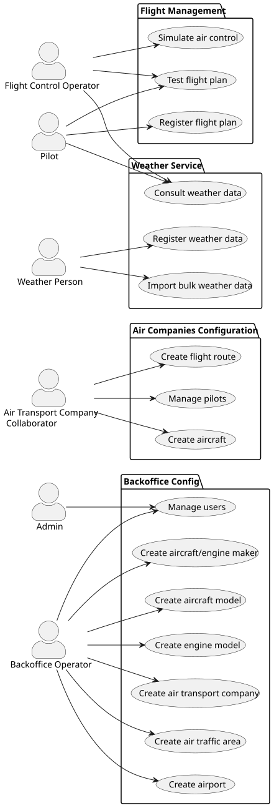

# Use Case Diagram Documentation – AlSafe System

---

## 1. Overview

The use case diagram represents the backoffice and flight management functionalities of the AlSafe system, 
organized into logical areas of responsibility, grouped into packages.

The main objective is to enable:
- Master data configuration
- Airline operations management
- Air traffic control simulation

---

## 2. System Actors

According to the specification, six main actors interact with the system:

- **Admin**  
  Responsible for user management and access permissions.

- **Backoffice Operator**  
  Responsible for core system configuration, including airports, aircraft models, and manufacturers.

- **Air Transport Company Collaborator (ATCC)**  
  Represents the airline, managing its fleet, routes, and pilots.

- **Pilot**  
  Responsible for registering flight plans and checking weather conditions.

- **Flight Control Operator (FCO)**  
  Monitors air safety through simulations and flight plan testing.

- **Weather Person**  
  Responsible for maintaining and importing meteorological data.

---

## 3. Functional Packages (Use Cases)

---

### A. Backoffice Configuration

This package groups the structural functions of the system, mainly managed by the **Backoffice Operator** and **Admin**:

- **Manage Users**  
  Control of access and user roles.

- **Create Air Traffic Area / Airport**  
  Definition of geographical and aeronautical infrastructure.

- **Create Aircraft and Engine Makers & Models**  
  Technical registration of manufacturers and model specifications for physical simulation.

- **Create Air Transport Company**  
  Registration of companies operating within the system.

---

### B. Air Companies Configuration

Focused on internal airline operations, managed by the **ATCC**:

- **Create Aircraft**  
  Add specific aircraft to the company's fleet.

- **Create Flight Route**  
  Define routes between airports.

- **Manage Pilots**  
  Manage certified pilot rosters.

---

### C. Flight Management

The operational core of the system, where flight plans are executed:

- **Register Flight Plan**  
  Submission of flight plans, including via Flight DSL.

- **Test Flight Plan**  
  Technical validation of fuel and altitude (implemented in C).

- **Simulate Air Control**  
  Parallel simulation of multiple flights to detect conflicts (**US100**).

---

### D. Weather Service

A transversal service supporting flight decision-making:

- **Register / Import Bulk Weather Data**  
  Feeding the AlSafe meteorological service.

- **Consult Weather Data**  
  Access to forecasts by pilots and flight control operators.

---
