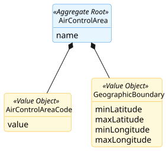
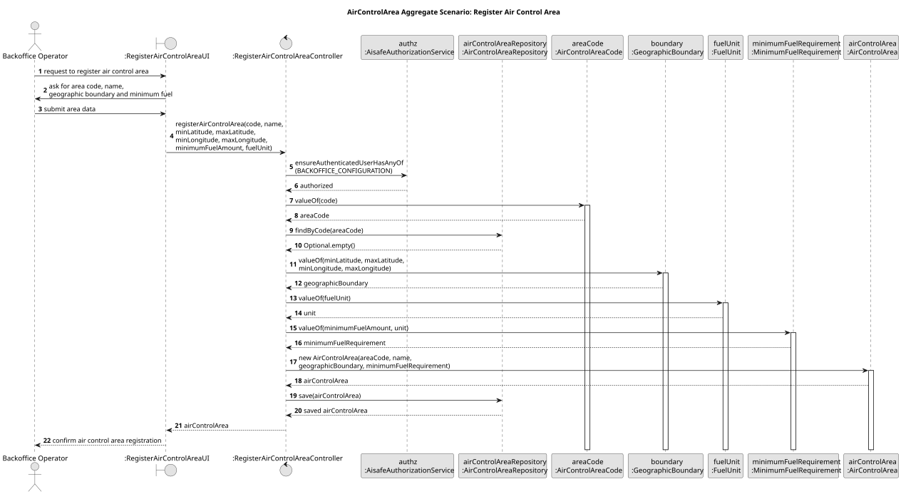

# Air Control Area Aggregate

## Scenario

The Backoffice Operator registers a new air control area by providing its name, unique area code, and geographic boundary.
The system must ensure that the area code is unique in the system and that the geographic boundary is valid.

## Domain Model

## Sequence Diagram

## Invariants

- Unique Area Code

  An `AirControlArea` must have a unique `AirControlAreaCode` in the system.

- Valid Geographic Boundary

  A `GeographicBoundary` must always be valid, meaning `minLatitude < maxLatitude` and `minLongitude < maxLongitude`.

## Justification

- Boundary Integrity

  The `AirControlArea` acts as the Aggregate Root and is responsible for creating and keeping together its identifying and 
spatial information. Since `AirControlAreaCode` and `GeographicBoundary` have no independent lifecycle outside the context 
of the area, the root ensures that the aggregate is always created in a valid state.

- Business Invariant Control

  This scenario demonstrates that the `AirControlArea` is responsible for enforcing the business rules associated with its 
identity and boundary. By centralizing validation inside the Aggregate Root, invalid coordinate ranges and inconsistent 
area definitions are prevented.

- Encapsulation of Internal State

  External components do not manipulate `AirControlAreaCode` or `GeographicBoundary` directly. They interact only with the
  `AirControlArea`, which decides whether the creation operation is valid. This preserves the consistency of the aggregate 
and makes its boundary explicit.

