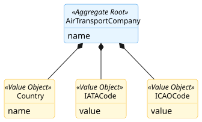
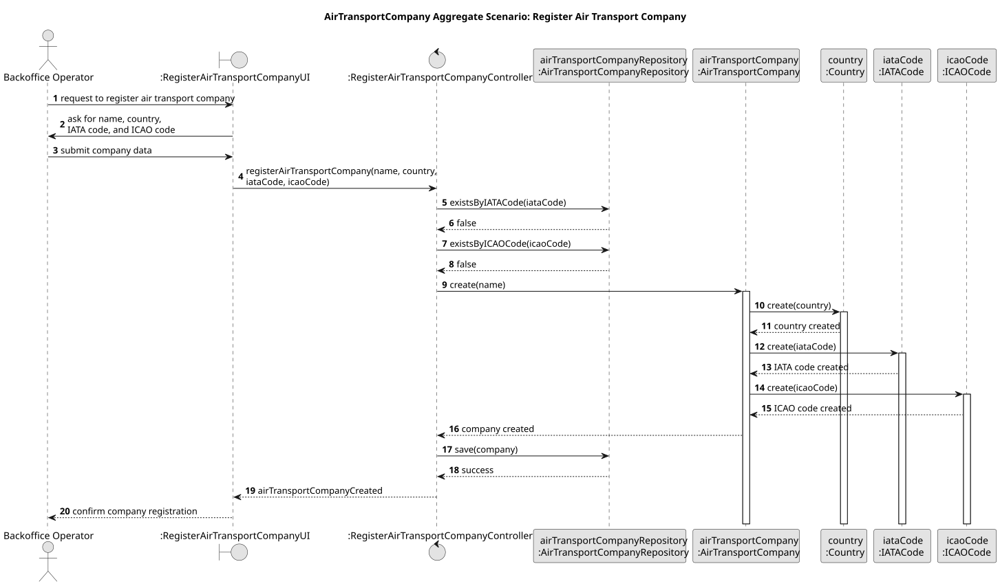

# Air Transport Company Aggregate

## Scenario

Descrever cenário de uso do agregado

## Domain Model

## Sequence Diagram

## Invariants
- Descrever invariante 1
- Descrever invariante 2
- ...

## Justification

- Ponto 1

Justificar ponto 1

- Ponto 2

Justificar ponto 2

...
