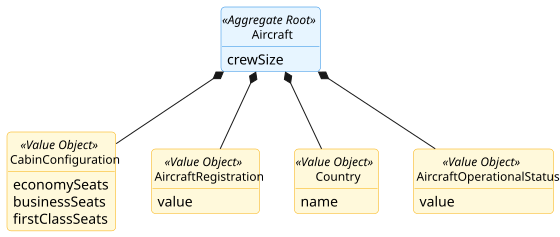
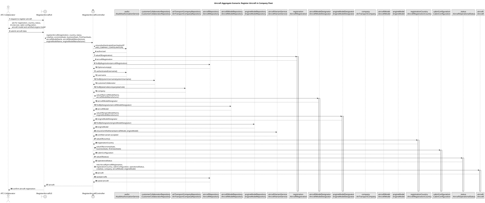

# Aircraft Aggregate

## Scenario

The Air Transport Company Collaborator registers a new aircraft in the company fleet by providing its registration, 
country, crew size, cabin configuration, and associated aircraft model.
The system must ensure that the aircraft registration is unique and that the cabin configuration does not exceed the 
passenger capacity of the selected aircraft model.

## Domain Model

## Sequence Diagram

## Invariants

- Unique Aircraft Registration

  An Aircraft must have a unique AircraftRegistration in the system.

- Valid Cabin Configuration

    The total number of seats in the CabinConfiguration must not exceed the passenger capacity of the associated 
AircraftModel.

- Valid Initial State

  An Aircraft must always be created with valid registration, country, crew size, and cabin configuration.

## Justification

- Aggregate Root Responsibility

  `Aircraft` is the Aggregate Root and the single entry point for creating a new aircraft. It encapsulates the creation 
of `AircraftRegistration`, `Country`, `CabinConfiguration`, and `AircraftOperationalStatus`, ensuring that these Value 
Objects cannot exist independently outside the aggregate.

- Internal Consistency Enforcement

  The aggregate guarantees that its internal state is always valid. In this scenario, this includes ensuring that the 
`CabinConfiguration` is consistent with the aircraft’s operational constraints.

- System-Wide Uniqueness Support

  The uniqueness of `AircraftRegistration` is a business rule that depends on the global state of the system. Therefore, 
it is verified through the repository before the aggregate is persisted.

- Association with Another Aggregate Root

  An `Aircraft` must be associated with an existing `AircraftModel`, which is another Aggregate Root in the domain model.  
The model is retrieved through its repository before the aircraft is created, ensuring that the relationship is 
established only with a valid aggregate.

- Business Invariant Control

  The aggregate is responsible for enforcing the rule that the total number of seats in the `CabinConfiguration` must 
not exceed the passenger capacity defined by the associated `AircraftModel`. This ensures that invalid aircraft 
configurations are prevented.

- Encapsulation of Internal State

  External components do not manipulate `AircraftRegistration`, `Country`, `CabinConfiguration`, or 
`AircraftOperationalStatus` directly. They interact only with `Aircraft`, which preserves the consistency of the 
aggregate and clearly defines its boundary.
