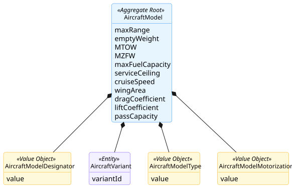
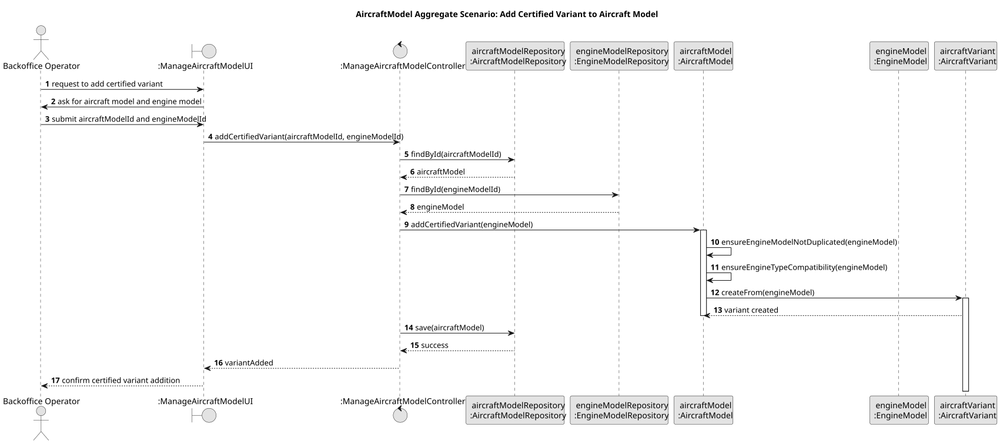

# Aircraft Model Aggregate

## Scenario

The Backoffice Operator adds a certified engine model to an existing aircraft model (e.g., Boeing 737), creating a new 
`AircraftVariant`.  
The system must ensure that the same engine model is not added more than once and that the engine model is technically 
compatible with the aircraft model.

## Domain Model

## Sequence Diagram

## Invariants

- Minimum Certified Configuration
  
    An `AircraftModel` must always contain at least one certified `AircraftVariant`.

- No Duplication
  
    The same `EngineModel` cannot be associated more than once with the same `AircraftModel`.

- Engine Compatibility
  
    The `EngineModel` associated with an `AircraftVariant` must be compatible with the motorization type defined in the `AircraftModel`.

## Justification

- Aggregate Root Responsibility

  `AircraftModel` is the Aggregate Root and is responsible for managing the lifecycle of its internal `AircraftVariant` 
entities. Since variants represent certified configurations of the aircraft model, they cannot exist independently 
outside this aggregate.

- Business Invariant Control

  This scenario demonstrates that `AircraftModel` is responsible for enforcing the main business rules associated with 
certified variants. In particular, it prevents duplicate associations with the same `EngineModel` and ensures that only 
technically compatible engine models can be added.

- Association with Another Aggregate Root

  The `EngineModel` is another Aggregate Root in the domain model. In this scenario, it is obtained through its 
repository before being associated with the `AircraftModel`. The `AircraftVariant` is then created based on this 
existing `EngineModel`, ensuring that no variant exists without a valid engine configuration.

- Encapsulation of Internal State

  External components do not manipulate `AircraftVariant` objects directly. All modifications are performed through 
`AircraftModel`, which preserves the consistency of the aggregate and clearly defines its boundary.

- Aggregate Consistency Over Time

  The aggregate must always retain at least one certified `AircraftVariant`. Although this invariant is especially 
relevant in removal scenarios, it justifies why variants are managed within the `AircraftModel` aggregate boundary.