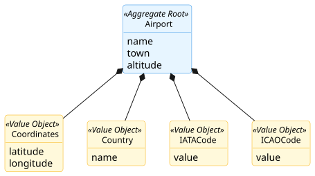
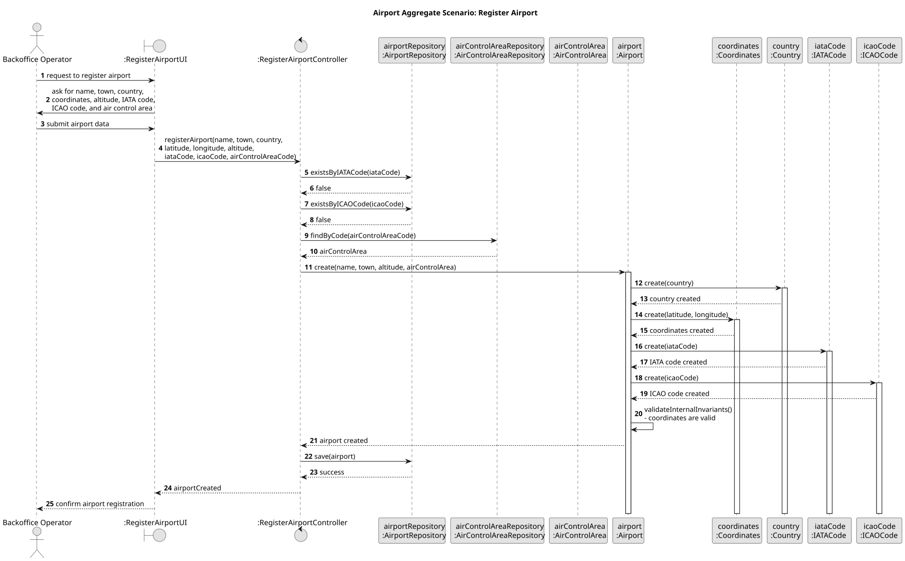

# Airport Aggregate

## Scenario

The Backoffice Operator registers a new airport by providing its name, town, country, coordinates, altitude, IATA code, ICAO code, and associated air control area.  
The system must ensure that the airport codes are unique, that the coordinates are valid, and that the airport is associated with exactly one existing air control area.

## Domain Model

## Sequence Diagram

## Invariants

- Unique Airport Codes

  An `Airport` must have a unique `IATACode` and a unique `ICAOCode` in the system.

- Valid Coordinates

  The `Coordinates` associated with an `Airport` must always represent a valid geographic location.

- Single Air Control Area Association

  An `Airport` must always be associated with exactly one `AirControlArea`.

## Justification

- Aggregate Root Responsibility

  `Airport` is the Aggregate Root and the single entry point for creating a new airport. It encapsulates the creation of 
`Coordinates`, `Country`, `IATACode`, and `ICAOCode`, ensuring that these Value Objects cannot exist independently 
outside the aggregate.

- Internal Consistency Enforcement

  The aggregate guarantees that its internal state is always valid. In this scenario, this includes ensuring that the 
`Coordinates` represent a valid geographic location.

- System-Wide Uniqueness Support

  The uniqueness of `IATACode` and `ICAOCode` is a business rule that depends on the global state of the system. 
Therefore, it is verified through the repository before the aggregate is persisted, ensuring that no duplicate airport 
codes exist.

- Association with Another Aggregate Root

  An `Airport` must always be associated with exactly one `AirControlArea`, which is another Aggregate Root in the 
domain model. In this scenario, the associated area is obtained through its repository before the airport is created, 
ensuring that the relation is established only with an existing aggregate root.

- Encapsulation of Internal State

  External components do not manipulate `Coordinates`, `Country`, `IATACode`, or `ICAOCode` directly. They interact only 
with `Airport`, which preserves the consistency of the aggregate and clearly defines its boundary.