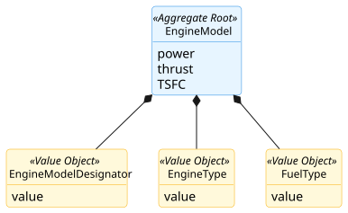
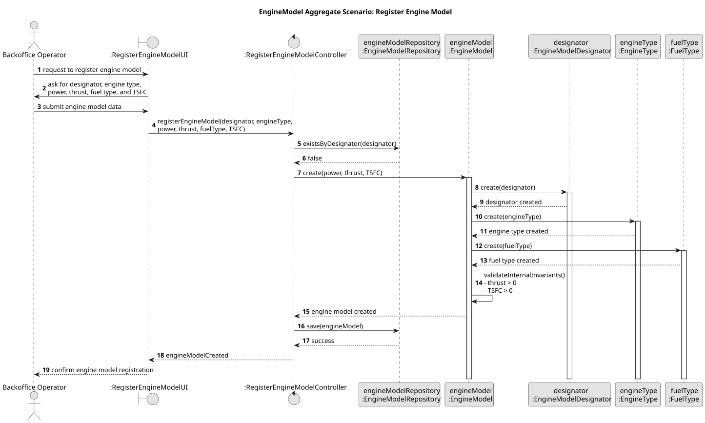

# Engine Model Aggregate

## Scenario

The Backoffice Operator registers a new engine model by providing its name, type, thrust, fuel type, TSFC, and designator.
The system must ensure that the engine model is created with valid performance and identification data.

## Domain Model

## Sequence Diagram

## Invariants

- Unique Engine Model Designator

    An `EngineModel` must have a unique `EngineModelDesignator` in the system.

- Valid Performance Values

  An `EngineModel` must always have physically valid performance attributes, namely `thrust > 0` and `TSFC > 0`.

- Complete Technical Definition

  An `EngineModel` must always have a defined engine type and fuel type.

## Justification

- Engine Model Integrity

  The `EngineModel` acts as the Aggregate Root and is responsible for creating and maintaining the technical identity of 
the engine model. Since `EngineModelDesignator` has no independent lifecycle outside the engine context, the root ensures 
that the aggregate is created in a valid and consistent state.

- Business Invariant Control

  This scenario demonstrates that the `EngineModel` is responsible for enforcing the core business rules of the aggregate, 
especially the validity of its technical and performance attributes. By centralizing these checks inside the Aggregate 
Root, invalid engine definitions are prevented.

- Encapsulation of Internal State

  External components do not manipulate the `EngineModelDesignator` directly. They interact only with the `EngineModel`, 
which decides whether the registration is valid. This preserves the consistency of the aggregate and makes its boundary 
explicit.

