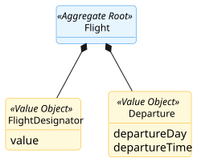
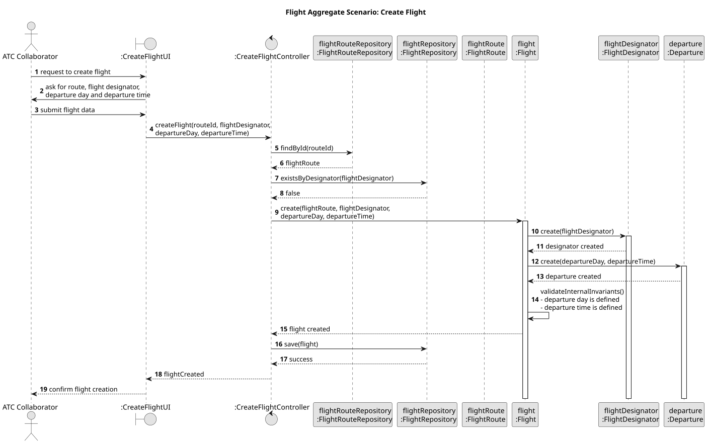

# Flight Aggregate

## Scenario

The Air Transport Company Collaborator creates a new flight by providing the route, the flight designator, and the departure day and time.  
The system must ensure that the flight is created with a unique designator, a valid departure definition, and an association with an existing flight route.

## Domain Model

## Sequence Diagram

## Invariants

- Unique Flight Designator

  A `Flight` must have a unique `FlightDesignator` in the system.

- Valid Departure Definition

  A `Flight` must always have `Departure`, including both departure day and departure time.

- Association with One Route

  A `Flight` must always be associated with one existing `FlightRoute`.

## Justification

- Aggregate Root Responsibility

  `Flight` is the Aggregate Root and the single entry point for creating a new flight.  
  It encapsulates the creation of `FlightDesignator` and `Departure`, ensuring that these Value Objects cannot exist 
independently outside the aggregate.

- Internal Consistency Enforcement

  The aggregate guarantees that its internal state is always valid.  
In this scenario, this includes ensuring that the flight is created with a complete departure definition, including both departure day and departure time.

- System-Wide Uniqueness Support

  The uniqueness of `FlightDesignator` is a business rule that depends on the global state of the system.  
Therefore, it is verified through the repository before the aggregate is persisted, ensuring that no duplicate flight designators exist.

- Association with Another Aggregate Root

  A `Flight` exists in the context of a `FlightRoute`, which is another Aggregate Root in the domain model.  
In this scenario, the associated route is obtained through its repository before the flight is created, ensuring that the relationship is established only with an existing aggregate root.

- Encapsulation of Internal State

  External components do not manipulate `FlightDesignator` or `Departure` directly.  
They interact only with `Flight`, which preserves the consistency of the aggregate and clearly defines its boundary.