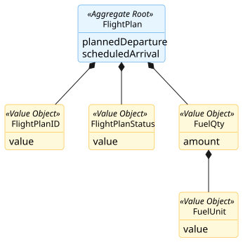
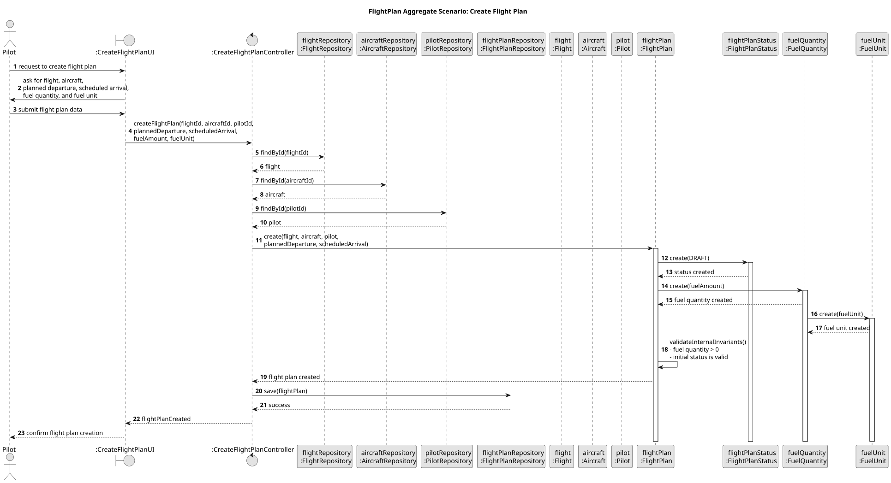

# FlightPlan Aggregate

## Scenario

The Pilot creates a new flight plan by selecting the flight, the aircraft, the pilot, the planned departure, the scheduled arrival, and the fuel quantity.  
The system must ensure that the flight plan is created with a valid initial status, a strictly positive fuel quantity, and valid associations with the required aggregates.

## Domain Model

## Sequence Diagram

## Invariants

- Positive Fuel Quantity

  A `FlightPlan` must always contain a `FuelQty` with a strictly positive amount.

- Valid Initial Status

  A `FlightPlan` must be created with a status consistent with the beginning of its lifecycle.

- Association with Required Aggregates

  A `FlightPlan` must always be associated with one existing `Flight`, one existing `Aircraft`, and one existing `Pilot`.

## Justification

- Aggregate Root Responsibility

  `FlightPlan` is the Aggregate Root and the single entry point for creating a new flight plan.  
  It encapsulates the creation of `FlightPlanStatus` and `FuelQty`, ensuring that these internal objects cannot exist independently outside the aggregate.

- Internal Consistency Enforcement

  The aggregate guarantees that its internal state is always valid.  
  In this scenario, this includes ensuring that the fuel quantity is strictly positive and that the flight plan starts with a valid initial status.

- Association with Other Aggregate Roots

  A `FlightPlan` exists in relation to other aggregates in the domain model, namely `Flight`, `Aircraft`, and `Pilot`.  
  In this scenario, these aggregates are obtained through their repositories before the flight plan is created, ensuring that the plan is only created with valid existing references.

- Business Invariant Control

  This scenario demonstrates that `FlightPlan` is responsible for enforcing the core business rules associated with creation.  
  In particular, it prevents invalid flight plans by centralizing fuel and lifecycle-state validation inside the Aggregate Root.

- Encapsulation of Internal State

  External components do not manipulate `FuelQty` or `FlightPlanStatus` directly.  
  They interact only with `FlightPlan`, which preserves the consistency of the aggregate and clearly defines its boundary.