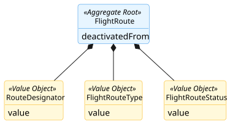
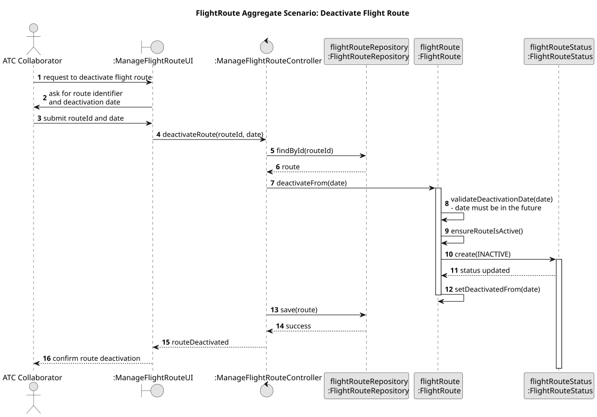

# Flight Route Aggregate

## Scenario

The Air Transport Company Collaborator deactivates an existing flight route by providing its identifier and the date 
from which it should become inactive.
The system must ensure that the route can only be deactivated from a valid future date and that the state transition is 
consistent.

## Domain Model

## Sequence Diagram

## Invariants

- Valid Deactivation Date

  A FlightRoute can only be deactivated with a date that is valid and in the future.

- Consistent Lifecycle State

  A FlightRoute can only transition to the inactive state if it is currently active.

- Consistent Deactivation Information

  When a FlightRoute becomes inactive, the deactivatedFrom date must be defined consistently with that state.

## Justification

- Lifecycle Integrity

  The FlightRoute acts as the Aggregate Root and is responsible for controlling the lifecycle of the route. Since the 
route’s status and deactivation date must remain coherent, the root ensures that the aggregate only transitions to an 
inactive state under valid conditions.

- Business Invariant Control

  This scenario demonstrates that the FlightRoute is responsible for enforcing the core business rules of the aggregate, 
especially those related to state transition and deactivation timing. By centralizing this validation inside the 
Aggregate Root, inconsistent route states are prevented.

- Encapsulation of Internal State

  External components do not change the route’s status or deactivation date directly. They interact only with the 
FlightRoute, which decides whether the deactivation operation is valid. This preserves the consistency of the aggregate 
and makes its boundary explicit.

