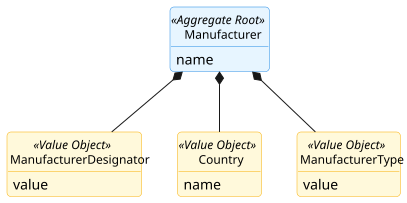
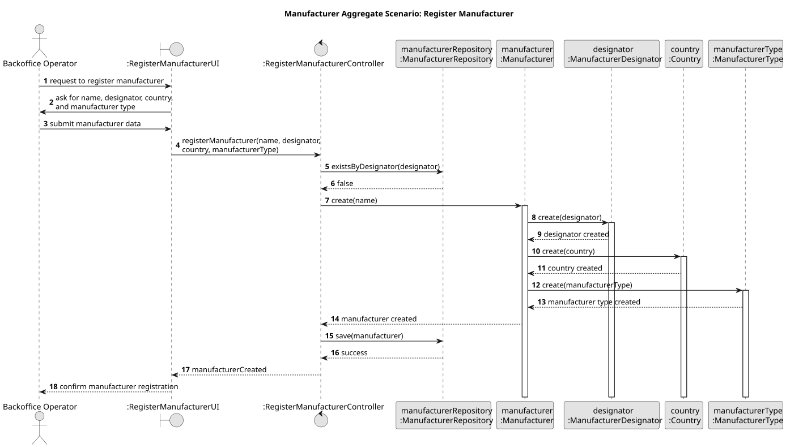

# Manufacturer Aggregate

## Scenario

The Backoffice Operator registers a new manufacturer by providing its name, designator, country, and manufacturer type.  
The system must ensure that the manufacturer is created with valid identifying information and one consistent technical classification.

## Domain Model

## Sequence Diagram

## Invariants

- Unique Manufacturer Designator

  A `Manufacturer` must have a unique `ManufacturerDesignator` in the system.

- Consistent Identification

  A `Manufacturer` must always have one valid `ManufacturerDesignator`, one `Country`, and one `ManufacturerType`.

## Justification

- Aggregate Root Responsibility

  `Manufacturer` is the Aggregate Root and the single entry point for creating a new manufacturer. It encapsulates the 
creation of `ManufacturerDesignator`, `Country`, and `ManufacturerType`, ensuring that these Value Objects cannot exist 
independently outside the aggregate.

- Internal Consistency Enforcement

  The aggregate is responsible for keeping together the manufacturer’s identifying and classification information as one 
consistent whole. This prevents incomplete or ambiguous manufacturer definitions inside the aggregate boundary.

- System-Wide Uniqueness Support

  The uniqueness of `ManufacturerDesignator` is a business rule that depends on the global state of the system. 
Therefore, it is verified through the repository before the aggregate is persisted, ensuring that no duplicate 
manufacturer designators exist.

- Encapsulation of Internal State

  External components do not manipulate `ManufacturerDesignator`, `Country`, or `ManufacturerType` directly. They 
interact only with `Manufacturer`, which preserves the consistency of the aggregate and clearly defines its boundary.