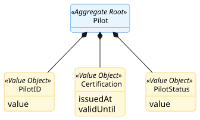
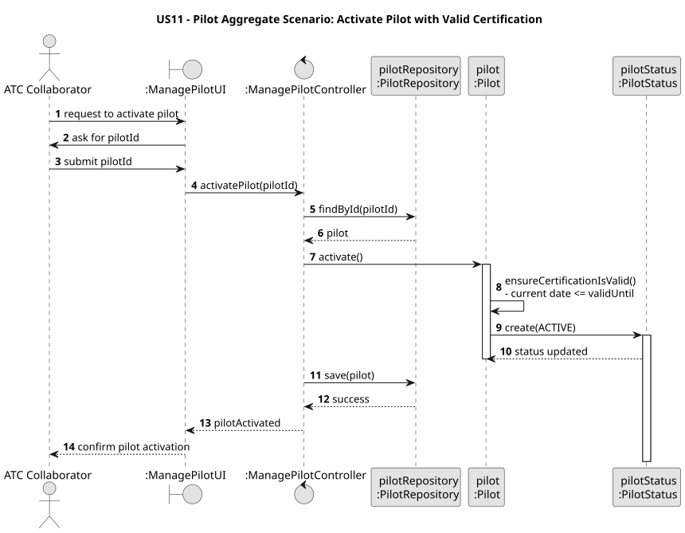

# Pilot Aggregate

## Scenario

The Air Transport Company Collaborator activates a pilot by providing the pilot identifier.
The system must ensure that the pilot can only be activated if their certification is still valid.

## Domain Model

## Sequence Diagram

## Invariants

- Valid Certification Period

  A `Certification` must always have a valid time interval where `issuedAt < validUntil`.

- Activation Requires Valid Certification

  A `Pilot` can only transition to the active state if the current date is on or before the certification’s `validUntil` date.

## Justification

- Aggregate Root Responsibility

  `Pilot` is the Aggregate Root and is responsible for controlling the lifecycle and operational status of the pilot.  
  The transition to an active state is only allowed through the root, which ensures that certification requirements are satisfied before activation.

- Business Invariant Control

  This scenario demonstrates that `Pilot` is responsible for enforcing the core business rules associated with 
activation. In particular, it guarantees that a pilot cannot become active if the associated `Certification` is no 
longer valid.

- Temporal Consistency

  The aggregate enforces temporal consistency between the pilot’s operational status and the validity period of the 
associated certification. This ensures that the status of the pilot is always coherent with the pilot’s qualification to 
operate.

- Encapsulation of Internal State

  External components do not manipulate `Certification` or `PilotStatus` directly when deciding activation. They 
interact only with `Pilot`, which preserves the consistency of the aggregate and clearly defines its boundary.