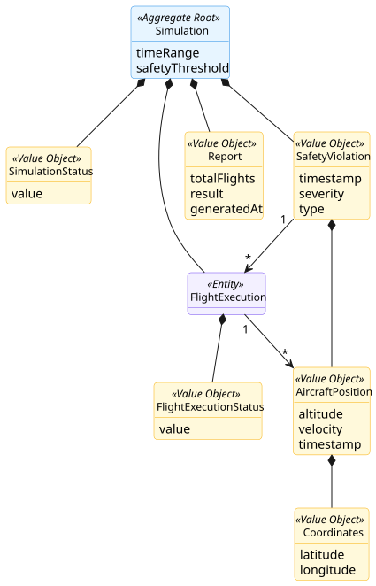
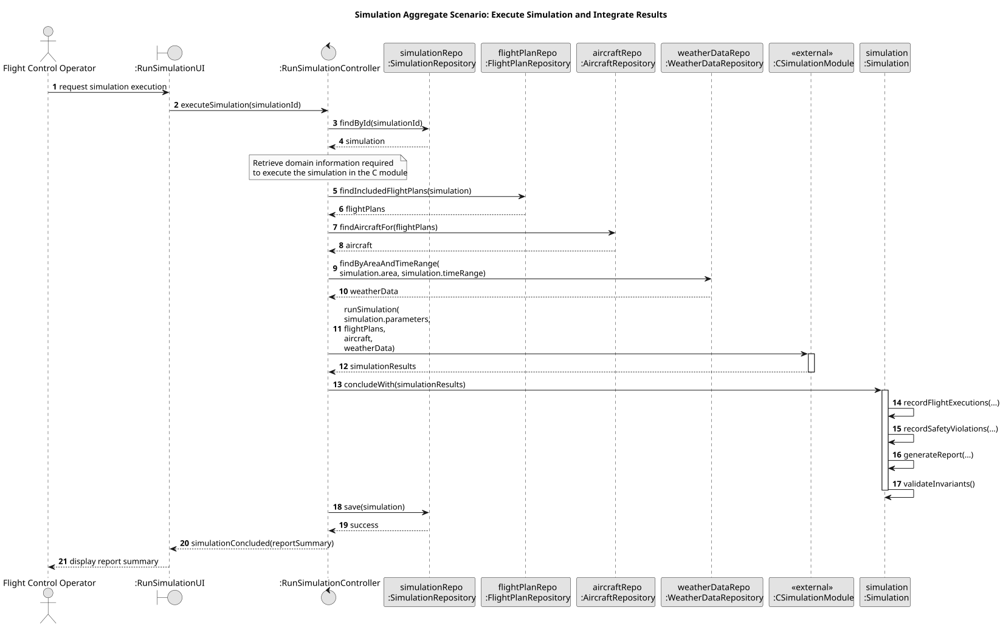

# Simulation Aggregate

## Scenario

This aggregate supports the registration of a simulation request and the incorporation of the results produced by the external simulation module implemented in C.

A Flight Control Operator executes a previously defined simulation for a given area and time range.  
The system retrieves the simulation configuration and all required domain information, namely the included flight plans, the aircraft involved, and the applicable weather data for the simulation area and time period.  
That information is sent to the external C simulation module, which performs the execution and returns the simulation results.

The `Simulation` aggregate then incorporates those results by recording the execution outcome of each simulated flight, any detected safety violations, and the final simulation report. Before being persisted, the aggregate validates its invariants to ensure that the simulation ends in a consistent concluded state.

## Domain Model

## Sequence Diagram

## Invariants

- Simulation must have valid execution parameters  
  A `Simulation` must define a valid time range, a target air control area, safety thresholds, and any additional execution settings required to run it.

- A concluded simulation must contain execution results  
  A `Simulation` can only move to the `CONCLUDED` state after receiving and recording the results returned by the simulation module.

- Every simulated flight must have a final execution status  
  Every `FlightExecution` recorded within the `Simulation` must represent a completed outcome for one included flight.

- The final report must be consistent with recorded executions  
  The report must reflect the actual number of simulated flights and their recorded execution outcomes.

- The final report result must be consistent with safety violations  
  If safety violations are recorded that invalidate the simulation, the report result cannot indicate a successful validation outcome.

- Simulation results belong to one simulation only  
  `FlightExecution`, `SafetyViolation`, and `Report` exist only in the context of a single `Simulation` aggregate.

## Justification

- Simulation as Aggregate Root

`Simulation` is the aggregate root because it is the only object that should be directly loaded and persisted.  
All relevant result objects, such as `FlightExecution`, `SafetyViolation`, and `Report`, only make sense within the context of one simulation run and should therefore be controlled through the root.

- Clear aggregate boundary

The aggregate boundary groups together the simulation request and its outcome.  
This is coherent with DDD guidance that objects with frequent coordinated changes and shared invariants should be kept together in the same aggregate.

- Consistency of the final simulation state

The most important business responsibility of this aggregate is to ensure that a simulation is never persisted as concluded without a coherent final state.  
That means a concluded simulation must contain execution results and a report that is consistent with those results.

- External simulator kept outside the aggregate

The simulation engine itself is implemented externally in C, as required by the project.  
For that reason, the aggregate does not model the internal execution mechanics of the simulator.  
Instead, it models the information sent to run the simulation and the validated results received from it.
