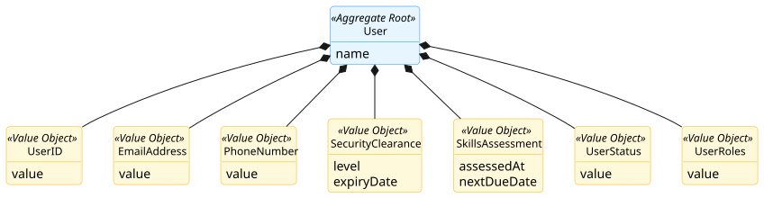
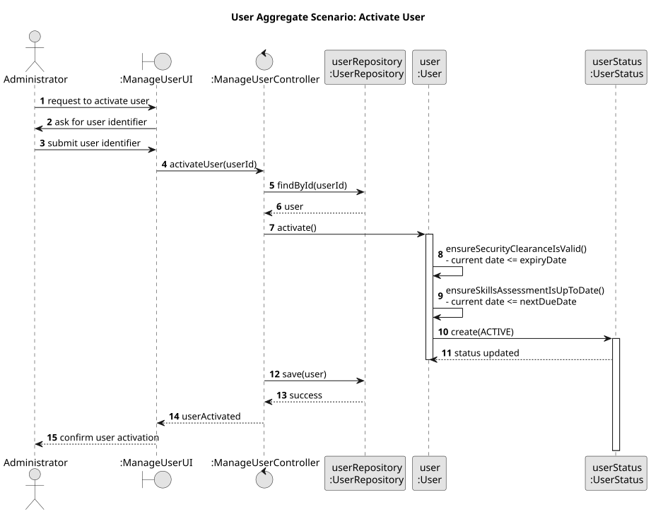

# User Aggregate

## Scenario

The Administrator activates a user by providing the user identifier.
The system must ensure that the user can only be activated if their security clearance is still valid and their skills 
assessment is up to date.

## Domain Model

## Sequence Diagram

## Invariants

- Valid Security Clearance

  A `User` can only be active if the current date is on or before the `expiryDate` of the `SecurityClearance`.

- Up-to-Date Skills Assessment

  A `User` can only be active if the current date is on or before the `nextDueDate` of the `SkillsAssessment`.

## Justification

- Aggregate Root Responsibility

  `User` is the Aggregate Root and is responsible for controlling the lifecycle and operational status of the user.  
  The transition to an active state is only allowed through the root, which ensures that the user satisfies the required 
conditions before activation.

- Business Invariant Control

  This scenario demonstrates that `User` is responsible for enforcing the business rules associated with activation.  
  In particular, it guarantees that a user cannot become active if the `SecurityClearance` is expired or if the 
`SkillsAssessment` is overdue.

- Temporal Consistency

  The aggregate enforces temporal consistency between the current user status and the validity periods of the associated 
qualification information. This ensures that the user status is always coherent with the user’s security and regulatory 
conditions.

- Encapsulation of Internal State

  External components do not manipulate `SecurityClearance`, `SkillsAssessment`, or `UserStatus` directly when deciding 
activation. They interact only with `User`, which preserves the consistency of the aggregate and clearly defines its 
boundary.