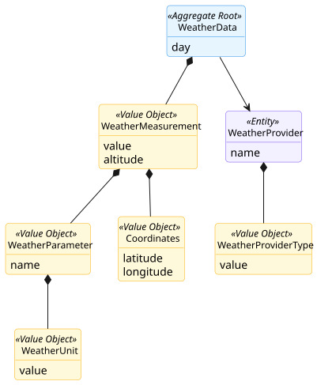
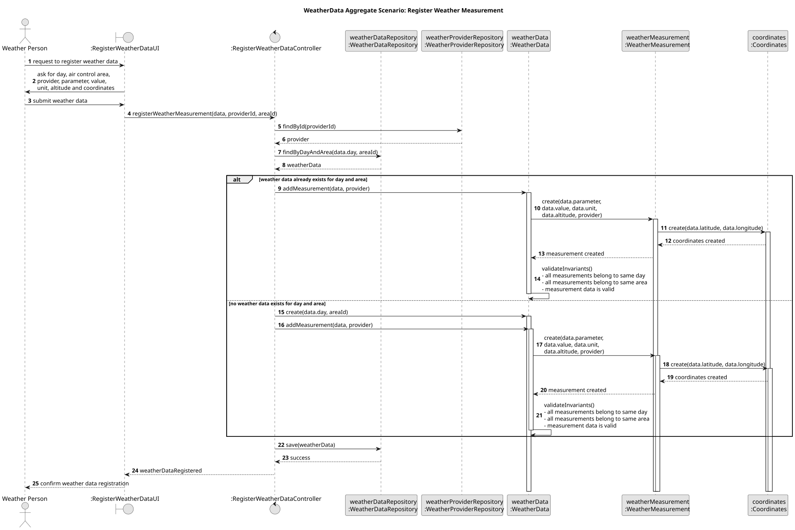

# Weather Data Aggregate

## Scenario

This aggregate supports the registration of weather measurements for a specific day and air control area.

A Weather Person provides the measurement data, including the day, the target air control area, the weather provider, the measured parameter, its value and unit, as well as the altitude and geographic coordinates where the measurement applies.

The system first identifies the weather provider and then checks whether weather data for that same day and air control area already exists. If it exists, the new measurement is added to the existing `WeatherData` aggregate. Otherwise, a new `WeatherData` aggregate is created for that day and area, and the measurement is then added.

Each measurement is recorded together with its coordinates and validated before the aggregate is persisted. The aggregate ensures that all stored measurements remain consistent with the same day and air control area, while allowing multiple measurements for different locations and altitudes within that area.

This scenario shows that the aggregate is responsible for keeping together the weather information that changes together and must remain consistent as a whole.

## Domain Model

## Sequence Diagram

## Invariants

- Weather data is defined for one day only  
  A `WeatherData` aggregate groups measurements referring to a single day.

- Weather data is defined for one air control area only  
  All `WeatherMeasurement` instances inside a `WeatherData` aggregate must belong to the same air control area.

- Every measurement must be valid  
  Each `WeatherMeasurement` must define a valid parameter, a valid unit for that parameter, a valid altitude, and valid coordinates.

- Every measurement must have an identified source  
  Each `WeatherMeasurement` must be associated with a `WeatherProvider`, so that the origin of the measurement is known.

- Measurements only exist within weather data  
  `WeatherMeasurement` objects do not have an independent lifecycle outside the `WeatherData` aggregate.
