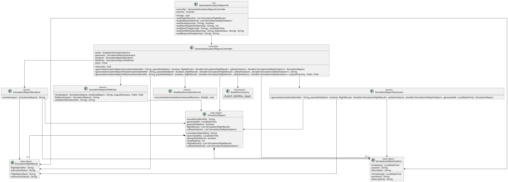
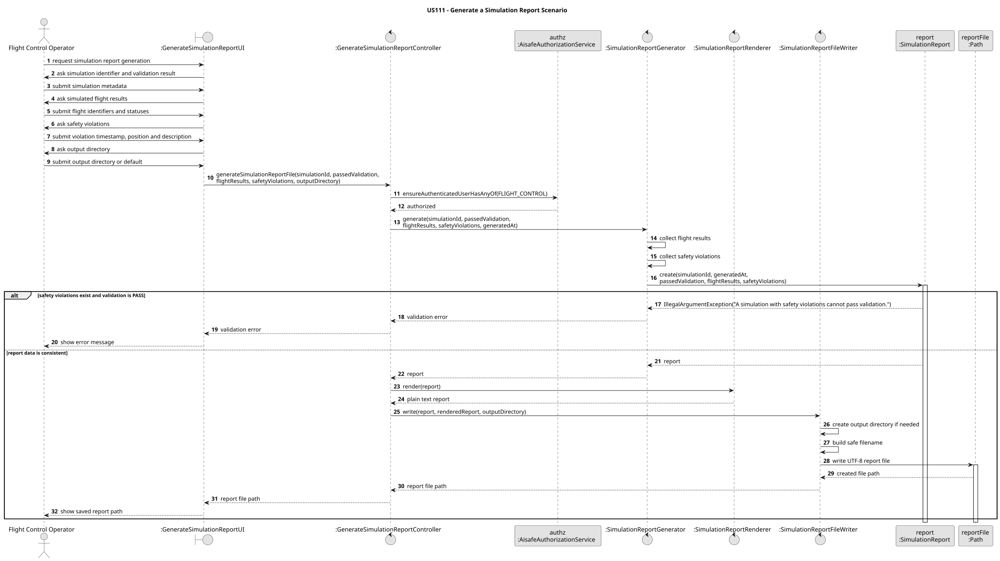

# US111 - Generate a Simulation Report

## 1. Context

US111 belongs to the Flight Control area and focuses on producing a summary report after a simulation has concluded.

The simulation execution itself is outside the scope of this Java/EAPLI implementation. The project requirements state that the simulation component is developed separately, while the core Java system must keep the information sent to the simulator and the results received from it. For that reason, this user story implements the Java-side report generation boundary: given simulation result data, the system builds a structured report and stores it in a file.

### 1.1 List of issues

- US111.1 - Implement Simulation Report Generation (#208)
- US111.2 - Include Safety Violation Information (#209)
- US111.3 - Store Report and Validation Result (#210)
- US111.4 - Add Simulation Report Tests (#211)
- US111.5 - Document Simulation Report Generation (#212)

## 2. Requirements

**US111** As a Flight Control Operator, I want to receive a summary of the simulation results so that I can determine if the programmed flights are safe to run.

**Acceptance Criteria:**

- AC1 - The system must generate a report from simulation results.
- AC2 - The report must be stored in a file for future reference.
- AC3 - The report must include the total number of simulated flights.
- AC4 - The report must include the execution status of each simulated flight.
- AC5 - If safety violations occur, the report must list timestamps and positions.
- AC6 - The report must indicate whether the scheduled flight plan passed or failed validation.
- AC7 - Only Flight Control Operators can generate simulation reports.
- AC8 - Automated tests validate report generation, validation rules and file storage.

**Dependencies/References:**

This requirement depends conceptually on the simulation execution use cases that produce flight execution statuses and safety violation events. In the current Java implementation, those execution results are represented as input data to the report-generation use case, not produced by the use case itself.

## 3. Analysis

US111 is a reporting use case, not a simulation execution use case. The business question answered by the report is whether the programmed flights are safe to run based on the completed simulation results.

The minimum information needed to generate the report is:

- simulation identifier;
- final validation result (`PASS` or `FAIL`);
- list of simulated flights and their execution status;
- list of safety violations, when any exist;
- report generation timestamp.

### 3.1 Data Source Boundary

The current implementation does not automatically read simulation results from the C/SCOMP simulator, shared memory, logs, sockets or a database table. The available Java codebase does not yet include a persisted `Simulation` aggregate or a simulation result repository.

For this reason, the current console UI collects the result data from the Flight Control Operator and passes it to the application controller. This is an interim boundary that allows the report-generation rules, format, authorization and file storage to be implemented and tested independently from the future simulation integration.

The intended future integration point is to replace the manual UI data collection with an adapter/provider that obtains concluded simulation results from the real simulation component or from persisted simulation data. The controller and domain report objects can remain stable because they already receive structured result data.

### 3.2 Validation Result Rule

A simulation report with safety violations cannot be marked as passed. This is enforced by `SimulationReport` so the rule is applied regardless of whether the data comes from the current UI or from a future simulator adapter.

## 4. Design

### 4.1 Realization





The `GenerateSimulationReportController` coordinates the use case:

1. Enforces `FLIGHT_CONTROL` permission.
2. Receives simulation result data.
3. Creates a `SimulationReport` through `SimulationReportGenerator`.
4. Renders the report as text through `SimulationReportRenderer`.
5. Stores the rendered report using `SimulationReportFileWriter`.
6. Returns the generated report file path to the UI.

### 4.2 Main Classes

- `SimulationReport`: immutable report object with simulation identifier, generation timestamp, validation result, flight execution statuses and safety violations.
- `SimulationFlightResult`: immutable value object representing one simulated flight and its final execution status.
- `SimulationSafetyViolation`: immutable value object representing one violation event with timestamp, position and description.
- `SimulationReportGenerator`: creates `SimulationReport` instances from result data.
- `SimulationReportRenderer`: renders `SimulationReport` as plain text.
- `SimulationReportFileWriter`: writes rendered reports to the filesystem.
- `GenerateSimulationReportController`: application controller that coordinates authorization, generation, rendering and storage.
- `GenerateSimulationReportUI`: console UI available from the Flight Control menu.

### 4.3 Validation Rules

| Rule | Behaviour |
|------|-----------|
| Permission | Only `FLIGHT_CONTROL_OPERATOR` can execute the use case. |
| Simulation identifier | Required and trimmed. |
| Flight result | Each result requires a flight identifier and execution status. |
| Safety violation | Each violation requires timestamp, position and description. |
| Validation result | A report with safety violations cannot be marked as `PASS`. |
| Output directory | Created automatically if it does not already exist. |

### 4.4 Report Structure

The generated text report contains these sections:

- Header with report title, simulation identifier, generation timestamp and validation result.
- `Summary`, with total flights and number of safety violations.
- `Flight Execution Status`, with one line per simulated flight.
- `Safety Violations`, with timestamp, position and description for each violation.

Example report:

```text
AISafe Simulation Report
Simulation: SIM-001
Generated at: 2027-01-10T12:00
Validation result: FAIL

Summary
-------
Total flights: 2
Safety violations: 1

Flight Execution Status
-----------------------
TP101 - COMPLETED
TP102 - FAILED

Safety Violations
-----------------
2027-01-10T10:45 | 40.0,-8.0,FL300 | Minimum separation breach
```

### 4.5 File Storage

Reports are stored as UTF-8 text files using this filename format:

```text
simulation-report-<simulation-id>-<yyyyMMddHHmmss>.txt
```

Invalid filename characters in the simulation identifier are replaced with `_`.

Example:

```text
reports/simulation-report-SIM_001-20270110120000.txt
```

## 5. Implementation

Main implementation artifacts:

- `aisafe.core/src/main/java/isep/aisafe/report/domain/SimulationReport.java`
- `aisafe.core/src/main/java/isep/aisafe/report/domain/SimulationFlightResult.java`
- `aisafe.core/src/main/java/isep/aisafe/report/domain/SimulationSafetyViolation.java`
- `aisafe.infrastructure.application/src/main/java/isep.aisafe/application/report/GenerateSimulationReportController.java`
- `aisafe.infrastructure.application/src/main/java/isep.aisafe/application/report/SimulationReportGenerator.java`
- `aisafe.infrastructure.application/src/main/java/isep.aisafe/application/report/SimulationReportRenderer.java`
- `aisafe.infrastructure.application/src/main/java/isep.aisafe/application/report/SimulationReportFileWriter.java`
- `aisafe.app.backoffice.console/src/main/java/isep.aisafe/app/backoffice/console/presentation/report/GenerateSimulationReportUI.java`

The controller operation used to generate and store a report is:

```java
generateSimulationReportFile(
        String simulationIdentifier,
        boolean passedValidation,
        Iterable<SimulationFlightResult> flightResults,
        Iterable<SimulationSafetyViolation> safetyViolations,
        Path outputDirectory)
```

## 6. Integration/Demonstration

### 6.1 Console Flow

The UI is available in the Flight Control menu:

```text
Generate Simulation Report (US111)
```

The current UI asks for:

- simulation identifier;
- validation result;
- number of simulated flights;
- each simulated flight identifier and execution status;
- number of safety violations;
- each violation timestamp, position and description;
- output directory, with `reports` as default.

### 6.2 User Feedback

On success, the UI prints the absolute path of the generated report file.

Relevant invalid operations raise clear exceptions:

```text
Simulation identifier is required.
Flight identifier is required.
Execution status is required.
Safety violation timestamp is required.
Safety violation position is required.
Safety violation description is required.
A simulation with safety violations cannot pass validation.
Unable to write simulation report file.
```

## 7. Acceptance Tests

**Test 1:** A simulation report can be created with flight execution statuses.

**Refers to Acceptance Criteria:** AC1, AC3, AC4, AC6

Implemented in `SimulationReportTest.ensureSimulationReportCanBeCreated` and `GenerateSimulationReportControllerTest.ensureSimulationReportIsGeneratedAndRendered`.

**Test 2:** Safety violation information is included in the rendered report.

**Refers to Acceptance Criteria:** AC5

Implemented in `GenerateSimulationReportControllerTest.ensureSimulationReportIsGeneratedAndRendered`.

**Test 3:** A report with safety violations cannot pass validation.

**Refers to Acceptance Criteria:** AC5, AC6

Implemented in `SimulationReportTest.ensureReportWithSafetyViolationsCannotPassValidation` and `GenerateSimulationReportControllerTest.ensureReportWithSafetyViolationsCannotPassValidation`.

**Test 4:** The generated report is stored in a file.

**Refers to Acceptance Criteria:** AC2

Implemented in `GenerateSimulationReportControllerTest.ensureSimulationReportIsStoredInFile`.

**Test 5:** Only Flight Control Operators can generate reports.

**Refers to Acceptance Criteria:** AC7

Implemented in `GenerateSimulationReportControllerTest.ensureExecuteRequiresFlightControlPermission` and `GenerateSimulationReportControllerTest.ensureAuthorizationFailureStopsReportGeneration`.

**Test 6:** Report data is immutable and required fields are validated.

**Refers to Acceptance Criteria:** AC8

Implemented in `SimulationReportTest.ensureSimulationReportKeepsDefensiveCopies`, `SimulationReportTest.ensureRequiredSimulationReportDataIsValidated`, `SimulationReportTest.ensureFlightResultRequiredDataIsValidated` and `SimulationReportTest.ensureSafetyViolationRequiredDataIsValidated`.

## 8. Observations

The current implementation intentionally separates report generation from simulation execution. This avoids adding fake simulation behaviour to the Java application and keeps the use case focused on the acceptance criteria for US111.

The main limitation is the current data source. Since there is no implemented Java repository or adapter for concluded simulation results, the console UI collects the result data manually. When the simulation execution/integration layer becomes available, the UI can be changed to select a concluded simulation and the controller can receive data from a `SimulationResultProvider` or similar adapter.

## 9. Tests

The following validation commands were executed successfully after implementation:

```bash
mvn -pl aisafe.infrastructure.application -am test
mvn -pl aisafe.app.backoffice.console -am test
mvn test
```
