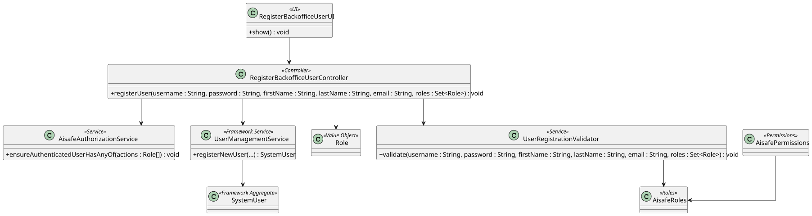

# US 030 - Register Backoffice Users

## 1. Context

This user story was developed for the Backoffice user management area. The goal is to allow an authorized administrator to register users that can access the backoffice application.

The implementation uses the eAPLI framework user management service for the actual system-user creation and keeps AISafe-specific validation and authorization rules in application-layer classes.

### 1.1 List of issues

Analysis:

- 1 - Identify required backoffice user data
- 2 - Define supported AISafe roles
- 3 - Define authorization rules for user registration

Design:

- 4 - Design backoffice user registration flow
- 5 - Document backoffice user registration

Implement:

- 1 - Implement AISafe roles and permissions
- 2 - Implement backoffice user registration controller
- 3 - Implement backoffice user registration UI
- 4 - Implement user registration validation

Test:

- 5 - Add user registration controller and validator tests

## 2. Requirements

**US030** As an Administrator, I want to register backoffice users so that they can access AISafe with the correct role.

**Acceptance Criteria:**

- US030.1 The system must allow an authorized Administrator to register a new backoffice user.
- US030.2 The system must collect username, password, first name, last name, email and role.
- US030.3 The user must be created through the system user management service.
- US030.4 Mandatory fields and email format must be validated before registration.
- US030.5 At least one valid AISafe role must be assigned.
- US030.6 Unauthorized actors must not be able to register users.

**Dependencies/References:**

This requirement depends on the eAPLI authentication and authorization framework. It also supports later user stories that rely on configured AISafe roles, such as backoffice configuration, air company configuration, flight control and weather data management.

## 3. Analysis

Backoffice user registration is a security-sensitive operation. The implementation separates three responsibilities:

- `AisafeRoles` centralizes the role names supported by the application.
- `AisafePermissions` defines which roles can execute protected actions.
- `UserRegistrationValidator` validates submitted registration data before the user is created.

The application does not duplicate the framework user aggregate. Instead, `RegisterBackofficeUserController` validates and authorizes the request, then delegates user creation to `UserManagementService`.

The domain-specific invariants for this use case are:

- Username, password, first name, last name and email are mandatory.
- Email must follow a valid email format.
- The role set cannot be null or empty.
- Every assigned role must be one of the supported AISafe roles.
- User registration requires `AisafePermissions.USER_REGISTRATION`, currently restricted to `ADMIN`.

## 4. Design

### 4.1. Realization



The `RegisterBackofficeUserUI` collects the registration data and asks the administrator to choose a supported backoffice role. It delegates the operation to `RegisterBackofficeUserController`.

The controller checks `USER_REGISTRATION` permission, validates the submitted data with `UserRegistrationValidator`, and registers the system user through the framework `UserManagementService`.

### 4.2. Acceptance Tests

**Test 1:** Valid backoffice user registration is authorized, validated and delegated to the user service.

**Refers to Acceptance Criteria:** US030.1, US030.2, US030.3, US030.4, US030.5

Implemented in `RegisterBackofficeUserControllerTest.ensureRegisterUserAuthorizesValidatesAndDelegatesToUserService`.

**Test 2:** Invalid registration data is rejected before creating a user.

**Refers to Acceptance Criteria:** US030.4

Implemented in `RegisterBackofficeUserControllerTest.ensureInvalidUserDataIsNotRegistered` and `UserRegistrationValidatorTest`.

**Test 3:** Authorization failure stops user registration.

**Refers to Acceptance Criteria:** US030.6

Implemented in `RegisterBackofficeUserControllerTest.ensureAuthorizationFailureStopsRegistration`.

**Test 4:** Supported roles are centralized and accepted by the validator.

**Refers to Acceptance Criteria:** US030.5

Implemented in `UserRegistrationValidatorTest` and `AisafeRolesTest`.

## 5. Implementation

Main implementation artifacts:

- `RegisterBackofficeUserUI`: Backoffice console UI for collecting registration data.
- `RegisterBackofficeUserController`: application controller that authorizes, validates and delegates registration.
- `UserRegistrationValidator`: validates mandatory fields, email format and roles.
- `AisafeRoles`: central definition of supported AISafe roles.
- `AisafePermissions`: central definition of protected action permissions.
- `AisafeAuthorizationService`: facade used by controllers to enforce permissions.
- `AisafeBootstrapper`: creates initial administrator and backoffice operator users.

## 6. Integration/Demonstration

The functionality is available in the Backoffice console after login as an Administrator.

Run the application with:

```bash
mvn -f aisafe.app.backoffice.console/pom.xml exec:java
```

Login with:

```text
Username/Email: admin
Password: Password1
```

Then select:

```text
1 - Register Backoffice User
```

The UI asks for username, password, first name, last name, email and role.

## 7. Observations

The framework is responsible for enforcing username/email uniqueness and password encoding. AISafe validates only the application-specific data before delegating to the framework service.
