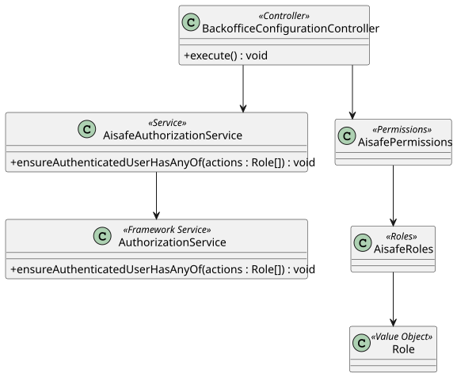

# US 031 - Backoffice Configuration Access

## 1. Context

This user story was developed to establish the Backoffice configuration area and its access control rule. The goal is to ensure that only authorized backoffice operators can execute configuration actions.

The implementation creates a small authorization entry point that is reused by configuration-related controllers and user stories.

### 1.1 List of issues

Analysis:

- US031.1 - Implement backoffice user registration
- US031.2 - Validate and persist registered user data
- US031.3 - Assign roles and permissions during user creation
- US031.4 - Implement bootstrap process for initial users
- US031.5 - Add user registration and bootstrap tests
- US031.6 - Document user registration and bootstrap setup

## 2. Requirements

**US031** As a Backoffice Operator, I want to access backoffice configuration functionality so that I can configure AISafe reference data.

**Acceptance Criteria:**

- AC1 - Administrators can successfully register new users in the system
- AC2 - User data (e.g., identity, roles, credentials) is validated and persisted correctly
- AC3 - Bootstrap process creates initial users successfully
- AC4 - Registered users can authenticate successfully in the system
- AC5 - Roles and permissions are correctly assigned during registration
- AC6 - Unit and/or integration tests validate user registration and bootstrap behaviour

**Dependencies/References:**

This requirement depends on US030 because the Backoffice Operator role and protected permissions are defined as part of AISafe user management. It is also used by later configuration user stories, including registering aircraft models, engine models, air transport companies, air control areas, airports and customer collaborators.

## 3. Analysis

Backoffice configuration is a cross-cutting area rather than a single domain aggregate. The important decision was to avoid scattering role checks across the codebase.

The role-to-permission mapping is centralized in `AisafePermissions`. Controllers call `AisafeAuthorizationService`, which delegates to the eAPLI framework authorization service.

The authorization invariant for this user story is:

- Backoffice configuration actions require `AisafePermissions.BACKOFFICE_CONFIGURATION`.
- `BACKOFFICE_CONFIGURATION` is granted only to `AisafeRoles.BACKOFFICE_OPERATOR`.
- Controllers must not swallow authorization exceptions.

## 4. Design

### 4.1. Realization



The `BackofficeConfigurationController` represents the protected application entry point. It requests `BACKOFFICE_CONFIGURATION` permission through `AisafeAuthorizationService`.

The `execute()` method currently acts as an authorization boundary only — it enforces the permission check but contains no feature-specific behavior (marked with a TODO). All concrete backoffice configuration features are implemented in their own dedicated controllers (e.g. `RegisterAirControlAreaController`, `RegisterEngineModelController`), each calling the same centralized permission via `AisafePermissions.BACKOFFICE_CONFIGURATION`.

The permission itself is defined in `AisafePermissions`, which maps protected actions to roles from `AisafeRoles`.

### 4.2. Acceptance Tests

**Test 1:** Backoffice configuration execution requires the configured permission.

**Refers to Acceptance Criteria:** US031.1, US031.2, US031.3

Implemented in `BackofficeConfigurationControllerTest.ensureExecuteRequiresBackofficeConfigurationPermission`.

**Test 2:** The backoffice configuration permission contains only the Backoffice Operator role.

**Refers to Acceptance Criteria:** US031.2, US031.3

Implemented in `AisafePermissionsTest.ensureBackofficeConfigurationPermissionsAreCorrect`.

**Test 3:** Authorization service forwards permission checks to the framework service.

**Refers to Acceptance Criteria:** US031.4

Implemented in `AisafeAuthorizationServiceTest`.

## 5. Implementation

Main implementation artifacts:

- `BackofficeConfigurationController`: application controller for protected configuration access. The `execute()` method currently enforces authorization only; feature-specific behavior is delegated to dedicated controllers.
- `AisafePermissions`: defines `BACKOFFICE_CONFIGURATION` (restricted to `BACKOFFICE_OPERATOR`).
- `AisafeRoles`: defines `BACKOFFICE_OPERATOR`.
- `AisafeAuthorizationService`: authorization facade used by controllers.
- `CapturingAuthorizationService`: test support fake used to verify required permissions.

## 6. Integration/Demonstration

Backoffice configuration permission is used by configuration controllers. Examples include:

- `RegisterEngineModelController`
- `ManageAircraftModelController`
- `RegisterAirControlAreaController`
- `RegisterCustomerCollaboratorController`

Run the Backoffice application with:

```bash
mvn -f aisafe.app.backoffice.console/pom.xml exec:java
```

Login with:

```text
Username/Email: backoffice
Password: Password1
```

Then execute any backoffice configuration operation exposed by the menu.

## 7. Observations

The `BackofficeConfigurationController.execute()` method is intentionally kept minimal. It acts as a shared authorization guard. Concrete configuration features each have their own controller, all enforcing the same `BACKOFFICE_CONFIGURATION` permission directly via `AisafeAuthorizationService`. This avoids unnecessary coupling to a single entry-point controller while still centralizing the permission definition in `AisafePermissions`.