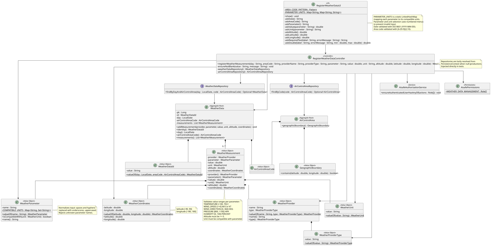

# US041 - Register Weather Data

## 1. Context

This user story was developed for the Weather Service area. The goal is to allow an authenticated Weather Person to manually register weather measurements into the system for a specific air control area and day.

The implementation bridges the gap between the existing backend domain model and user accessibility, following the UI validation patterns established in US030, US031 and US061.

### 1.1 List of issues

- US041.1 – Implement Weather Data Registration
- US041.2 – Validate Weather Data
- US041.3 – Add Weather Data Registration Tests
- US041.4 – Document Weather Data Registration

## 2. Requirements

**US041** As a Weather Person, I want to register weather data in the system for a specific air control area.

**Acceptance Criteria:**

- AC1 - Weather Person can successfully register weather data for a specific air control area 
- AC2 - Weather data is associated with exactly one air control area 
- AC3 - Weather data attributes (e.g., wind, temperature, etc.) are validated before persistence 
- AC4 - Weather data can vary within the air control area (e.g., by location or altitude) 
- AC5 - All required weather data is correctly stored in the system 
- AC6 - Unit and/or integration tests validate weather data registration behaviour

**Dependencies/References:**

This requirement depends on the existing `AirControlArea` aggregate (US050) for boundary validation, and on US030/US061 for the `WEATHER_PERSON` role and user creation. It follows the UI patterns of US030, US031 and US061.

## 3. Analysis

Weather data registration requires two layers of validation:

**UI-level validation (before controller call):**
- Date format: ISO 8601 (`YYYY-MM-DD`), parsed with `LocalDate.parse()`.
- Area code: format `[A-Z0-9]{2,10}`, uppercased before validation.
- Provider name and provider type: non-blank.
- Parameter: numbered menu (1–5), no free-text input to prevent typos.
- Measurement value: `double` within parameter-specific range.
- Unit: dynamic numbered menu showing only compatible units for the selected parameter.
- Altitude: `double >= 0`.
- Latitude: `double` in `[-90, 90]`.
- Longitude: `double` in `[-180, 180]`.

**Controller/domain-level validation (requires database access):**
- Air control area existence (via `AirControlAreaRepository`).
- Coordinate boundary check: coordinates must be within the area's `GeographicBoundary`.
- Unit/parameter compatibility: enforced by `WeatherMeasurement` and `WeatherParameter.isCompatibleWith()`.
- Value range enforcement: re-validated inside `WeatherMeasurement.validateValue()`.

**Parameter and unit compatibility table:**

| Parameter       | Allowed Values            | Units          |
|-----------------|---------------------------|----------------|
| TEMPERATURE     | [-100, 70]                | C              |
| WIND_SPEED      | [0, +∞)                   | M/S, KT        |
| WIND_DIRECTION  | [0, 360]                  | DEG            |
| PRESSURE        | [800, 1100]               | HPA            |
| HUMIDITY        | [0, 100]                  | PERCENT        |

**Aggregation rule:** Measurements for the same day and air control area are grouped into a single `WeatherData` aggregate. The controller looks up an existing aggregate before creating a new one (`findByDayAndAirControlArea`), then appends the measurement via `addMeasurement()`.

**Authorization:** The `WEATHER_DATA_MANAGEMENT` permission is restricted to `WEATHER_PERSON`. The check is the first action inside `registerWeatherMeasurement()`.

**Weather Person creation:** A Weather Person user is not created by the `RegisterWeatherDataUI`. It must be created beforehand — either via bootstrap (`ipma@aisafe.com`, password `Password1`) or by the Admin/Backoffice Operator through US031/US061. The Weather Person then logs in via the dedicated "Weather Person login" option in the main menu.

## 4. Design

### 4.1. Realization



The `RegisterWeatherDataUI` collects all inputs with immediate per-field validation in loops. It uses:
- A static `LinkedHashMap` (`PARAMETER_UNITS`) that maps each parameter to its compatible units, preserving display order.
- Numbered menus for parameter selection (1–5) and dynamic unit selection (1–N, based on the selected parameter) to prevent invalid free-text input.
- `DateTimeFormatter.ISO_LOCAL_DATE` for date parsing.
- A regex pattern `[A-Z0-9]{2,10}` for area code format.
- A generic `askDouble()` helper for all numeric inputs, accepting a min and max bound.

The `RegisterWeatherDataController`:
1. Enforces `WEATHER_DATA_MANAGEMENT` permission.
2. Validates all string fields as non-blank.
3. Looks up the air control area by code; throws `IllegalArgumentException` if not found.
4. Validates that coordinates are within the area's geographic boundary.
5. Looks up or creates a `WeatherData` aggregate for the given day and area.
6. Builds domain value objects (`WeatherProvider`, `WeatherParameter`, `WeatherUnit`, `WeatherCoordinates`) and delegates to `WeatherData.addMeasurement()`.
7. Persists and returns the updated aggregate.

Repositories are resolved lazily from `PersistenceContext` in the production constructor (both set to `null`), and injected directly in tests via the package-private constructor.

### 4.2. Acceptance Tests

**Test 1:** Valid weather measurement is authorized, persisted and returned.

**Refers to Acceptance Criteria:** AC1, AC2, AC3, AC4, AC5

Implemented in `RegisterWeatherDataControllerTest.ensureValidWeatherMeasurementIsRegistered`.

**Test 2:** Two measurements for the same day and area reuse the same aggregate.

**Refers to Acceptance Criteria:** AC5

Implemented in `RegisterWeatherDataControllerTest.ensureExistingWeatherDataAggregateIsReused`.

**Test 3:** Unknown air control area code is rejected.

**Refers to Acceptance Criteria:** AC2, AC3

Implemented in `RegisterWeatherDataControllerTest.ensureUnknownAirControlAreaIsRejected`.

**Test 4:** Measurement value outside parameter range is rejected.

**Refers to Acceptance Criteria:** AC3

Implemented in `RegisterWeatherDataControllerTest.ensureInvalidWeatherMeasurementIsRejected`.

**Test 5:** Blank required fields are rejected.

**Refers to Acceptance Criteria:** AC3, AC5

Implemented in `RegisterWeatherDataControllerTest.ensureRequiredWeatherRegistrationFieldsAreRejected`.

**Test 6:** Coordinates outside the air control area boundary are rejected.

**Refers to Acceptance Criteria:** AC2, AC3, AC4

Implemented in `RegisterWeatherDataControllerTest.ensureCoordinatesOutsideAirControlAreaAreRejected`.

**Test 7:** Authorization failure stops registration before any persistence.

**Refers to Acceptance Criteria:** AC1

Implemented in `RegisterWeatherDataControllerTest.ensureAuthorizationFailureStopsRegistration`.

**Test 8:** Production constructor creates a non-null controller instance.

Implemented in `RegisterWeatherDataControllerTest.ensureDefaultConstructorIsAvailable`.

**Test 9:** Package-private constructor rejects null dependencies.

Implemented in `RegisterWeatherDataControllerTest.ensureConstructorRejectsNullDependencies`.

## 5. Implementation

Main implementation artifacts:

- `RegisterWeatherDataUI`: console UI for Weather Persons to manually register measurements. Validates all inputs at UI level before calling the controller. Uses static `PARAMETER_UNITS` map for dynamic unit menus and `AREA_CODE_PATTERN` for area code format.
- `RegisterWeatherDataController`: application controller that enforces authorization, validates inputs, checks area existence and boundary, and delegates to the domain aggregate.
- `WeatherData`: aggregate root grouping all measurements for one day and one air control area. Identity is `WeatherDataId` (composite of day + area code).
- `WeatherMeasurement`: value object embedded in `WeatherData`. Validates value ranges per parameter and unit compatibility.
- `WeatherParameter`: value object for the atmospheric parameter. Normalizes input (spaces/hyphens to underscores, uppercase) and rejects unsupported values. Holds the compatibility map (`COMPATIBLE_UNITS`).
- `WeatherUnit`: value object for the measurement unit (uppercased string).
- `WeatherProvider`: value object combining provider name and `WeatherProviderType`.
- `WeatherProviderType`: value object for the provider source type (e.g. `STATION`, `SATELLITE`).
- `WeatherCoordinates`: value object for latitude/longitude with range enforcement.
- `WeatherDataId`: composite value object (day + area code) used as the aggregate identity.
- `WeatherDataRepository`: repository abstraction with `findByDayAndAirControlArea()` for aggregate reuse.
- `AisafeBackoffice`: updated main menu with option 4 "Weather Person login" and dedicated `showWeatherPersonOptions()` method.
- `AisafeBootstrapper`: creates the initial Weather Person user (`ipma@aisafe.com`, password `Password1`, role `WEATHER_PERSON`).

## 6. Integration/Demonstration

### Prerequisites

The Weather Person user must exist before logging in. The bootstrap process creates one automatically:

| Field    | Value                  |
|----------|------------------------|
| Username | `ipma`                 |
| Password | `Password1`            |
| Email    | `ipma@aisafe.com`      |
| Role     | `WEATHER_PERSON`       |

Alternatively, an Admin or Backoffice Operator can create a Weather Person via the user registration flow (US030/US061).

### Running the application

```bash
mvn -f aisafe.app.backoffice.console/pom.xml exec:java
```

### Login flow

```text
AISafe Console Login
1 - Admin login
2 - Backoffice Operator login
3 - Air Company Collaborator login
4 - Weather Person login     ← select this
5 - Exit

Option: 4
Username/Email: ipma
Password: Password1
```

### Weather Management Console

```text
Weather Management Console
1 - Register Weather Data   (US41)
2 - Logout
```

### Example registration session

```text
Register Weather Data
Date (YYYY-MM-DD): 2026-05-17
Air control area code: LISACC
Provider name: National Weather Service
Provider type: STATION
Weather parameter:
1 - Temperature
2 - Wind Speed
3 - Wind Direction
4 - Pressure
5 - Humidity
Option: 1
Temperature (-100 to 70 C): 18.5
Unit:
1 - C
Option: 1
Altitude (meters, >= 0): 1200
Latitude (-90 to 90): 38.72
Longitude (-180 to 180): -9.14
Weather measurement registered successfully.
```

### Example error scenarios

```text
Date (YYYY-MM-DD): 17-05-2026
→ Invalid date format. Use YYYY-MM-DD (e.g., 2026-05-17).

Temperature (-100 to 70 C): 85
→ Temperature must be a number between -100 and 70.

[Controller rejects unknown area]
→ Invalid weather data: Air control area not found.

[Controller rejects out-of-boundary coordinates]
→ Invalid weather data: Weather coordinates must be inside the air control area.
```

## 7. Observations

**Unused return value in UI:** The `show()` method captures the `WeatherData` return value from the controller call but does not use it. This produces a compiler warning. The variable can be removed — `controller.registerWeatherMeasurement(...)` is sufficient since the success message is printed unconditionally after a non-exceptional return.

**Lazy repository resolution:** Both `WeatherDataRepository` and `AirControlAreaRepository` are set to `null` in the production constructor and resolved from `PersistenceContext` on first use. This follows the same pattern used by `RegisterBackofficeUserController` and `RegisterCustomerCollaboratorController`, allowing test injection without a running persistence context.

**Parameter normalization in domain:** `WeatherParameter.valueOf()` normalizes input by replacing spaces and hyphens with underscores and uppercasing. This means the UI could accept free-text parameter input as an alternative to menus, but the numbered menu approach is preferred because it prevents unsupported parameter names from reaching the controller.

**Double validation of ranges:** Value ranges are validated twice — at the UI level (`askDouble()` with min/max) and inside `WeatherMeasurement.validateValue()`. The UI validation provides immediate feedback; the domain validation ensures the invariant is enforced even if the controller is called programmatically (e.g. from tests or future integrations like US042 bulk import).

**Weather Person creation:** The `RegisterWeatherDataUI` does not create Weather Person users. This is the responsibility of the Admin/Backoffice Operator via US030/US061. The bootstrap provides one default user for development and testing purposes.
