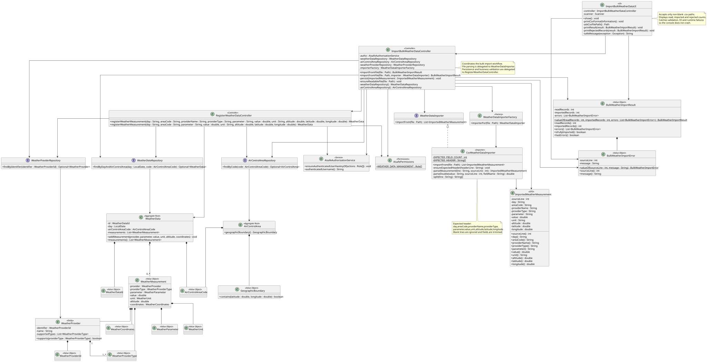

# US042 - Import Bulk Weather Data

## 1. Context

This user story was developed for the Weather Service area. The goal is to allow an authenticated Weather Person to import multiple weather measurements from an external source, initially through a simple CSV file.

The implementation reuses the weather data registration rules introduced in US041. Bulk import is responsible for reading external records and reporting failures, while persistence and domain validation remain centralized in `RegisterWeatherDataController` and the `WeatherData` aggregate.

### 1.1 List of issues

- US042.1 - Implement Bulk Weather Data Import
- US042.2 - Support CSV Weather Data Import
- US042.3 - Validate Imported Weather Data
- US042.4 - Design Extensible Weather Provider Import Mechanism
- US042.5 - Add Bulk Weather Import Tests
- US042.6 - Document Bulk Weather Import

## 2. Requirements

**US042** As a Weather Person, I want to import bulk weather data into the system. Weather data might be from multiple external weather service providers, so the system can aggregate data from various sources for better accuracy. While a simple CSV file format will be available for initial system development, the system should be easy to expand to new weather data sources.

**Acceptance Criteria:**

- AC1 - Weather Person can successfully import bulk weather data into the system.
- AC2 - CSV weather data files are supported for initial import.
- AC3 - Imported weather data is validated before persistence.
- AC4 - Invalid records are rejected or reported with clear feedback.
- AC5 - Imported weather data is associated with the correct air control area and source.
- AC6 - Import mechanism is extensible to support additional weather data providers.
- AC7 - Unit and/or integration tests validate bulk weather import behaviour.

**Dependencies/References:**

This requirement depends on US041 because imported records are persisted through the same weather registration controller and domain model. It also depends on existing `AirControlArea` data because each weather measurement must be associated with an existing air control area and valid coordinates inside its boundary.

## 3. Analysis

Bulk weather import has two responsibilities:

- Convert an external import source into internal imported measurement records.
- Persist each valid imported record while reporting invalid records without crashing the import operation.

The import workflow intentionally does not duplicate business validation. Instead, each imported record is delegated to `RegisterWeatherDataController.registerWeatherMeasurement(...)`, which validates:

- authentication and `WEATHER_DATA_MANAGEMENT` permission;
- required fields;
- ISO date format (`YYYY-MM-DD`);
- air control area existence;
- coordinates inside the air control area's geographic boundary;
- provider name and provider type;
- weather parameter support;
- measurement value range;
- unit compatibility;
- altitude and coordinate ranges.

CSV parsing performs only structural validation:

- file must contain the expected header;
- each non-blank data line must contain exactly 10 fields;
- numeric fields must be parseable as `double`;
- leading and trailing whitespace is trimmed from each field;
- blank lines are ignored.

If parsing fails structurally, the import is rejected with a clear message. If individual records fail domain/application validation, the controller imports the remaining valid records and returns a `BulkWeatherImportResult` containing the source line and error message for each rejected record.

## 4. Design

### 4.1. Realization




The `ImportBulkWeatherDataUI` is available from the Weather Person Backoffice menu. It asks for a CSV file path, validates that the path input is non-blank and uses a `.csv` extension, then delegates the import to `ImportBulkWeatherDataController`.

The `ImportBulkWeatherDataController` coordinates the use case:

1. Authorizes the operation with `WEATHER_DATA_MANAGEMENT`.
2. Validates that the import path is a readable regular file.
3. Selects an importer through `WeatherDataImporterFactory` when using `importFromFile(Path)`.
4. Reads the external records through the selected `WeatherDataImporter`.
5. Delegates each imported record to `RegisterWeatherDataController` for persistence and validation.
6. Collects per-record `IllegalArgumentException` failures as `BulkWeatherImportError` entries.
7. Returns `BulkWeatherImportResult` with read, imported and rejected counts.

The extensibility point is `WeatherDataImporter`. Adding a future importer requires a new implementation of this interface and a factory selection rule for the new format or provider.

### 4.2. CSV Format

The initial supported format is CSV with this exact header:

```csv
day,areaCode,providerName,providerType,parameter,value,unit,altitude,latitude,longitude
```

Example:

```csv
day,areaCode,providerName,providerType,parameter,value,unit,altitude,latitude,longitude
2026-06-01,LISACC,IPMA,GROUND_SENSOR,TEMPERATURE,18.5,C,1200,38.72,-9.14
2026-06-01,LISACC,IPMA,SATELLITE,WIND_SPEED,12.0,M/S,1500,38.80,-9.10
```

Fields:

| Field          | Description |
|----------------|-------------|
| `day`          | Measurement day in ISO format `YYYY-MM-DD` |
| `areaCode`     | Existing air control area code |
| `providerName` | Weather data provider name, for example `IPMA` |
| `providerType` | Source/type of data, for example `GROUND_SENSOR`, `SATELLITE`, `BALLOON` or `MANUAL_INPUT` |
| `parameter`    | Weather parameter, for example `TEMPERATURE`, `WIND_SPEED`, `WIND_DIRECTION`, `PRESSURE`, `HUMIDITY` |
| `value`        | Numeric measurement value |
| `unit`         | Measurement unit compatible with the parameter |
| `altitude`     | Non-negative altitude where the value applies |
| `latitude`     | Latitude where the value applies |
| `longitude`    | Longitude where the value applies |

### 4.3. Validation Rules

The import validates data at three levels:

- UI validation: requires a non-blank `.csv` path and catches user-facing exceptions.
- Importer validation: checks CSV header, field count and numeric fields.
- Controller/domain validation: checks authorization, required data, air control area association, coordinates, provider source information, parameter, unit and value rules.

Invalid CSV structure stops the import because records cannot be safely mapped. Invalid domain records are rejected individually and reported with their source line.

### 4.4. Acceptance Tests

**Test 1:** Valid imported records are persisted.

**Refers to Acceptance Criteria:** AC1, AC3, AC5

Implemented in `ImportBulkWeatherDataControllerTest`.

**Test 2:** Invalid imported weather records are rejected and reported with source line feedback.

**Refers to Acceptance Criteria:** AC3, AC4

Implemented in `ImportBulkWeatherDataControllerTest` and `RegisterWeatherDataControllerTest`.

**Test 3:** CSV files are parsed into imported weather measurements.

**Refers to Acceptance Criteria:** AC2

Implemented in `CsvWeatherDataImporterTest`.

**Test 4:** Malformed CSV files are rejected with clear messages.

**Refers to Acceptance Criteria:** AC2, AC4

Implemented in `CsvWeatherDataImporterTest`.

**Test 5:** Importer selection supports CSV and rejects unsupported formats.

**Refers to Acceptance Criteria:** AC6

Implemented in `WeatherDataImporterFactoryTest`.

**Test 6:** Import result and error value objects enforce valid state.

**Refers to Acceptance Criteria:** AC4, AC7

Implemented in `BulkWeatherImportResultTest` and related application tests.

## 5. Implementation

Main implementation artifacts:

- `ImportBulkWeatherDataUI`: console UI for Weather Persons to import CSV weather data files and display read/imported/rejected counts.
- `ImportBulkWeatherDataController`: application controller that coordinates authorization, file validation, importer selection, per-record persistence and error aggregation.
- `WeatherDataImporter`: interface for importers that convert external files into `ImportedWeatherMeasurement` records.
- `CsvWeatherDataImporter`: initial importer that supports the defined CSV format.
- `WeatherDataImporterFactory`: selects the importer based on file format; currently supports `.csv`.
- `ImportedWeatherMeasurement`: DTO representing one measurement read from an import source, including the original source line.
- `BulkWeatherImportResult`: result object with read record count, imported record count and rejected record errors.
- `BulkWeatherImportError`: value object describing a rejected record line and reason.
- `RegisterWeatherDataController`: reused to validate and persist each imported measurement.
- `WeatherData`: aggregate root that groups measurements by day and air control area.
- `AisafeBackoffice`: exposes the bulk import option in the Weather Person menu.
- `AisafeBootstrapper`: creates the initial Weather Person user aligned with IPMA.

## 6. Integration/Demonstration

### Prerequisites

The bootstrap process creates a Weather Person user:

| Field    | Value            |
|----------|------------------|
| Username | `ipma`           |
| Password | `Password1`      |
| Email    | `ipma@aisafe.com` |
| Role     | `WEATHER_PERSON` |

An existing air control area must also exist before imported records can be persisted.

### Running the application

```bash
mvn -f aisafe.app.backoffice.console/pom.xml exec:java
```

### Login flow

```text
AISafe Console Login
1 - Admin login
2 - Backoffice Operator login
3 - Air Company Collaborator login
4 - Weather Person login
5 - Exit

Option: 4
Username/Email: ipma
Password: Password1
```

Then select the Weather Person menu option for importing bulk weather data and provide the path to a CSV file.

### Expected feedback

For a fully valid file, the UI reports a successful import and prints the number of records read, imported and rejected.

For a partially valid file, valid records are imported and rejected records are listed with their source line and validation message.

For an invalid file path, unsupported extension, malformed CSV header or unreadable file, the UI shows a clear error message and does not crash.

## 7. Observations

The current CSV parser is intentionally simple and does not support quoted commas. This is acceptable for the initial development format described by US042. Future provider-specific formats should be added as new `WeatherDataImporter` implementations instead of adding provider-specific logic to `ImportBulkWeatherDataController`.

Manual weather registration uses the authenticated username as provider name and `MANUAL_INPUT` as provider type. CSV import keeps provider name and provider type from the file, allowing records such as `IPMA/SATELLITE`, `IPMA/GROUND_SENSOR` or `IPMA/BALLOON`.

## 8. Tests

The following validation commands were executed successfully after implementation:

```bash
mvn -pl aisafe.infrastructure.application -am test
mvn -pl aisafe.app.backoffice.console -am test
mvn clean verify
```
