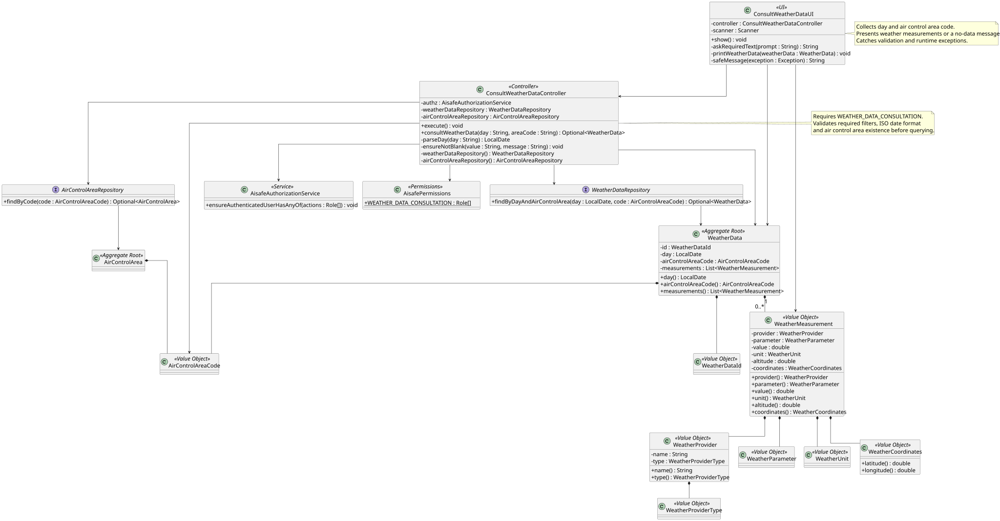
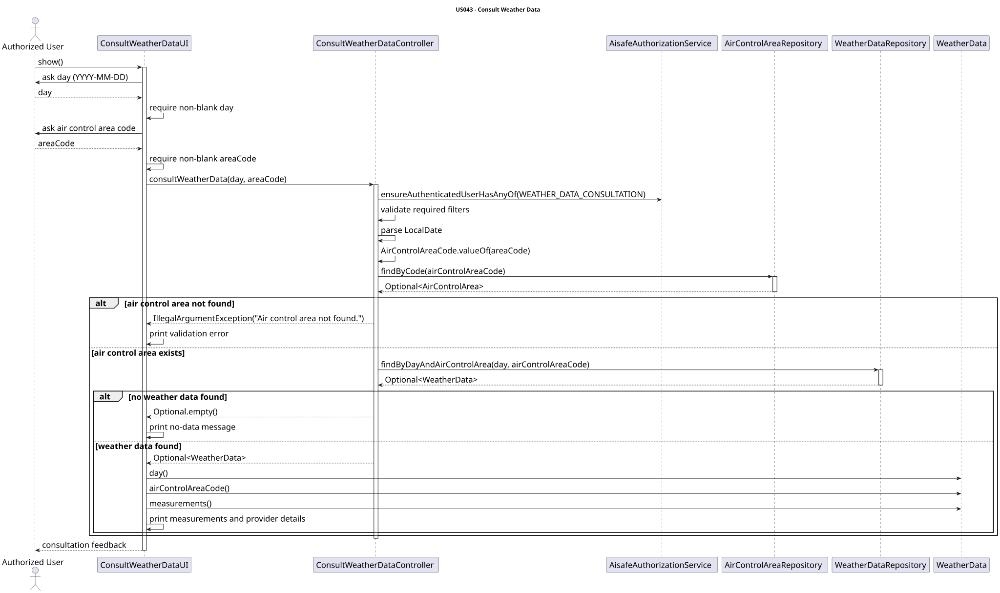

# US043 - Consult Weather Data

## 1. Context

This user story was developed for the Weather Service area. The goal is to allow authorized operational users to consult weather data already registered or imported into the system for a specific day and air control area.

The implementation reuses the `WeatherData` aggregate created by US041 and populated manually or through US042 bulk import. Consultation is read-only and does not modify weather data.

### 1.1 List of issues

- US043.1 - Implement Weather Data Consultation
- US043.2 - Add Weather Data Filtering
- US043.3 - Add Weather Data Consultation Tests
- US043.4 - Document Weather Data Consultation

## 2. Requirements

**US043** As a Weather Person, a Pilot, or a Flight Control Operator, I want to consult weather data in the system for a given day and a specific air control area.

**Acceptance Criteria:**

- AC1 - Weather Person, Pilot, and Flight Control Operator can successfully consult weather data.
- AC2 - Weather data can be filtered by air control area.
- AC3 - Weather data can be filtered by a specific day.
- AC4 - Only weather data associated with the selected air control area is displayed.
- AC5 - Retrieved weather data is correctly presented to the user.
- AC6 - Unit and/or integration tests validate weather data consultation behaviour.

**Dependencies/References:**

This requirement depends on the existing `WeatherData` aggregate and `WeatherDataRepository`. It also depends on the `AirControlArea` aggregate because consultation validates that the selected air control area exists before returning weather data.

## 3. Analysis

Weather data consultation is a read-only use case. The user provides two filters:

- weather data day in ISO format (`YYYY-MM-DD`);
- air control area code.

The consultation flow validates authorization first, then validates the filter input values. The air control area must exist; otherwise the operation is rejected with a clear error message. If the air control area exists but no weather data is available for the selected day and area, the controller returns an empty result and the UI presents a clear no-data message.

The use case must be available to three roles:

- `WEATHER_PERSON`;
- `PILOT`;
- `FLIGHT_CONTROL_OPERATOR`.

This is represented by `AisafePermissions.WEATHER_DATA_CONSULTATION`.

## 4. Design

### 4.1. Realization





The `ConsultWeatherDataUI` collects the day and air control area code from the user and delegates the request to `ConsultWeatherDataController`.

The `ConsultWeatherDataController` coordinates the use case:

1. Enforces `WEATHER_DATA_CONSULTATION` permission.
2. Validates required filters.
3. Parses the day using ISO local date format.
4. Converts the air control area code using `AirControlAreaCode.valueOf(...)`.
5. Validates that the air control area exists through `AirControlAreaRepository`.
6. Retrieves weather data through `WeatherDataRepository.findByDayAndAirControlArea(...)`.
7. Returns `Optional<WeatherData>` so the UI can distinguish found data from an empty result.

The Backoffice console exposes consultation in the Weather Person menu and through a weather consultation menu for authenticated users that have consultation permission but no weather management menu.

### 4.2. Supported Filters

| Filter     | Validation |
|------------|------------|
| `day`      | Required, ISO date format `YYYY-MM-DD` |
| `areaCode` | Required, valid `AirControlAreaCode`, existing air control area |

Only the aggregate matching both filters is returned. Weather data from another day or another air control area is not displayed.

### 4.3. Presented Data

When weather data exists, the UI presents:

- day;
- air control area code;
- total number of measurements;
- provider name;
- provider type;
- weather parameter;
- value and unit;
- altitude;
- latitude;
- longitude.

When no weather data exists for the selected day and area, the UI prints:

```text
No weather data found for the selected day and air control area.
```

### 4.4. Acceptance Tests

**Test 1:** Weather data can be consulted by day and air control area.

**Refers to Acceptance Criteria:** AC1, AC2, AC3, AC4, AC5

Implemented in `ConsultWeatherDataControllerTest.ensureWeatherDataCanBeConsultedByDayAndArea`.

**Test 2:** Consultation filters by day.

**Refers to Acceptance Criteria:** AC3

Implemented in `ConsultWeatherDataControllerTest.ensureConsultationFiltersByDay`.

**Test 3:** Consultation filters by air control area.

**Refers to Acceptance Criteria:** AC2, AC4

Implemented in `ConsultWeatherDataControllerTest.ensureConsultationFiltersByAirControlArea`.

**Test 4:** Invalid filters are rejected with clear messages.

**Refers to Acceptance Criteria:** AC2, AC3

Implemented in `ConsultWeatherDataControllerTest.ensureInvalidConsultationFiltersAreRejected`.

**Test 5:** Unknown air control areas are rejected.

**Refers to Acceptance Criteria:** AC2, AC4

Implemented in `ConsultWeatherDataControllerTest.ensureUnknownAirControlAreaIsRejected`.

**Test 6:** Authorization failure stops consultation.

**Refers to Acceptance Criteria:** AC1

Implemented in `ConsultWeatherDataControllerTest.ensureAuthorizationFailureStopsConsultation`.

**Test 7:** Weather consultation permission includes Weather Person, Pilot and Flight Control Operator.

**Refers to Acceptance Criteria:** AC1

Implemented in `AisafePermissionsTest.ensureWeatherDataConsultationPermissionsAreCorrect`.

## 5. Implementation

Main implementation artifacts:

- `ConsultWeatherDataUI`: console UI that collects filters and presents weather data measurements.
- `ConsultWeatherDataController`: application controller that authorizes the operation, validates filters, validates air control area existence and retrieves matching weather data.
- `WeatherDataRepository`: repository abstraction with `findByDayAndAirControlArea(...)`.
- `AirControlAreaRepository`: repository abstraction used to validate that the selected air control area exists.
- `WeatherData`: aggregate root grouping weather measurements by day and air control area.
- `WeatherMeasurement`: value object representing each measurement displayed to the user.
- `AisafePermissions`: defines `WEATHER_DATA_CONSULTATION` for Weather Person, Pilot and Flight Control Operator.
- `AisafeBackoffice`: exposes the consultation option in the console menus.

## 6. Integration/Demonstration

### Running the application

```bash
mvn -f aisafe.app.backoffice.console/pom.xml exec:java
```

### Access

Weather data consultation is available to users with `WEATHER_DATA_CONSULTATION` permission:

| Role | Access |
|------|--------|
| `WEATHER_PERSON` | Weather Management Console |
| `PILOT` | Weather Consultation Console |
| `FLIGHT_CONTROL_OPERATOR` | Weather Consultation Console |

### Consultation flow

```text
Consult Weather Data
Weather data day (YYYY-MM-DD): 2027-01-10
Air control area code: CONACC
```

If data exists, the UI displays the weather measurements for that exact day and air control area. If no data exists, the UI displays a no-data message.

## 7. Observations

The controller returns the domain aggregate directly because consultation is an internal console use case and no separate representation model is currently required. If weather data consultation becomes part of an external API, a DTO should be introduced to avoid exposing domain objects outside the application boundary.

## 8. Tests

The following validation commands were executed successfully after implementation:

```bash
mvn -pl aisafe.infrastructure.application -am test
mvn -pl aisafe.app.backoffice.console -am test
mvn clean verify
```
