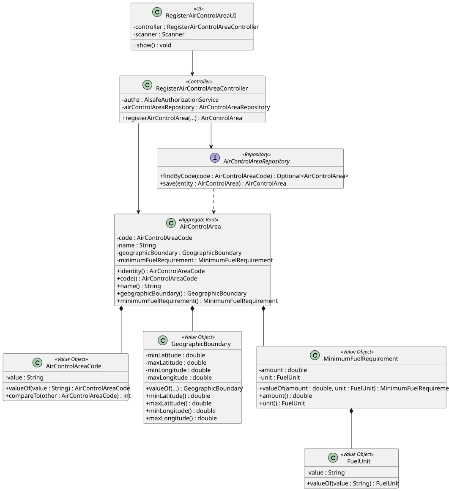

# US 050 - Register an Air Control Area

## 1. Context

This user story was developed for the Backoffice configuration area. The goal is to allow a Backoffice Operator to register air control areas used by airports, weather data and later flight-control operations.

The implementation follows the existing DDD approach in the project: `AirControlArea` is the aggregate root, its business identity is represented by `AirControlAreaCode`, and geographic/fuel rules are represented by value objects.

### 1.1 List of issues

GitHub sub-issues:

- US050.1 - Implement Air Control Area Registration (#120)
- US050.2 - Validate Area Code and Name (#121)
- US050.3 - Enforce Unique Area Code (#122)
- US050.4 - Validate Geographic Boundary (#123)
- US050.5 - Implement Air Control Area Bootstrap Process (#124)
- US050.6 - Add Air Control Area Registration Tests (#125)
- US050.7 - Document Air Control Area Registration (#126)

## 2. Requirements

**US050** As a Backoffice Operator, I want to register an air control area. The area code must be unique in the system. Geographic boundaries must be valid. This must also be achievable by a bootstrap process.

**Acceptance Criteria:**

- US050.1 The system must allow a Backoffice Operator to register an air control area.
- US050.2 The air control area code must be unique.
- US050.3 Geographic boundaries must contain valid latitude and longitude ranges.
- US050.4 Minimum fuel requirements must be valid because they are part of the air control area's operational data.
- US050.5 The feature must be available through the Backoffice console and bootstrap process.

**Dependencies/References:**

This requirement supports US052 because airports must be registered in exactly one air control area. It is also relevant to later weather and flight validation stories because air control areas define operational constraints.

## 3. Analysis

An air control area is identified by a unique area code. The code is represented by `AirControlAreaCode`, which normalizes the value and ensures the format is valid before the aggregate is created.

The geographic boundary is represented by `GeographicBoundary`, which validates latitude and longitude limits. This keeps coordinate rules outside the application layer and inside the domain model.

The domain model enforces the following invariants:

- Air control area code is mandatory and normalized.
- Air control area name is mandatory.
- Geographic boundary is mandatory.
- Latitude values must be between -90 and 90.
- Longitude values must be between -180 and 180.
- Minimum latitude must be lower than maximum latitude.
- Minimum longitude must be lower than maximum longitude.
- Minimum fuel requirement must have a positive amount and a supported unit.
- Duplicate area codes are rejected by the controller through the repository.

## 4. Design

### 4.1. Realization



The `RegisterAirControlAreaUI` collects the air control area data from the Backoffice Operator and delegates registration to `RegisterAirControlAreaController`.

The controller authorizes the operation, creates the value objects, checks code uniqueness using `AirControlAreaRepository`, creates the `AirControlArea` aggregate and persists it.

### 4.2. Acceptance Tests

**Test 1:** Valid air control area registration is accepted and persisted.

**Refers to Acceptance Criteria:** US050.1, US050.2, US050.3, US050.4

Implemented in `RegisterAirControlAreaControllerTest.ensureValidAirControlAreaRegistrationIsAccepted`.

**Test 2:** Duplicate air control area codes are rejected.

**Refers to Acceptance Criteria:** US050.2

Implemented in `RegisterAirControlAreaControllerTest.ensureDuplicateAirControlAreaCodeRegistrationIsRejected`.

**Test 3:** Invalid area codes are rejected.

**Refers to Acceptance Criteria:** US050.2

Implemented in `RegisterAirControlAreaControllerTest.ensureInvalidAirControlAreaCodeIsRejected` and `AirControlAreaCodeTest`.

**Test 4:** Invalid geographic boundaries are rejected.

**Refers to Acceptance Criteria:** US050.3

Implemented in `RegisterAirControlAreaControllerTest.ensureInvalidGeographicBoundaryIsRejected` and `AirControlAreaTest`.

**Test 5:** Invalid minimum fuel data is rejected.

**Refers to Acceptance Criteria:** US050.4

Implemented in `RegisterAirControlAreaControllerTest.ensureInvalidMinimumFuelAmountIsRejected` and `ensureInvalidFuelUnitIsRejected`.

## 5. Implementation

Main implementation artifacts:

- `AirControlArea`: aggregate root for air control area data.
- `AirControlAreaCode`: value object for the unique area code.
- `GeographicBoundary`: value object for latitude and longitude boundaries.
- `MinimumFuelRequirement`: value object for required minimum fuel.
- `FuelUnit`: value object for supported fuel units.
- `AirControlAreaRepository`: repository abstraction used to enforce uniqueness.
- `InMemoryAirControlAreaRepository`: in-memory repository used by tests and memory persistence mode.
- `JpaAirControlAreaRepository`: JPA repository implementation.
- `RegisterAirControlAreaController`: application service/controller for registration.
- `RegisterAirControlAreaUI`: Backoffice console UI.
- `AisafeBootstrapper`: creates initial air control area data.

## 6. Integration/Demonstration

The functionality is available in the Backoffice console after login as a Backoffice Operator.

Run the application with:

```bash
mvn -f aisafe.app.backoffice.console/pom.xml exec:java
```

Login with:

```text
Username/Email: backoffice
Password: Password1
```

Then select:

```text
5 - Register Air Control Area (US50)
```

The bootstrap process creates `LISACC` as an initial air control area.

## 7. Observations

The requirement only explicitly mentions valid geographic boundaries, but minimum fuel requirement is also registered because the specification states that the destination air control area defines the minimum fuel required at the end of a flight.
