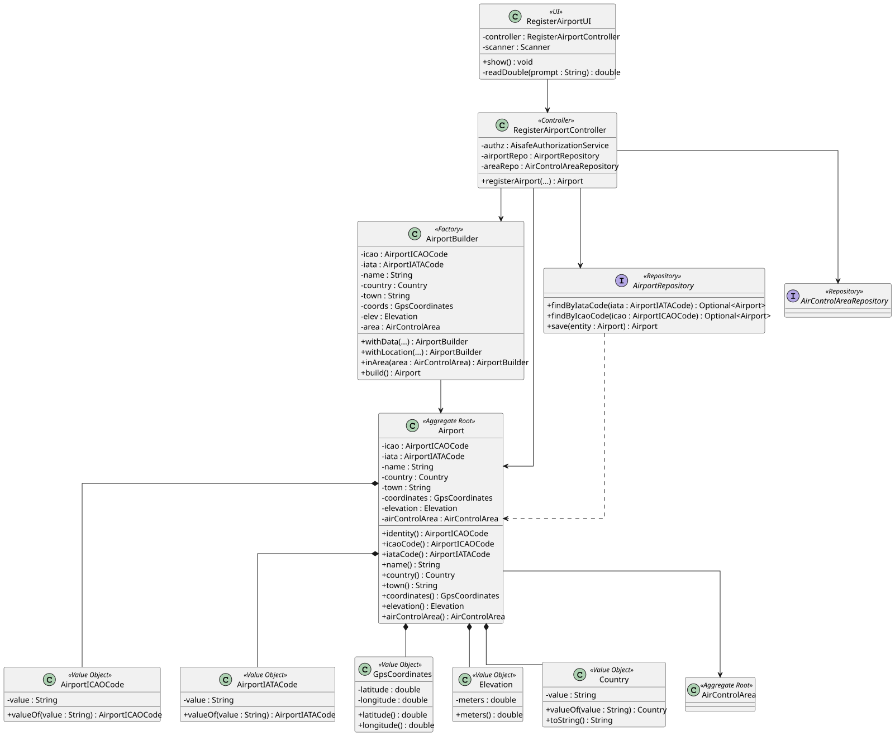

# US 052 - Register an Airport

## 1. Context

This user story was developed for the Backoffice configuration area. The goal is to allow a Backoffice Operator to register airports associated with existing air control areas.

The implementation follows the project's DDD approach: `Airport` is the aggregate root, airport identifiers are represented by value objects (`AirportICAOCode` and `AirportIATACode`), and operational/location data is encapsulated through value objects such as `GpsCoordinates`, `Elevation`, and `Country`.

Each airport must belong to exactly one air control area because operational restrictions, weather constraints and future flight validation depend on that association.

### 1.1 List of issues

Analysis:

- 1 - Implement Airport Registration
- 2 - Validate ICAO and IATA Codes
- 3 - Validate Airport Coordinates and Elevation
- 4 - Associate Airport with an Air Control Area
- 5 - Enforce Worldwide Airport Code Uniqueness

Design:

- 1 - Document Airport Registration

Implement:

- 1 - Implement Airport Registration Flow
- 2 - Implement Airport Builder
- 3 - Implement Airport Bootstrap Process
- 4 - Implement Airport Validation Rules

Test:

- 1 - Add Airport Domain Tests
- 2 - Add Airport Controller Tests
- 3 - Add Airport Bootstrap Tests

## 2. Requirements

**US052** As a Backoffice Operator, I want to register an airport in a given air control area. An airport must be associated with exactly one air control area. The airport has an ICAO and IATA code that must be unique worldwide. An airport has location coordinates that must be valid and an elevation in meters above sea level. This must also be achievable by a bootstrap process.

**Acceptance Criteria:**

- US052.1 The system must allow a Backoffice Operator to register an airport.
- US052.2 Each airport must be associated with exactly one existing air control area.
- US052.3 Airport ICAO and IATA codes must be valid and unique worldwide.
- US052.4 Airport geographic coordinates must contain valid latitude and longitude values.
- US052.5 Airport elevation must be valid and represented in meters above sea level.
- US052.6 The feature must be available through the Backoffice console and bootstrap process.
- US052.7 Unit and/or integration tests must validate airport registration behaviour.

**Dependencies/References:**

This requirement depends on US050 because airports can only exist inside previously registered air control areas.

The airport aggregate will also support future user stories related to:
- weather validation,
- route management,
- flight planning,
- aircraft operations.

## 3. Analysis

An airport is identified by a unique ICAO code and also contains a globally unique IATA code.

The ICAO code is represented by `AirportICAOCode`, which validates that the identifier contains exactly four letters.

The IATA code is represented by `AirportIATACode`, which validates that the identifier contains exactly three letters.

Airport location data is represented by `GpsCoordinates`, which validates latitude and longitude limits according to geographic constraints.

Airport elevation is represented by `Elevation`, which validates that the value is not negative.

The airport country is represented through the `Country` value object.

The domain model enforces the following invariants:

- Airport ICAO code is mandatory and normalized.
- Airport IATA code is mandatory and normalized.
- Airport name is mandatory.
- Airport country is mandatory.
- Airport town is mandatory.
- Airport coordinates are mandatory.
- Latitude values must be between -90 and 90.
- Longitude values must be between -180 and 180.
- Airport elevation cannot be negative.
- Airport must belong to exactly one air control area.
- Duplicate ICAO codes are rejected.
- Duplicate IATA codes are rejected.

## 4. Design

### 4.1. Realization



The `RegisterAirportUI` collects airport data from the Backoffice Operator and delegates registration to `RegisterAirportController`.

The controller authorizes the operation, validates airport uniqueness through `AirportRepository`, validates the existence of the selected air control area through `AirControlAreaRepository`, creates the airport using `AirportBuilder`, and persists the aggregate.

The `Airport` aggregate encapsulates the airport operational identity and location information while delegating validation responsibilities to specialized value objects.

### 4.2. Acceptance Tests

**Test 1:** Valid airport registration is accepted and persisted.

**Refers to Acceptance Criteria:** US052.1, US052.2, US052.3, US052.4, US052.5

Implemented in `RegisterAirportControllerTest.ensureValidAirportRegistrationIsAccepted`.

---

**Test 2:** Duplicate ICAO codes are rejected.

**Refers to Acceptance Criteria:** US052.3

Implemented in `RegisterAirportControllerTest.ensureDuplicateAirportIcaoCodeIsRejected`.

---

**Test 3:** Duplicate IATA codes are rejected.

**Refers to Acceptance Criteria:** US052.3

Implemented in `RegisterAirportControllerTest.ensureDuplicateAirportIataCodeIsRejected`.

---

**Test 4:** Invalid ICAO/IATA formats are rejected.

**Refers to Acceptance Criteria:** US052.3

Implemented in:
- `AirportICAOCodeTest`
- `AirportIATACodeTest`
- `RegisterAirportControllerTest`

---

**Test 5:** Invalid coordinates are rejected.

**Refers to Acceptance Criteria:** US052.4

Implemented in:
- `GpsCoordinatesTest`
- `RegisterAirportControllerTest.ensureInvalidCoordinatesAreRejected`

---

**Test 6:** Invalid elevation values are rejected.

**Refers to Acceptance Criteria:** US052.5

Implemented in:
- `ElevationTest`
- `RegisterAirportControllerTest.ensureInvalidElevationIsRejected`

---

**Test 7:** Airports cannot be created without an existing air control area.

**Refers to Acceptance Criteria:** US052.2

Implemented in `RegisterAirportControllerTest.ensureAirportRequiresExistingAirControlArea`.

---

**Test 8:** Airport bootstrap process creates airports successfully and avoids duplicates.

**Refers to Acceptance Criteria:** US052.6

Implemented in:
- `AisafeBootstrapperTest.ensureAirportIsBootstrappedWhenMissing`
- `AisafeBootstrapperTest.ensureAirportBootstrapIsIdempotent`

## 5. Implementation

Main implementation artifacts:

- `Airport`: aggregate root for airport data.
- `AirportBuilder`: domain factory/builder used to create valid airport aggregates.
- `AirportICAOCode`: value object for airport ICAO code.
- `AirportIATACode`: value object for airport IATA code.
- `GpsCoordinates`: value object for geographic coordinates.
- `Elevation`: value object for airport elevation.
- `Country`: value object representing the airport country.
- `AirportRepository`: repository abstraction for airport persistence and uniqueness validation.
- `InMemoryAirportRepository`: in-memory repository used for tests and memory persistence mode.
- `JpaAirportRepository`: JPA repository implementation.
- `RegisterAirportController`: application service/controller responsible for airport registration.
- `RegisterAirportUI`: Backoffice console UI.
- `AisafeBootstrapper`: creates initial airport data associated with existing air control areas.

## 6. Integration/Demonstration

The functionality is available in the Backoffice console after login as a Backoffice Operator.

Run the application with:

```bash
mvn -f aisafe.app.backoffice.console/pom.xml exec:java