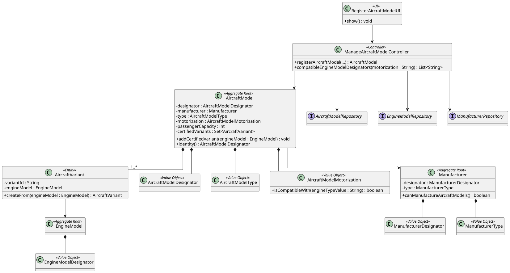

# US 055 - Create an Aircraft Model

## 1. Context

This user story was developed for the Backoffice configuration area. The goal is to allow a Backoffice Operator to register aircraft models with their technical characteristics and at least one certified engine model.

The implementation follows the existing DDD approach in the project: `AircraftModel` is the aggregate root, model identity and characteristics are represented by value objects, and certified engine configurations are represented as internal `AircraftVariant` entities.

### 1.1 List of issues

Analysis:

- 1  Implement Aircraft Model Registration
- 2 - Validate Aircraft Model Identity and Characteristics
- 3 - Enforce Unique Model and Manufacturer Combination
- 4 - Associate Certified Engine Models

Design:

- 7 - Document Aircraft Model Registration

Implement:

- 1 - Implement Aircraft Model Registration
- 4 - Associate Certified Engine Models
- 5 - Implement Aircraft Model Bootstrap Process

Test:

- 6 - Add Aircraft Model Registration Tests

## 2. Requirements

**US055** As a Backoffice Operator, I want to register a new aircraft model. Any model must have at least one engine model. Aircraft has a model name and manufacturer, and their combination must be unique. At least one certified engine model must be associated. An aircraft model will have a type, maximum range and other flight characteristics. This must also be achieved by a bootstrap process.

**Acceptance Criteria:**

- US055.1 The system must allow a Backoffice Operator to register an aircraft model.
- US055.2 The model name and manufacturer combination must uniquely identify the aircraft model.
- US055.3 The aircraft model must include technical characteristics such as type, motorization, range, weights, fuel capacity, speed, wing area and coefficients.
- US055.4 The aircraft model must include at least one certified engine model.
- US055.5 Certified engine models must exist before being associated with the aircraft model.
- US055.6 Certified engine type must be compatible with the aircraft model motorization.
- US055.7 The same certified engine model cannot be associated twice with the same aircraft model.

**Dependencies/References:**

This requirement depends on US056 because aircraft models reference existing engine models. It also relates to US057 and US058, which extend certified engine management after the initial model registration.

## 3. Analysis

The aircraft model is domain-relevant because it defines the general flight characteristics used later by aircraft registration, flight planning and simulation. The combination of model name and manufacturer is represented by `AircraftModelDesignator`, which normalizes the identity and supports uniqueness checks through the repository.

The requirement states that each aircraft model must have at least one certified engine model. Instead of storing raw engine identifiers inside the aggregate, the implementation creates `AircraftVariant` entities from existing `EngineModel` aggregates. This keeps the aircraft model aggregate responsible for controlling certified configurations.

Important invariants are enforced inside the domain model:

- An aircraft model cannot be created without a designator, type or motorization.
- Numeric flight characteristics must be positive.
- Passenger capacity must be positive.
- At least one certified engine model is required.
- Engine model type must match aircraft model motorization.
- Duplicate certified engine models are rejected.

## 4. Design

### 4.1. Realization



The `RegisterAircraftModelUI` collects operator input and presents selection lists for manufacturer, aircraft type, motorization and compatible engine models. The UI delegates registration to `ManageAircraftModelController`.

The controller authorizes the operation, validates uniqueness using `AircraftModelRepository`, loads certified engines from `EngineModelRepository`, and creates the `AircraftModel` aggregate. The aggregate then enforces its internal invariants and creates `AircraftVariant` entities for the certified engines.

### 4.2. Acceptance Tests

**Test 1:** Valid aircraft model registration is accepted and persisted.

**Refers to Acceptance Criteria:** US055.1, US055.2, US055.3, US055.4, US055.5

Implemented in `ManageAircraftModelControllerTest.ensureValidAircraftModelRegistrationIsAccepted`.

**Test 2:** Duplicate aircraft model designators are rejected.

**Refers to Acceptance Criteria:** US055.2

Implemented in `ManageAircraftModelControllerTest.ensureDuplicateAircraftModelRegistrationIsRejected`.

**Test 3:** Missing certified engine models are rejected.

**Refers to Acceptance Criteria:** US055.4, US055.5

Implemented in `ManageAircraftModelControllerTest.ensureMissingCertifiedEngineModelIsRejected` and `ensureEmptyCertifiedEngineModelListIsRejected`.

**Test 4:** Incompatible engine types are rejected.

**Refers to Acceptance Criteria:** US055.6

Implemented in `ManageAircraftModelControllerTest.ensureIncompatibleEngineModelIsRejected`.

**Test 5:** Compatible engine models can be listed by motorization.

**Refers to Acceptance Criteria:** US055.6

Implemented in `ManageAircraftModelControllerTest.ensureCompatibleEngineModelsCanBeListedByMotorization`.

## 5. Implementation

Main implementation artifacts:

- `AircraftModel`: aggregate root that stores technical characteristics and certified variants.
- `AircraftVariant`: entity internal to the aggregate representing a certified engine configuration.
- `AircraftModelDesignator`: value object for model identity based on model name and manufacturer.
- `AircraftModelType`: value object for model type.
- `AircraftModelMotorization`: value object for motorization and compatibility checks.
- `AircraftModelRepository`: repository abstraction used to enforce uniqueness.
- `ManageAircraftModelController`: application service/controller for registration and compatible engine listing.
- `RegisterAircraftModelUI`: Backoffice console UI.
- `AisafeBootstrapper`: creates initial aircraft model data.

## 6. Integration/Demonstration

The functionality is available in the Backoffice console after login as a Backoffice Operator.

Run the application with:

```bash
mvn -f aisafe.app.backoffice.console/pom.xml exec:java
```

Login with:

```text
Username/Email: backoffice
Password: Password1
```

Then select:

```text
2 - Register Aircraft Model (US55)
```

The UI guides the operator through fixed choices for manufacturer, type and motorization, then lists compatible certified engine models to select by number.

## 7. Observations

Manufacturer is currently represented as text in the model designator because the manufacturer aggregate/repository is not yet implemented for this flow. The UI mitigates this by presenting common manufacturers while still allowing `OTHER` when needed.
