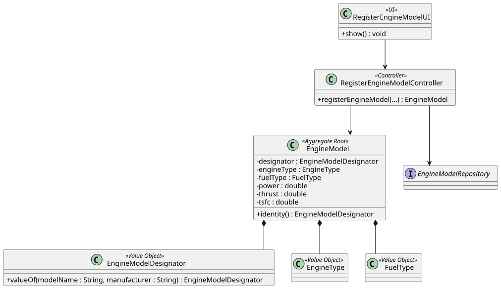

# US 056 - Create an Aircraft Engine Model

## 1. Context

This user story was developed for the Backoffice configuration area. The goal is to allow a Backoffice Operator to register engine models that can later be certified for aircraft models.

The implementation follows the same DDD approach used across the project: `EngineModel` is the aggregate root, with identity and classifications represented by value objects, and the model references an existing `Manufacturer` aggregate.

### 1.1 List of issues

Analysis:

- 1 - Implement Engine Model Registration 
- 2 - Validate Engine Model Data 
- 3 - Enforce Unique Model and Manufacturer Combination 
Design:

- 6 - Document Engine Model Registration 

Implement:

- 1 - Implement Engine Model Registration 
- 2 - Validate Engine Model Data 
- 3 - Enforce Unique Model and Manufacturer Combination 
- 4 - Implement Engine Model Bootstrap Process 

Test:

- 5 - Add Engine Model Registration Tests 

## 2. Requirements

**US056** As a Backoffice Operator, I want to register a new engine model to be used by aircrafts. The model's name and manufacturer combination must be unique. Other important information regarding the type, power, fuel, and efficiency should be included. This must also be achievable by a bootstrap process.

**Acceptance Criteria:**

- US056.1 The system must allow a Backoffice Operator to register an engine model.
- US056.2 The model name and manufacturer combination must uniquely identify the engine model.
- US056.3 The engine model must include engine type.
- US056.4 The engine model must include fuel type.
- US056.5 The engine model must include positive power, thrust and TSFC values.
- US056.6 Duplicate engine model designators must be rejected.
- US056.7 The feature must be available through the Backoffice console and bootstrap process.

**Dependencies/References:**

This requirement supports US055 because aircraft models must select existing certified engine models. It is also a foundation for US057 and US058, where certified engine associations are managed after aircraft model registration.

## 3. Analysis

An engine model is identified by the combination of model name and manufacturer. This identity is represented by `EngineModelDesignator`, which normalizes the value and is used by repositories for uniqueness checks. The manufacturer itself is an existing `Manufacturer` aggregate loaded by the controller before the engine model is created.

The aggregate stores the engine technical characteristics needed by later aircraft model certification and flight simulation work:

- Engine type.
- Fuel type.
- Power.
- Thrust.
- TSFC.

The domain model enforces the following invariants:

- Engine model designator cannot be null or empty.
- The selected manufacturer must exist and be classified as an engine manufacturer.
- Engine type cannot be null or empty.
- Fuel type cannot be null or empty.
- Power must be greater than zero.
- Thrust must be greater than zero.
- TSFC must be greater than zero.
- A duplicate model name/manufacturer combination cannot be registered.

## 4. Design

### 4.1. Realization



The `RegisterEngineModelUI` collects the data needed to register an engine model. The UI presents selection lists for registered engine manufacturers, engine type and fuel type.

The `RegisterEngineModelController` authorizes the operation, loads the selected manufacturer from `ManufacturerRepository`, builds the `EngineModelDesignator`, checks repository uniqueness, creates the `EngineModel` aggregate and persists it through `EngineModelRepository`.

### 4.2. Acceptance Tests

**Test 1:** Valid engine model registration is accepted and persisted.

**Refers to Acceptance Criteria:** US056.1, US056.2, US056.3, US056.4, US056.5

Implemented in `RegisterEngineModelControllerTest` and `EngineModelTest`.

**Test 2:** Duplicate engine model registration is rejected.

**Refers to Acceptance Criteria:** US056.2, US056.6

Implemented in `RegisterEngineModelControllerTest`.

**Test 3:** Invalid numeric values are rejected.

**Refers to Acceptance Criteria:** US056.5

Implemented in `EngineModelTest`.

**Test 4:** Engine model identity value object normalizes and compares designators correctly.

**Refers to Acceptance Criteria:** US056.2

Implemented in `EngineModelDesignatorTest`.

**Test 5:** In-memory repository can save and find engine models by designator.

**Refers to Acceptance Criteria:** US056.2, US056.6

Implemented in `InMemoryEngineModelRepositoryTest`.

## 5. Implementation

Main implementation artifacts:

- `EngineModel`: aggregate root for engine model data.
- `EngineModelDesignator`: value object for model identity based on model name and manufacturer.
- `EngineType`: value object for the engine type classification.
- `FuelType`: value object for the supported fuel type.
- `Manufacturer`: aggregate root referenced by the engine model as its maker.
- `ManufacturerRepository`: repository used to load existing engine manufacturers.
- `EngineModelRepository`: repository abstraction used to enforce uniqueness.
- `InMemoryEngineModelRepository`: in-memory repository used by tests and memory persistence mode.
- `JpaEngineModelRepository`: JPA repository implementation.
- `RegisterEngineModelController`: application service/controller for registration.
- `RegisterEngineModelUI`: Backoffice console UI.
- `AisafeBootstrapper`: creates initial engine model data.

## 6. Integration/Demonstration

The functionality is available in the Backoffice console after login as a Backoffice Operator.

Run the application with:

```bash
mvn -f aisafe.app.backoffice.console/pom.xml exec:java
```

Login with:

```text
Username/Email: backoffice
Password: Password1
```

Then select:

```text
3 - Register Engine Model (US56)
```

The UI guides the operator through registered engine manufacturers and fixed choices for engine type and fuel type, then asks for power, thrust and TSFC.

## 7. Observations

Manufacturer is represented by its own aggregate and must exist before an engine model can reference it. The bootstrap creates common engine manufacturers used in the demonstration dataset.
