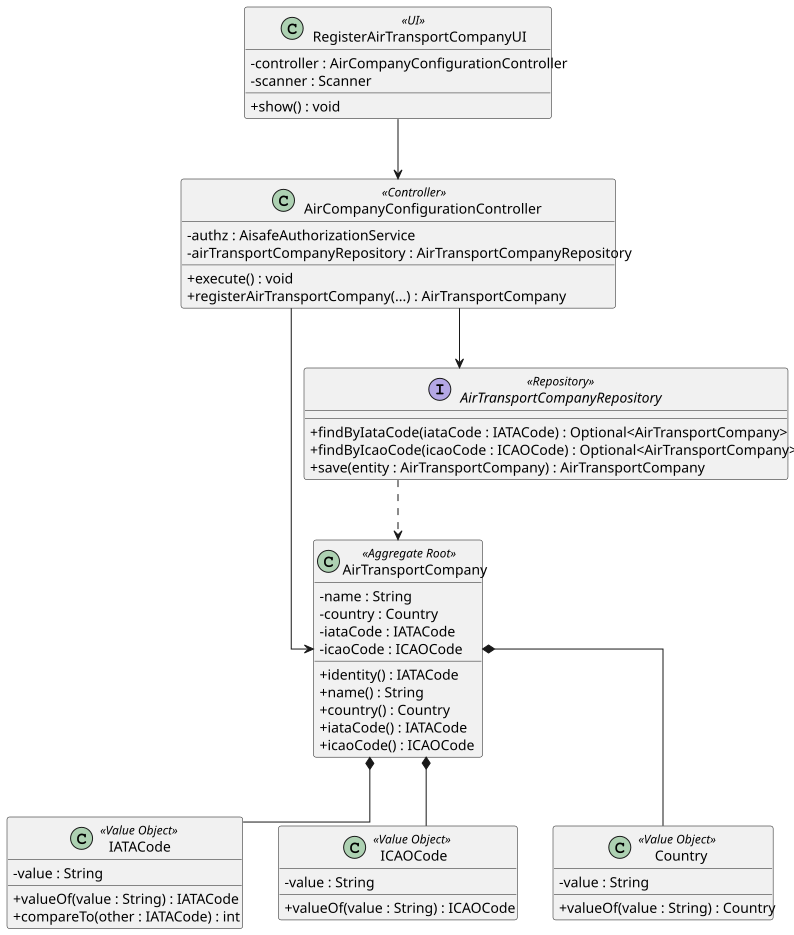

# US 060 - Register an Air Transport Company

## 1. Context

This user story was developed for the Backoffice configuration area. The goal is to allow a Backoffice Operator to register air transport companies that will later own aircraft, routes, collaborators and flights.

The implementation follows the existing DDD approach in the project: `AirTransportCompany` is the aggregate root, with IATA and ICAO codes represented by dedicated value objects.

### 1.1 List of issues

Analysis:

- 1 - Implement Air Transport Company Registration
- 2 - Validate IATA and ICAO Codes
- 3 - Enforce Unique IATA and ICAO Codes

Design:

- 6 - Document Air Transport Company Registration

Implement:

- 1 - Implement Air Transport Company Registration
- 2 - Implement Air Transport Company Bootstrap Process
- 3 - Correct Backoffice Operator Authorization

Test:

- 4 - Add Air Transport Company Domain Tests
- 5 - Add Air Transport Company Controller Tests

## 2. Requirements

**US060** As a Backoffice Operator, I want to register an air transport company. A company has a company name, and IATA (2 letters) and ICAO code (2-3 letters) that must be unique. This must also be achievable by a bootstrap process.

**Acceptance Criteria:**

- US060.1 The system must allow a Backoffice Operator to register an air transport company.
- US060.2 The company must have a non-empty company name.
- US060.3 The IATA code must have exactly two letters.
- US060.4 The ICAO code must have two or three letters.
- US060.5 IATA and ICAO codes must be unique.
- US060.6 The feature must be available through the Backoffice console and bootstrap process.

**Dependencies/References:**

This requirement supports US061 and US070 because collaborators and aircraft must be associated with an existing air transport company.

## 3. Analysis

An air transport company is identified by its IATA code in the system. The IATA and ICAO codes are globally relevant identifiers and are represented by `IATACode` and `ICAOCode` value objects.

The domain model enforces the following invariants:

- Company name is mandatory and normalized.
- Country is mandatory.
- IATA code is mandatory and has exactly two letters.
- ICAO code is mandatory and has two or three letters.
- Duplicate IATA codes are rejected by the controller through the repository.
- Duplicate ICAO codes are rejected by the controller through the repository.

## 4. Design

### 4.1. Realization



The `RegisterAirTransportCompanyUI` collects the company name, country, IATA code and ICAO code from the Backoffice Operator. The UI delegates registration to `AirCompanyConfigurationController`.

The controller authorizes the operation with Backoffice configuration permissions, creates the value objects, checks uniqueness using `AirTransportCompanyRepository`, creates the `AirTransportCompany` aggregate and persists it.

### 4.2. Acceptance Tests

**Test 1:** Valid air transport company registration is accepted and persisted.

**Refers to Acceptance Criteria:** US060.1, US060.2, US060.3, US060.4

Implemented in `AirCompanyConfigurationControllerTest.ensureValidAirTransportCompanyRegistrationIsAccepted`.

**Test 2:** Duplicate IATA codes are rejected.

**Refers to Acceptance Criteria:** US060.5

Implemented in `AirCompanyConfigurationControllerTest.ensureDuplicateIataCodeRegistrationIsRejected`.

**Test 3:** Duplicate ICAO codes are rejected.

**Refers to Acceptance Criteria:** US060.5

Implemented in `AirCompanyConfigurationControllerTest.ensureDuplicateIcaoCodeRegistrationIsRejected`.

**Test 4:** Invalid company data is rejected.

**Refers to Acceptance Criteria:** US060.2, US060.3, US060.4

Implemented in `AirCompanyConfigurationControllerTest.ensureInvalidAirTransportCompanyDataIsRejected`, `AirTransportCompanyTest`, `IATACodeTest` and `ICAOCodeTest`.

**Test 5:** Registration requires Backoffice Operator authorization.

**Refers to Acceptance Criteria:** US060.1

Implemented in `AirCompanyConfigurationControllerTest` through the captured `BACKOFFICE_CONFIGURATION` permission.

## 5. Implementation

Main implementation artifacts:

- `AirTransportCompany`: aggregate root for company data.
- `IATACode`: value object for the two-letter IATA company code.
- `ICAOCode`: value object for the two or three-letter ICAO company code.
- `Country`: value object for the company's country.
- `AirTransportCompanyRepository`: repository abstraction used to enforce uniqueness.
- `InMemoryAirTransportCompanyRepository`: in-memory repository used by tests and memory persistence mode.
- `JpaAirTransportCompanyRepository`: JPA repository implementation.
- `AirCompanyConfigurationController`: application service/controller for registration.
- `RegisterAirTransportCompanyUI`: Backoffice console UI.
- `AisafeBootstrapper`: creates initial air transport company data.

## 6. Integration/Demonstration

The functionality is available in the Backoffice console after login as a Backoffice Operator.

Run the application with:

```bash
mvn -f aisafe.app.backoffice.console/pom.xml exec:java
```

Login with:

```text
Username/Email: backoffice
Password: Password1
```

Then select:

```text
4 - Register Air Transport Company (US60)
```

The bootstrap process creates initial companies such as `TP`, `FR` and `LH`.

## 7. Observations

The registration flow now uses `BACKOFFICE_CONFIGURATION` authorization because the actor defined by the requirement is the Backoffice Operator, not the Air Transport Company Collaborator.
