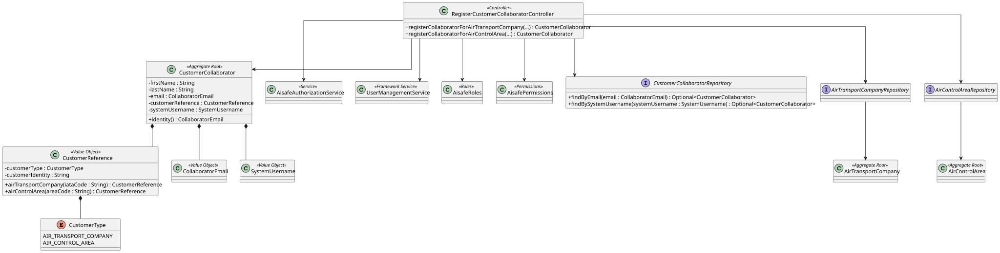

# US 061 - Register Customer Collaborators

## 1. Context

This user story was developed for customer collaborator management. The goal is to allow a Backoffice Operator to register collaborators associated with existing AISafe customers.

The implemented customer types are air transport companies and air control areas. Each collaborator is also registered as a system user, so the collaborator can authenticate and execute the actions allowed by the role assigned to its customer type.

### 1.1 List of issues

Analysis:

- 1 - Identify customer collaborator data
- 2 - Identify supported customer types
- 3 - Define collaborator-to-customer association rules
- 4 - Define system-user role mapping for collaborator types

Design:

- 5 - Design customer collaborator aggregate
- 6 - Design customer reference value object
- 7 - Document customer collaborator registration

Implement:

- 1 - Implement customer collaborator aggregate and value objects
- 2 - Implement repository abstraction and persistence implementations
- 3 - Implement customer collaborator registration controller
- 4 - Integrate collaborator registration with framework user management
- 5 - Bootstrap initial customer collaborators

Test:

- 6 - Add domain, repository, controller and bootstrap tests

## 2. Requirements

**US061** As a Backoffice Operator, I want to register customer collaborators, associating each collaborator with exactly one customer and creating the corresponding system user.

**Acceptance Criteria:**

- US061.1 The system must allow registering a customer collaborator with first name, last name and email.
- US061.2 A collaborator must be associated with exactly one existing customer.
- US061.3 Supported customer types are air transport companies and air control areas.
- US061.4 Collaborator email must be unique and must identify the collaborator aggregate.
- US061.5 A collaborator must also be registered as a system user.
- US061.6 The system username must be derived from the collaborator email.
- US061.7 Air transport company collaborators receive the `AIR_TRANSPORT_COMPANY_COLLABORATOR` role.
- US061.8 Air control area collaborators receive the `FLIGHT_CONTROL_OPERATOR` role.
- US061.9 The registration must be available through a bootstrap process.

**Dependencies/References:**

This requirement depends on existing customer aggregates: `AirTransportCompany` and `AirControlArea`. It also depends on US030 for user management roles and on the eAPLI framework for system-user creation.

## 3. Analysis

The collaborator belongs to the customer collaboration domain and is represented by the `CustomerCollaborator` aggregate root. The aggregate identity is the collaborator email.

The collaborator must refer to different types of customers. Instead of coupling the aggregate directly to multiple customer aggregate classes, the implementation uses `CustomerReference`, an embedded value object composed of:

- `CustomerType`, identifying the type of customer.
- `customerIdentity`, storing the customer business identity.

For air transport companies, the customer identity is the company IATA code. For air control areas, the customer identity is the air control area code.

Important invariants are enforced in the domain and application layers:

- First name and last name are mandatory.
- Collaborator email is mandatory, valid, normalized and unique.
- Each collaborator must have exactly one customer reference.
- Each collaborator must have one system username.
- The referenced customer must already exist.
- The system username is the normalized collaborator email.
- System-user role depends on the associated customer type.

## 4. Design

### 4.1. Realization



The `RegisterCustomerCollaboratorController` exposes separate methods for air transport company collaborators and air control area collaborators. Each method validates the customer identifier, checks that the customer exists, builds a `CustomerReference`, and delegates to the common registration flow.

The common registration flow checks backoffice configuration permission, validates collaborator data, enforces email uniqueness, persists the `CustomerCollaborator`, and creates a matching framework system user with the role required by the customer type.

### 4.2. Acceptance Tests

**Test 1:** Valid collaborator registration for an air transport company is accepted and persisted.

**Refers to Acceptance Criteria:** US061.1, US061.2, US061.3, US061.5, US061.6, US061.7

Implemented in `RegisterCustomerCollaboratorControllerTest.ensureCollaboratorIsRegisteredForAirTransportCompany`.

**Test 2:** Valid collaborator registration for an air control area is accepted and persisted.

**Refers to Acceptance Criteria:** US061.1, US061.2, US061.3, US061.5, US061.6, US061.8

Implemented in `RegisterCustomerCollaboratorControllerTest.ensureCollaboratorIsRegisteredForAirControlArea`.

**Test 3:** Duplicate collaborator emails are rejected.

**Refers to Acceptance Criteria:** US061.4

Implemented in `RegisterCustomerCollaboratorControllerTest.ensureDuplicateCollaboratorEmailIsRejected` and `InMemoryCustomerCollaboratorRepositoryTest`.

**Test 4:** Unknown customer identifiers are rejected.

**Refers to Acceptance Criteria:** US061.2, US061.3

Implemented in `RegisterCustomerCollaboratorControllerTest.ensureUnknownAirTransportCompanyIsRejected` and `ensureUnknownAirControlAreaIsRejected`.

**Test 5:** Invalid collaborator data and blank initial passwords are rejected.

**Refers to Acceptance Criteria:** US061.1, US061.5

Implemented in `RegisterCustomerCollaboratorControllerTest.ensureInvalidCollaboratorDataIsRejected` and `ensureBlankInitialPasswordIsRejected`.

**Test 6:** Customer collaborator aggregate invariants are enforced.

**Refers to Acceptance Criteria:** US061.1, US061.2, US061.4, US061.6

Implemented in `CustomerCollaboratorTest`, `CollaboratorEmailTest`, `CustomerReferenceTest` and `SystemUsernameTest`.

## 5. Implementation

Main implementation artifacts:

- `CustomerCollaborator`: aggregate root representing a collaborator associated with one customer.
- `CollaboratorEmail`: value object for collaborator identity and email normalization.
- `SystemUsername`: value object for the linked system username.
- `CustomerReference`: value object identifying the associated customer.
- `CustomerType`: enum for supported customer types.
- `CustomerCollaboratorRepository`: repository abstraction with lookups by email and system username.
- `InMemoryCustomerCollaboratorRepository`: in-memory repository implementation.
- `JpaCustomerCollaboratorRepository`: JPA repository implementation.
- `RegisterCustomerCollaboratorController`: application controller for registering collaborators.
- `AisafeBootstrapper`: creates initial customer collaborators and matching system users.

## 6. Integration/Demonstration

The implemented registration flow is exposed through the application layer and bootstrap process.

The bootstrap creates two initial collaborators:

- `tap.collaborator@aisafe.com`, associated with air transport company `TP`, role `AIR_TRANSPORT_COMPANY_COLLABORATOR`.
- `lisacc.collaborator@aisafe.com`, associated with air control area `LISACC`, role `FLIGHT_CONTROL_OPERATOR`.

Run the application with:

```bash
mvn -f aisafe.app.backoffice.console/pom.xml exec:java
```

The collaborators are created during `AisafeBootstrapper.bootstrap()` if they do not already exist.

## 7. Observations

There is no dedicated console UI for this use case yet. The registration logic is available through the controller and bootstrapper, and the model is prepared for customer-specific authorization in later user stories such as aircraft registration and decommissioning.
