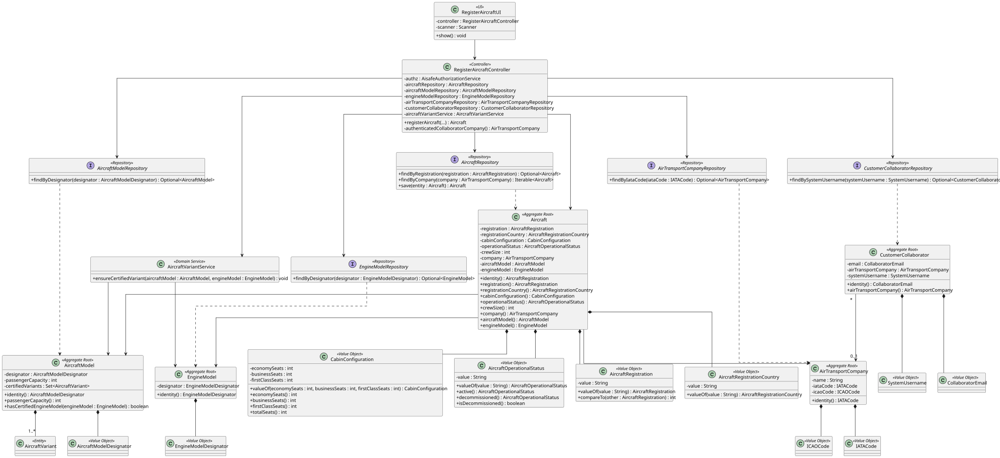

# US 070 - Add an Aircraft to an Air Transport Company

## 1. Context

This user story was developed for the Air Transport Company configuration area. The goal is to allow an authenticated Air Transport Company Collaborator to register aircraft in the fleet of the company they belong to.

The implementation follows the existing DDD approach in the project: `Aircraft` is the aggregate root, registration, registration country, cabin configuration and operational status are represented by value objects, and cross-aggregate checks are performed by the application service before persistence.

### 1.1 List of issues

GitHub sub-issues:

- US070.1 - Implement Aircraft Fleet Registration (#142)
- US070.2 - Associate Aircraft with Model and Engines (#143)
- US070.3 - Validate Aircraft Registration and Country (#144)
- US070.4 - Validate Seat Configuration and Capacity (#145)
- US070.5 - Define and Store Aircraft Operational Status (#146)
- US070.6 - Add Aircraft Registration Tests (#148)
- US070.7 - Document Aircraft Fleet Registration (#149)

## 2. Requirements

**US070** As an Air Transport Company Collaborator, I want to add an aircraft to my company's fleet. The aircraft is of a given model, including the engines, and the number of seats of each type/class must be provided. Total number of seats cannot exceed the model's capacity. An aircraft is identified by the aircraft registration number, that is unique. Also, an aircraft is registered in a country. An aircraft also has an operational status.

**Acceptance Criteria:**

- US070.1 The system must allow an Air Transport Company Collaborator to register an aircraft in their company's fleet.
- US070.2 Aircraft registration number must be unique.
- US070.3 Aircraft registration country must be provided.
- US070.4 Cabin configuration must include the number of seats per class.
- US070.5 Total seats cannot exceed the selected aircraft model passenger capacity.
- US070.6 The selected aircraft model must exist.
- US070.7 The selected engine model must exist.
- US070.8 The selected engine model must be certified for the selected aircraft model.
- US070.9 Aircraft operational status must be valid.

**Dependencies/References:**

This requirement depends on US060 because the aircraft belongs to an existing air transport company. It also depends on US055 and US056 because the aircraft must reference an existing aircraft model and an existing certified engine model.

## 3. Analysis

The aircraft registration is the business identity of an aircraft and is represented by `AircraftRegistration`. The registration country is represented separately because it may differ from the company's home country.

The authenticated collaborator determines the owning company. The controller obtains the authenticated username, resolves the matching `CustomerCollaborator`, verifies that the collaborator is associated with an air transport company and then loads that company from `AirTransportCompanyRepository`.

The domain model enforces the following invariants:

- Aircraft registration is mandatory and normalized.
- Registration country is mandatory.
- Cabin configuration is mandatory.
- Seat counts cannot be negative.
- Cabin configuration must contain at least one seat.
- Crew size must be positive.
- Company, aircraft model and engine model are mandatory.
- Manufacture year must be between 1903 and the current year.
- Total seats cannot exceed the selected aircraft model passenger capacity.
- Operational status must be one of `ACTIVE`, `IN_MAINTENANCE` or `DECOMMISSIONED`.

The selected engine model must also be certified for the selected aircraft model. This is a cross-aggregate rule between `AircraftModel` and `EngineModel`, so `RegisterAircraftController` invokes `AircraftVariantService` before creating and persisting the `Aircraft` aggregate.

## 4. Design

### 4.1. Realization



The `RegisterAircraftUI` collects aircraft registration, registration country, operational status, crew size, cabin configuration, aircraft model and engine model data. The UI delegates registration to `RegisterAircraftController`.

The controller authorizes the operation with air company configuration permissions, checks registration uniqueness, resolves the authenticated collaborator's company, loads the selected aircraft model and engine model, validates the certified variant through `AircraftVariantService`, creates the `Aircraft` aggregate and persists it through `AircraftRepository`.

### 4.2. Acceptance Tests

**Test 1:** Valid aircraft registration is accepted and persisted.

**Refers to Acceptance Criteria:** US070.1, US070.2, US070.3, US070.4, US070.5, US070.6, US070.7, US070.8, US070.9

Implemented in `RegisterAircraftControllerTest.ensureValidAircraftRegistrationIsAccepted` and `AircraftTest.ensureValidAircraftIsAccepted`.

**Test 2:** Duplicate aircraft registrations are rejected.

**Refers to Acceptance Criteria:** US070.2

Implemented in `RegisterAircraftControllerTest.ensureDuplicateAircraftRegistrationIsRejected`.

**Test 3:** Unknown aircraft models are rejected.

**Refers to Acceptance Criteria:** US070.6

Implemented in `RegisterAircraftControllerTest.ensureUnknownAircraftModelIsRejected`.

**Test 4:** Unknown engine models are rejected.

**Refers to Acceptance Criteria:** US070.7

Implemented in `RegisterAircraftControllerTest.ensureUnknownEngineModelIsRejected`.

**Test 5:** Collaborator and company association rules are enforced.

**Refers to Acceptance Criteria:** US070.1

Implemented in `RegisterAircraftControllerTest.ensureAuthenticatedUserMustBeCustomerCollaborator`, `ensureCollaboratorMustBeAssociatedWithAirTransportCompany` and `ensureAssociatedAirTransportCompanyMustExist`.

**Test 6:** Cabin capacity and certified engine rules are enforced.

**Refers to Acceptance Criteria:** US070.5, US070.8

Implemented in `AircraftTest.ensureTotalSeatsCannotExceedModelCapacity` and `ensureEngineModelMustBeCertifiedForAircraftModel`.

**Test 7:** Operational status can be provided explicitly.

**Refers to Acceptance Criteria:** US070.9

Implemented in `RegisterAircraftControllerTest.ensureAircraftCanBeRegisteredWithExplicitOperationalStatus` and `AircraftOperationalStatusTest`.

## 5. Implementation

Main implementation artifacts:

- `Aircraft`: aggregate root for fleet aircraft.
- `AircraftRegistration`: value object for the unique registration number.
- `AircraftRegistrationCountry`: value object for the aircraft registration country.
- `CabinConfiguration`: value object for economy, business and first-class seats.
- `AircraftOperationalStatus`: value object for aircraft status.
- `AircraftVariantService`: domain service that enforces certified aircraft model/engine model variants before aircraft creation.
- `Aircraft.manufactureYear`: aircraft manufacture year used to calculate aircraft age.
- `AircraftRepository`: repository abstraction used to enforce registration uniqueness.
- `InMemoryAircraftRepository`: in-memory repository used by tests and memory persistence mode.
- `JpaAircraftRepository`: JPA repository implementation.
- `RegisterAircraftController`: application service/controller for fleet registration.
- `RegisterAircraftUI`: console UI for aircraft registration.

## 6. Integration/Demonstration

The functionality is available after login as an Air Transport Company Collaborator.

Run the console application with:

```bash
mvn -f aisafe.app.backoffice.console/pom.xml exec:java
```

Login with the bootstrap collaborator:

```text
Username/Email: tap.collaborator@aisafe.com
Password: Password1
```

Then select:

```text
6 - Register Aircraft (US70)
```

The bootstrap process creates `TP`, the TAP collaborator, the `A320neo` aircraft model and the `LEAP-1A` engine model used for demonstration.

## 7. Observations

The UI is intentionally simple and only collects the aircraft data. The controller derives the owning company from the authenticated collaborator instead of asking for a company code in the UI. This prevents a collaborator from registering aircraft in another company's fleet.
