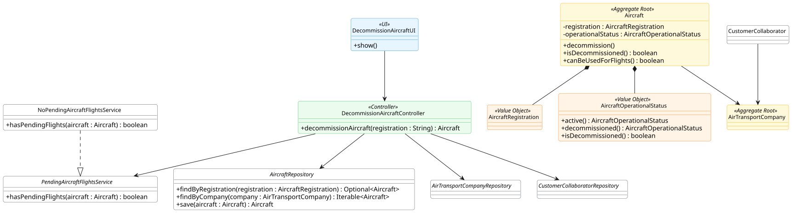

# US 071 - Decommission an Aircraft

## 1. Context

This user story was developed for the Air Transport Company configuration area. The goal is to allow an Air Transport Company Collaborator to retire an aircraft from their company's fleet.

The implementation extends the existing `Aircraft` aggregate created for US070. Instead of deleting the aircraft, the system changes its operational status to `DECOMMISSIONED`, preserving the aircraft registration and historical fleet information.

### 1.1 List of issues

Analysis:

- 1 - Analyse aircraft retirement rules
- 2 - Identify dependencies with pending flights
- 3 - Validate ownership by authenticated air transport company collaborator

Design:

- 4 - Design aircraft decommission flow
- 5 - Document aircraft decommissioning

Implement:

- 6 - Add aircraft decommission domain behavior
- 7 - Implement aircraft decommission controller
- 8 - Add pending flights validation seam
- 9 - Add backoffice console UI for decommissioning

Test:

- 10 - Add aircraft decommission domain tests
- 11 - Add aircraft decommission controller tests

## 2. Requirements

**US071** As an Air Transport Company Collaborator, I want to retire an aircraft from my company's fleet. It is not possible to create flights for a retired aircraft, nor is it possible to retire an aircraft that has pending flights registered in the system.

**Acceptance Criteria:**

- US071.1 The system must allow an Air Transport Company Collaborator to decommission an aircraft from their company fleet.
- US071.2 Only aircraft belonging to the authenticated collaborator's air transport company can be decommissioned.
- US071.3 A decommissioned aircraft must have operational status `DECOMMISSIONED`.
- US071.4 An aircraft that is already decommissioned cannot be decommissioned again.
- US071.5 An aircraft with pending flights registered in the system cannot be decommissioned.
- US071.6 A decommissioned aircraft must not be available for future flight assignment.

**Dependencies/References:**

This requirement depends on US070 because only registered aircraft can be retired. It also relates to future flight and flight plan management requirements, because the pending-flight rule requires knowledge of flights or flight plans assigned to the aircraft.

## 3. Analysis

The aircraft is not removed from the system when it is retired. Removing the aggregate would lose fleet history and could break references from flight-related information. The selected approach is therefore a status transition inside the `Aircraft` aggregate.

The decommission operation has two kinds of rules:

- Internal aircraft lifecycle rules, enforced by the `Aircraft` aggregate.
- Cross-aggregate rules involving company ownership and pending flights, enforced by the application layer before changing the aggregate state.

The `Aircraft` aggregate enforces that the same aircraft cannot be decommissioned twice. The controller enforces that the authenticated collaborator belongs to an air transport company and that the target aircraft belongs to that company.

The pending-flight check is represented by `PendingAircraftFlightsService`. At the moment, there is no complete persisted `Flight` or `FlightPlan` aggregate/repository implementation in the Java application layer. For that reason, the production implementation is a temporary seam (`NoPendingAircraftFlightsService`) that can later be replaced by a repository-backed implementation when flight persistence is available.

Important invariants and rules:

- Aircraft registration must identify an existing aircraft.
- The authenticated user must be an Air Transport Company Collaborator.
- The aircraft must belong to the authenticated collaborator's company.
- The aircraft must not have pending flights.
- The aircraft must not already be decommissioned.
- A decommissioned aircraft cannot be used for future flight assignment.

## 4. Design

### 4.1. Realization




The `DecommissionAircraftUI` asks the collaborator for the aircraft registration number and delegates the operation to `DecommissionAircraftController`.

The controller authorizes the operation with `AisafePermissions.AIR_COMPANY_CONFIGURATION`, loads the target aircraft, resolves the authenticated collaborator's company, checks that the aircraft belongs to that company, verifies whether pending flights exist through `PendingAircraftFlightsService`, and then calls `Aircraft.decommission()`.

The `Aircraft` aggregate updates its `AircraftOperationalStatus` to `DECOMMISSIONED`. The repository then persists the modified aggregate.

### 4.2. Acceptance Tests

**Test 1:** Valid aircraft decommissioning is accepted and persisted.

**Refers to Acceptance Criteria:** US071.1, US071.2, US071.3, US071.6

Implemented in `DecommissionAircraftControllerTest.ensureValidAircraftCanBeDecommissioned` and `AircraftTest.ensureAircraftCanBeDecommissioned`.

**Test 2:** Unknown aircraft registration is rejected.

**Refers to Acceptance Criteria:** US071.1

Implemented in `DecommissionAircraftControllerTest.ensureUnknownAircraftIsRejected`.

**Test 3:** Aircraft from another company cannot be decommissioned.

**Refers to Acceptance Criteria:** US071.2

Implemented in `DecommissionAircraftControllerTest.ensureAircraftMustBelongToAuthenticatedCollaboratorCompany`.

**Test 4:** Aircraft with pending flights cannot be decommissioned.

**Refers to Acceptance Criteria:** US071.5

Implemented in `DecommissionAircraftControllerTest.ensureAircraftWithPendingFlightsCannotBeDecommissioned`.

**Test 5:** Already decommissioned aircraft cannot be decommissioned again.

**Refers to Acceptance Criteria:** US071.4

Implemented in `DecommissionAircraftControllerTest.ensureAlreadyDecommissionedAircraftIsRejected` and `AircraftTest.ensureAlreadyDecommissionedAircraftCannotBeDecommissionedAgain`.

**Test 6:** Invalid authenticated users or collaborators are rejected.

**Refers to Acceptance Criteria:** US071.1, US071.2

Implemented in `DecommissionAircraftControllerTest.ensureAuthenticatedUserMustBeCustomerCollaborator`, `ensureCollaboratorMustBeAssociatedWithAirTransportCompany`, and `ensureAssociatedAirTransportCompanyMustExist`.

## 5. Implementation

Main implementation artifacts:

- `Aircraft`: aggregate root that controls the decommission transition.
- `AircraftOperationalStatus`: value object representing `ACTIVE`, `IN_MAINTENANCE` and `DECOMMISSIONED` statuses.
- `AircraftRepository`: repository abstraction used to find and persist aircraft.
- `DecommissionAircraftController`: application controller for US071.
- `PendingAircraftFlightsService`: seam used to check whether pending flights exist for an aircraft.
- `NoPendingAircraftFlightsService`: temporary implementation used until flight persistence is available.
- `DecommissionAircraftUI`: Backoffice console UI for decommissioning an aircraft by registration number.

## 6. Integration/Demonstration

The functionality is intended for authenticated Air Transport Company Collaborators.

Run the application with:

```bash
mvn -f aisafe.app.backoffice.console/pom.xml exec:java
```

Login with the bootstrapped collaborator:

```text
Username/Email: tap.collaborator@aisafe.com
Password: Password1
```

Then access the aircraft decommission flow and provide the aircraft registration number to retire.

## 7. Observations

The pending-flight validation is currently represented by a service seam because the Java persistence model for flights and flight plans is not yet implemented. The tests prove that the controller blocks decommissioning when the seam reports pending flights. When a real `Flight` or `FlightPlan` repository becomes available, `NoPendingAircraftFlightsService` should be replaced by an implementation that queries pending assignments.

The system marks aircraft as `DECOMMISSIONED` instead of deleting them. This keeps the aggregate available for historical references while preventing future use in flight assignment.
