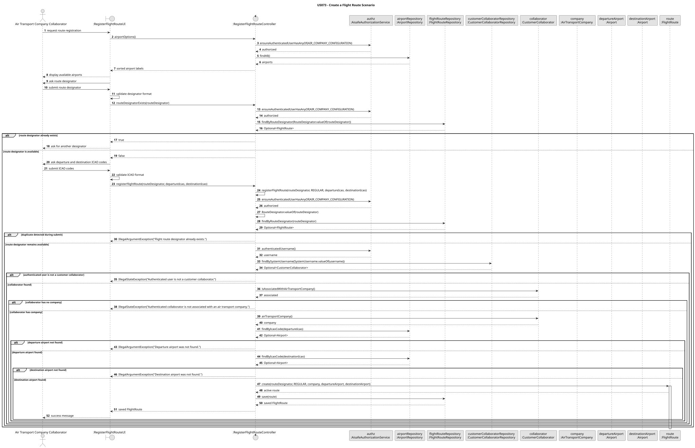

# US 073 - Create a Flight Route

## 1. Context

This user story was developed for the Air Transport Company configuration area. The goal is to allow an authenticated Air Transport Company Collaborator to register flight routes for the company they belong to.

The implementation follows the existing DDD approach used for the aircraft fleet user stories: `FlightRoute` is the aggregate root, route designator, type and status are represented by value objects, and cross-aggregate checks are performed by the application controller before persistence.

### 1.1 List of issues

GitHub sub-issues:

- US073.1 - Implement Flight Route Creation (#195)
- US073.2 - Validate Route Airports (#196)
- US073.3 - Validate Route Name and Uniqueness (#197)
- US073.4 - Add Flight Route Creation Tests (#198)
- US073.5 - Document Flight Route Creation (#199)

## 2. Requirements

**US073** As an Air Transport Company Collaborator, I want to create a flight route for my company. The route connects two airports. The route name must have 2 company initials followed by up to 4 numbers, for example `TP123`, and must be unique.

**Acceptance Criteria:**

- US073.1 The system must allow an Air Transport Company Collaborator to create a flight route for their company.
- US073.2 The route designator must have 2 company letters followed by 1 to 4 digits.
- US073.3 The route designator must start with the authenticated company IATA code.
- US073.4 The route designator must be unique.
- US073.5 The departure airport must exist.
- US073.6 The destination airport must exist.
- US073.7 The departure and destination airports must be different.
- US073.8 A newly created route must be active.
- US073.9 The UI should help the collaborator identify available airports.

**Dependencies/References:**

This requirement depends on the existing air transport company, customer collaborator and airport registrations. The authenticated collaborator determines the owning company, following the same security rule used by US070, US071 and US072.

## 3. Analysis

The route designator is the business identity of a flight route and is represented by `RouteDesignator`. The value object normalizes the text to uppercase and validates the format `[A-Z]{2}[0-9]{1,4}`.

The authenticated collaborator determines the owning company. The controller obtains the authenticated username, resolves the matching `CustomerCollaborator`, verifies that the collaborator is associated with an air transport company and then loads that company from `AirTransportCompanyRepository`.

The domain model and application layer enforce the following rules:

- Route designator is mandatory, normalized and format-validated.
- Route designator must start with the owning company's IATA code.
- Route designator must be unique in `FlightRouteRepository`.
- Route type is mandatory and defaults to `REGULAR` when not explicitly provided.
- Route status is initialized as `ACTIVE`.
- Departure airport is mandatory and must exist.
- Destination airport is mandatory and must exist.
- Departure and destination airports must be different.
- Company is mandatory and is derived from the authenticated collaborator.

The `FlightRoute` aggregate is responsible for internal route invariants, such as mandatory fields, different airports, ownership-compatible route designator and initial active status. Rules that require repositories or other aggregates, such as route designator uniqueness, airport existence and authenticated company resolution, are handled by `RegisterFlightRouteController` before the aggregate is persisted.

## 4. Design

### 4.1. Realization



The main flow is:

- The user logs in as an Air Transport Company Collaborator.
- The user selects the flight route registration option from the Air Company menu.
- `RegisterFlightRouteUI` lists available airports through `RegisterFlightRouteController.airportOptions()`.
- The UI asks for the route designator, departure airport ICAO code and destination airport ICAO code.
- The UI validates the basic route designator and ICAO code formats before submitting the request.
- `RegisterFlightRouteController` authorizes the operation with `AIR_COMPANY_CONFIGURATION`.
- The controller checks route designator uniqueness with `FlightRouteRepository.findByRouteDesignator`.
- The controller resolves the authenticated collaborator's air transport company.
- The controller loads the departure and destination airports by ICAO code.
- The controller creates the `FlightRoute` aggregate and persists it through `FlightRouteRepository`.

`Airport` and `AirTransportCompany` are referenced as external aggregates. The route keeps associations to the owning company, departure airport and destination airport, but does not own their lifecycle.

### 4.2. Acceptance Tests

**Test 1:** Valid flight route registration is accepted and persisted.

**Refers to Acceptance Criteria:** US073.1, US073.2, US073.3, US073.4, US073.5, US073.6, US073.7, US073.8

Implemented in `RegisterFlightRouteControllerTest.ensureValidFlightRouteRegistrationIsAccepted`, `FlightRouteTest.ensureValidFlightRouteIsAccepted` and `InMemoryFlightRouteRepositoryTest`.

**Test 2:** Route designator format and normalization rules are enforced.

**Refers to Acceptance Criteria:** US073.2

Implemented in `RouteDesignatorTest`.

**Test 3:** Duplicate route designators are rejected.

**Refers to Acceptance Criteria:** US073.4

Implemented in `RegisterFlightRouteControllerTest.ensureDuplicateRouteDesignatorIsRejected`.

**Test 4:** Route designator must belong to the authenticated collaborator's company.

**Refers to Acceptance Criteria:** US073.3

Implemented in `RegisterFlightRouteControllerTest.ensureRouteDesignatorMustBelongToAuthenticatedCompany` and `FlightRouteTest.ensureRouteDesignatorMustBelongToCompany`.

**Test 5:** Unknown airports are rejected.

**Refers to Acceptance Criteria:** US073.5, US073.6

Implemented in `RegisterFlightRouteControllerTest.ensureDepartureAirportMustExist` and `ensureDestinationAirportMustExist`.

**Test 6:** Departure and destination airports must be different.

**Refers to Acceptance Criteria:** US073.7

Implemented in `RegisterFlightRouteControllerTest.ensureDepartureAndDestinationMustBeDifferent` and `FlightRouteTest.ensureDepartureAndDestinationMustBeDifferent`.

**Test 7:** Collaborator and company association rules are enforced.

**Refers to Acceptance Criteria:** US073.1, US073.3

Implemented in `RegisterFlightRouteControllerTest.ensureAuthenticatedUserMustBeCustomerCollaborator`, `ensureCollaboratorMustBeAssociatedWithAirTransportCompany`, `ensureAssociatedAirTransportCompanyMustExist` and `ensureAuthorizationErrorsArePropagated`.

**Test 8:** Airports can be listed to support route creation.

**Refers to Acceptance Criteria:** US073.9

Implemented in `RegisterFlightRouteControllerTest.ensureAirportsCanBeListedForSelection`.

## 5. Implementation

Main implementation artifacts:

- `FlightRoute`: aggregate root for flight route data and lifecycle state.
- `RouteDesignator`: value object for the route identity and company-prefix validation.
- `FlightRouteType`: value object for the route classification, defaulting to `REGULAR`.
- `FlightRouteStatus`: value object for route lifecycle state, initialized as `ACTIVE`.
- `FlightRouteRepository`: repository abstraction used to enforce designator uniqueness and company lookup support.
- `InMemoryFlightRouteRepository`: in-memory repository used by tests and memory persistence mode.
- `JpaFlightRouteRepository`: JPA repository implementation.
- `RegisterFlightRouteController`: application service/controller for route registration.
- `RegisterFlightRouteUI`: console UI for route creation.
- `RepositoryFactory.flightRoutes()`: repository factory method used by application services.
- `JpaRepositoryFactory.flightRoutes()`: JPA repository factory method.
- `persistence.xml`: includes the `FlightRoute` JPA entity.

## 6. Integration/Demonstration

The functionality is available after login as an Air Transport Company Collaborator.

Run the console application with:

```bash
mvn -f aisafe.app.backoffice.console/pom.xml exec:java
```

Login with the bootstrap collaborator, for example:

```text
Username/Email: tap.collaborator@aisafe.com
Password: Password1
```

Then select the flight route registration option in the Air Company Management Console. The UI lists available airports and asks for:

- route designator;
- departure airport ICAO code;
- destination airport ICAO code.

The controller derives the owning company from the authenticated collaborator instead of asking for a company code in the UI.

## 7. Observations

The UI performs basic input checks to improve usability, but the domain and controller remain the source of truth for business validation. This ensures the same rules are enforced even if another interface invokes `RegisterFlightRouteController` directly.

The route type can be provided explicitly through the controller overload, but the current console UI creates regular routes by default. Newly created routes are active and can later be deactivated through the existing `FlightRoute.deactivateFrom` lifecycle operation.
