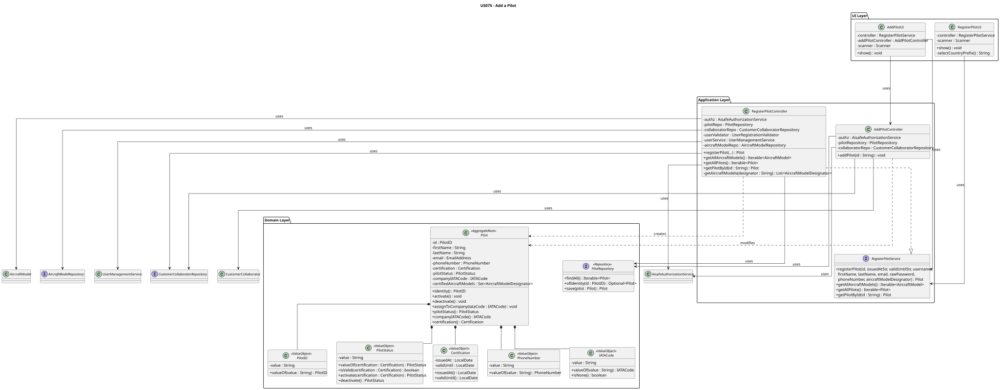
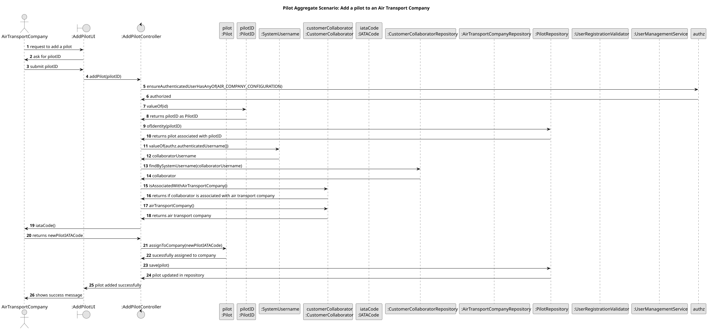
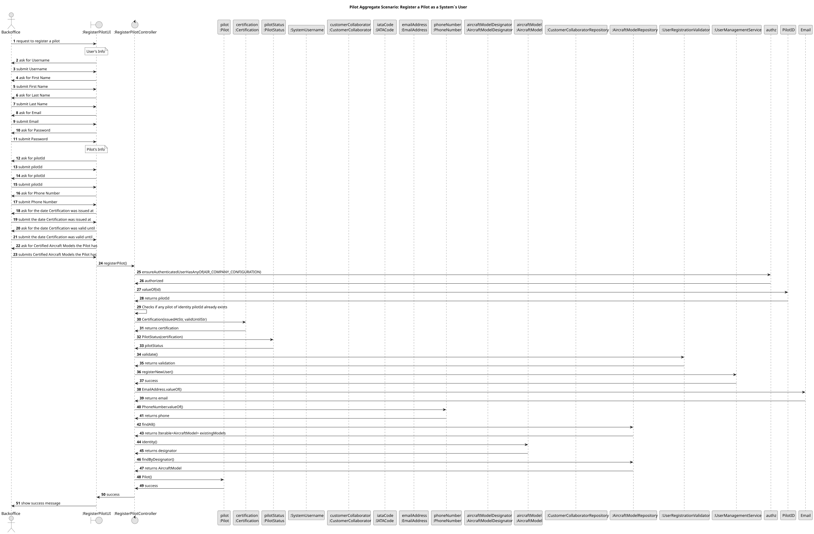

# US075 - Add a Pilot

## 1. Context

This user story was developed for the Air Companies Configuration area. The goal is to allow an Air Transport Company Collaborator to register a new pilot in the system and associate them with their company.

### 1.1 List of Issues

- US075.1 – Implement Pilot Registration
- US075.2 – Implement Pilot Aircraft Certifications
- US075.3 – Create Tests for Pilot Registration
- US075.4 – Document Pilot Registration Feature

---

## 2. Requirements

**US075** As an Air Transport Company Collaborator, I want to add a pilot to my company. A pilot is a system user. A pilot is certified to pilot one or more aircraft models.

**Acceptance Criteria:**

- AC1 – Air Transport Company Collaborator can successfully add a pilot.
- AC2 – Pilot is associated with the collaborator's company.
- AC3 – Pilot is registered as a valid system user.
- AC4 – Pilot certification for one or more aircraft models is stored correctly.
- AC5 – Only valid and existing aircraft models can be assigned to the pilot.
- AC6 – Duplicate pilot registrations are prevented.
- AC7 – Retrieved pilot information is correctly persisted and displayed.
- AC8 – Unit and/or integration tests validate pilot creation behaviour.

**Dependencies/References:**

This user story depends on existing aircraft models (US055) and on `AircraftModelRepository.findByDesignator(...)`. It also depends on the `CustomerCollaborator` aggregate to resolve the authenticated collaborator's company.

---

## 3. Analysis

Pilot registration is a creation use case. The collaborator provides:

- a pilot identifier (e.g. `MLC`);
- certification issued and valid-until dates in `dd-MM-yyyy` format;
- system username and password;
- first and last name;
- email address;
- phone number;
- one or more aircraft model designators (comma-separated).

The application layer validates authorization, input format, duplicate pilot ID, and aircraft model existence. The domain aggregate owns the pilot identity invariant and certification validity rule.

This use case is restricted to the `AIR_COMPANY_CONFIGURATION` permission. Pilot registration and company association are handled as two separate steps: `RegisterPilotController` creates the pilot without a company, and `AddPilotController` associates the pilot with the authenticated collaborator's company.

---

## 4. Design

### 4.1 Realization






The `RegisterPilotController` coordinates the registration use case:

1. Enforces `USER_MANAGEMENT` permission.
2. Validates that the pilot ID does not already exist.
3. Creates `Certification` and `PilotStatus` value objects from the provided dates.
4. Validates and registers the pilot as a system user via `UserManagementService`.
5. Resolves the aircraft model designators via `AircraftModelRepository`.
6. Creates the `Pilot` aggregate and persists it via `PilotRepository`.

The `AddPilotController` coordinates the company association step:

1. Enforces `AIR_COMPANY_CONFIGURATION` permission.
2. Resolves the authenticated collaborator via `CustomerCollaboratorRepository`.
3. Validates that the collaborator belongs to an air transport company.
4. Calls `Pilot.assignToCompany(IATACode)` and persists the updated pilot.

### 4.2 Validation Rules

| Rule                       | Behaviour                                                              |
|----------------------------|------------------------------------------------------------------------|
| Permission (register)      | Only `AIR_COMPANY_CONFIGURATION` can register pilots.                  |
| Pilot ID                   | Required, must match pattern `[A-Z]{3}`. Duplicate IDs are rejected.   |
| Certification dates        | Required, `dd-MM-yyyy` format. Valid-until must be after issued-at.    |
| Username / email           | Validated by `UserRegistrationValidator` before user creation.         |
| Aircraft model designators | Must match existing aircraft models in the repository.                 |
| Company association        | Authenticated user must be a collaborator of an air transport company. |
| Pilot status               | Pilot must have a valid certification to be assigned to a company.     |

### 4.3 Acceptance Tests

**Test 1:** Pilot is registered successfully.

**Refers to Acceptance Criteria:** AC1, AC3, AC7

Implemented in `RegisterPilotControllerTest.ensurePilotIsRegisteredSuccessfully` and `RegisterPilotControllerTest.ensurePilotIsRegisteredWithCorrectEmail`.

**Test 2:** Duplicate pilot registration is rejected.

**Refers to Acceptance Criteria:** AC6

Implemented in `RegisterPilotControllerTest.ensureDuplicatePilotRegistrationIsRejected`.

**Test 3:** Pilot is persisted in repository.

**Refers to Acceptance Criteria:** AC7

Implemented in `RegisterPilotControllerTest.ensurePilotIsPersistedInRepository`.

**Test 4:** Invalid date formats and date ordering are rejected.

**Refers to Acceptance Criteria:** AC4

Implemented in `RegisterPilotControllerTest.ensureRegistrationRejectsInvalidDateFormat` and `RegisterPilotControllerTest.ensureRegistrationRejectsValidUntilBeforeIssuedAt`.

**Test 5:** Invalid pilot ID format is rejected.

**Refers to Acceptance Criteria:** AC1

Implemented in `RegisterPilotControllerTest.ensureRegistrationRejectsInvalidPilotID`.

**Test 6:** Controller rejects null dependencies.

**Refers to Acceptance Criteria:** AC1

Implemented in `RegisterPilotControllerTest.ensureControllerRejectsNullAuthz`, `ensureControllerRejectsNullRepository`, `ensureControllerRejectsNullCollaboratorRepo`, `ensureControllerRejectsNullValidator`, `ensureControllerRejectsNullUserController`, `ensureControllerRejectsNullAircraftModelRepo`.

**Test 7:** All aircraft models are retrievable.

**Refers to Acceptance Criteria:** AC5

Implemented in `RegisterPilotControllerTest.ensureGetAllAircraftModelsReturnsListWithElements`.

**Test 8:** Pilot domain invariants are enforced.

**Refers to Acceptance Criteria:** AC1, AC4

Implemented in `PilotTest.ensurePilotIsCreatedSuccessfully`, `ensurePilotRejectsNullID`, `ensurePilotRejectsNullCertification`, `ensurePilotRejectsNullStatus`, `ensurePilotRejectsNullEmail`, `ensurePilotRejectsNullPhoneNumber`, `ensurePilotRejectsNullFirstName`, `ensurePilotRejectsNullLastName`, `ensurePilotRejectsNullcertifiedAircraftModels`.

---

## 5. Implementation

Main implementation artifacts:

- `Pilot`: aggregate root storing pilot identifier, name, email, phone number, certification, status, company IATA code and certified aircraft model designators.
- `PilotID`: value object for pilot identity, must match `[A-Z]{3}`.
- `Certification`: value object storing issued-at and valid-until dates as `LocalDate`.
- `PilotStatus`: value object derived from certification validity. Supports `activate(Certification)` and `deactivate()` factory methods.
- `PhoneNumber`: value object for phone number.
- `IATACode`: value object for company IATA code reference (cross-aggregate reference by ID).
- `PilotRepository`: repository abstraction for pilot aggregates.
- `InMemoryPilotRepository`: in-memory repository used by tests.
- `JpaPilotRepository`: production repository used through `PersistenceContext.repositories().pilots()`.
- `RegisterPilotController`: application controller coordinating pilot creation and user registration.
- `AddPilotController`: application controller coordinating company association.
- `RegisterPilotService`: interface defining the public contract of `RegisterPilotController`.

---

## 6. Integration/Demonstration

### Application Use Case

The controller operation for registration is:

```java
registerPilot(String id, String issuedAtStr, String validUntilStr, String username,
              String firstName, String lastName, String email, String rawPassword,
              String phoneNumber, String aircraftModelDesignator)
```

Example input:

```text
Pilot ID: MLC
Certification issued at: 10-05-2000
Certification valid until: 10-05-2100
Username: miguel.correia
Password: Password1!
First name: Miguel
Last name: Correia
Email: miguel123@aisafe.com
Phone number: +351912345678
Aircraft model designator: A320NEO
```

The company association step then calls:

```java
addPilot(String pilotID)
```

Where the company is resolved automatically from the authenticated collaborator's session.

### User Feedback Messages

The controller raises clear exceptions for invalid operations:

```text
Pilot's ID <id> already exists.
Invalid date format. Use DD-MM-YYYY (e.g., 17-05-2026).
Valid until must be after issued at.
Aircraft model with designator <designator> does not exist.
Authenticated user is not a customer collaborator.
Authenticated user is not associated with an air transport company.
Pilot status must be valid to assign to a company.
```

---

## 7. Observations

Pilot registration and company association are intentionally separated into two controllers following the Single Responsibility Principle. `RegisterPilotController` handles the creation and user registration concern, while `AddPilotController` handles the business rule of associating the pilot with the authenticated collaborator's company.

The `IATACode` is stored as a value object inside `Pilot` as a cross-aggregate reference, following DDD principles — the full `AirTransportCompany` aggregate is never stored inside `Pilot`.

---

## 8. Tests

The following test classes validate this user story:

- `PilotTest` — domain unit tests
- `RegisterPilotControllerTest` — application layer integration tests

```bash
mvn -pl aisafe.infrastructure.application -am test
mvn -pl aisafe.core -am test
```