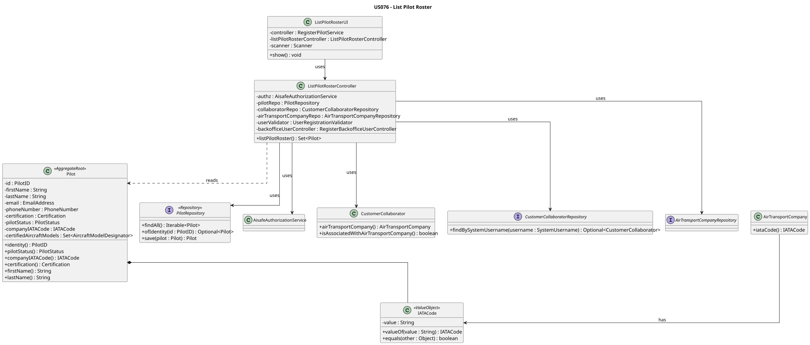
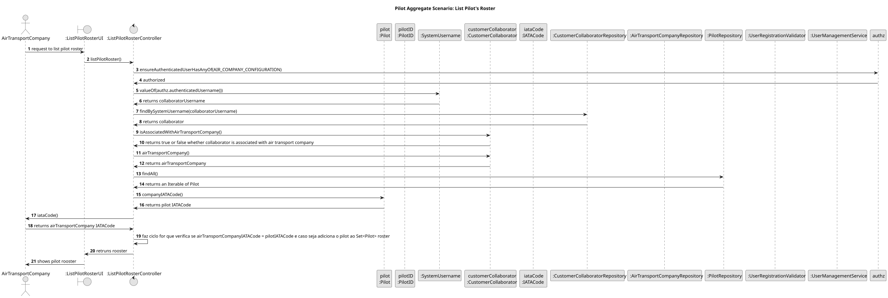

# US076 - List Pilot Roster

## 1. Context

This user story was developed for the Air Companies Configuration area. The goal is to allow an Air Transport Company Collaborator to list all pilots belonging to their company's roster.

### 1.1 List of Issues

- US076.1 – Implement Pilot Roster Listing
- US076.2 – Implement Pilot Filtering and Presentation
- US076.3 – Create Tests for Pilot Roster Listing
- US076.4 – Document Pilot Roster Listing Feature

---

## 2. Requirements

**US076** As an Air Transport Company Collaborator, I want to list my company's pilot roster.

**Acceptance Criteria:**

- AC1 – Air Transport Company Collaborator can successfully list pilots.
- AC2 – Only pilots associated with the collaborator's company are displayed.
- AC3 – Inactive pilots are handled according to business rules.
- AC4 – Pilot information is correctly presented to the user.
- AC5 – Listing operation respects authorization rules.
- AC6 – Unit and/or integration tests validate pilot roster consultation behaviour.

**Dependencies/References:**

This user story depends on pilots already registered in the system (US075) and on `CustomerCollaboratorRepository.findBySystemUsername(...)` to resolve the authenticated collaborator's company.

---

## 3. Analysis

Pilot roster listing is a query use case. The collaborator does not provide any input beyond authenticating into the system.

The application layer validates authorization and resolves the authenticated collaborator's company. The filtering logic compares each pilot's stored `IATACode` with the company's IATA code to return only pilots belonging to that company.

This use case is restricted to the `AIR_COMPANY_CONFIGURATION` permission.

---

## 4. Design

### 4.1 Realization




The `ListPilotRosterController` coordinates the listing use case:

1. Enforces `AIR_COMPANY_CONFIGURATION` permission.
2. Resolves the authenticated collaborator via `CustomerCollaboratorRepository`.
3. Validates that the collaborator belongs to an air transport company.
4. Retrieves the collaborator's `AirTransportCompany` and its `IATACode`.
5. Iterates all pilots from `PilotRepository` and filters by matching `IATACode`.
6. Returns the filtered set of pilots.

### 4.2 Validation Rules

| Rule | Behaviour |
|------|-----------|
| Permission | Only `AIR_COMPANY_CONFIGURATION` can list pilots. |
| Collaborator existence | Authenticated user must be a registered collaborator. |
| Company association | Collaborator must be associated with an air transport company. |
| Pilot filtering | Only pilots whose `companyIATACode` matches the collaborator's company are returned. |
| Empty roster | An empty set is returned when no pilots are associated with the company. |

### 4.3 Acceptance Tests

**Test 1:** Empty roster is returned when no pilots are registered.

**Refers to Acceptance Criteria:** AC1, AC4

Implemented in `ListPilotRosterControllerTest.ensureListPilotRosterReturnsEmptyWhenNoPilots`.

**Test 2:** Only pilots from the authenticated collaborator's company are returned.

**Refers to Acceptance Criteria:** AC2, AC5

Implemented in `ListPilotRosterControllerTest.ensureListPilotRosterReturnsPilotsFromSameCompany` and `ListPilotRosterControllerTest.ensureListPilotRosterDoesNotReturnPilotsFromOtherCompany`.

**Test 3:** Only pilots from the authenticated company are returned when multiple companies exist.

**Refers to Acceptance Criteria:** AC2

Implemented in `ListPilotRosterControllerTest.ensureListPilotRosterReturnsOnlyPilotsFromAuthenticatedCompany`.

**Test 4:** Listing is rejected when collaborator is not from an air transport company.

**Refers to Acceptance Criteria:** AC5

Implemented in `ListPilotRosterControllerTest.ensureListPilotRosterRejectsCollaboratorNotFromAirTransportCompany`.

**Test 5:** Controller rejects null dependencies.

**Refers to Acceptance Criteria:** AC5

Implemented in `ListPilotRosterControllerTest.ensureControllerRejectsNullAuthz`, `ensureControllerRejectsNullPilotRepo`, `ensureControllerRejectsNullCollaboratorRepo`, `ensureControllerRejectsNullCompanyRepo`.

---

## 5. Implementation

Main implementation artifacts:

- `Pilot`: aggregate root queried for roster listing.
- `IATACode`: value object used for cross-aggregate filtering — pilots are matched to a company by comparing their stored `IATACode` with the company's `IATACode`.
- `PilotRepository`: repository abstraction providing `findAll()` for roster retrieval.
- `InMemoryPilotRepository`: in-memory repository used by tests.
- `JpaPilotRepository`: production repository used through `PersistenceContext.repositories().pilots()`.
- `ListPilotRosterController`: application controller coordinating authorization, company resolution and pilot filtering.
- `CustomerCollaboratorRepository`: repository used to resolve the authenticated collaborator.
- `AirTransportCompanyRepository`: repository used to validate company association.

---

## 6. Integration/Demonstration

### Application Use Case

The controller operation is:

```java
listPilotRoster()
```

No input is required from the user. The company is resolved automatically from the authenticated collaborator's session.

### Example Output

```text
ID - Name || Company || Status
MLC - Miguel Correia || TP || VÁLIDO
AGG - Alicate Gay || TP || VÁLIDO
```

### User Feedback Messages

The controller raises clear exceptions for invalid operations:

```text
Authenticated user is not a customer collaborator.
Authenticated user is not associated with an air transport company.
```

---

## 7. Observations

The filtering of pilots by company is done at the application layer by iterating all pilots and matching `IATACode`. This is a pragmatic approach given the current repository abstraction. A future improvement could introduce a `PilotRepository.findByCompanyIATACode(IATACode)` query method to push filtering to the persistence layer.

The `IATACode` stored on each pilot is a cross-aggregate reference following DDD principles, avoiding a direct reference to the `AirTransportCompany` aggregate from within `Pilot`.

---

## 8. Tests

The following test class validates this user story:

- `ListPilotRosterControllerTest` — application layer integration tests

```bash
mvn -pl aisafe.infrastructure.application -am test
```