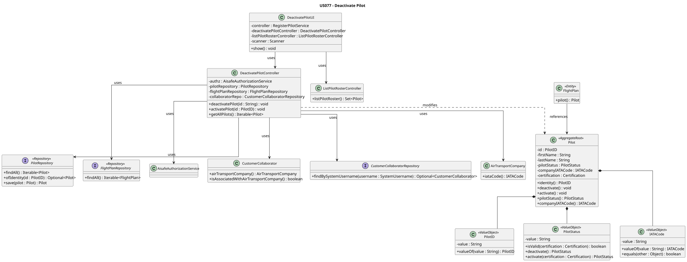
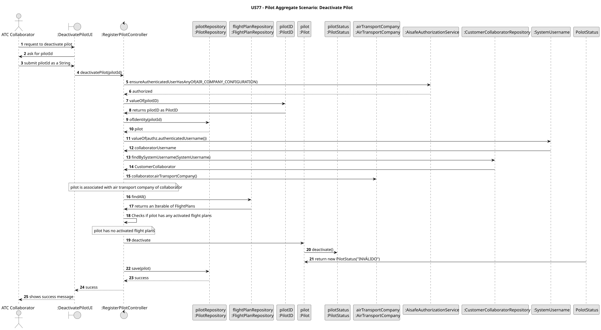

# US077 - Remove a Pilot

## 1. Context

This user story was developed for the Air Companies Configuration area. The goal is to allow an Air Transport Company Collaborator to make a pilot inactive in their company's roster. A pilot cannot be deactivated if they have flight plans assigned.

### 1.1 List of Issues

- US077.1 – Implement Pilot Deactivation
- US077.2 – Validate Assigned Flight Constraints
- US077.3 – Create Tests for Pilot Deactivation
- US077.4 – Document Pilot Deactivation Feature

---

## 2. Requirements

**US077** As an Air Transport Company Collaborator, I want to make a pilot inactive in my company's roster. Cannot deactivate a pilot with flight plans assigned.

**Acceptance Criteria:**

- AC1 – Air Transport Company Collaborator can successfully deactivate a pilot.
- AC2 – Only pilots belonging to the collaborator's company can be deactivated.
- AC3 – Pilots with assigned flight plans cannot be deactivated.
- AC4 – Pilot status is updated correctly in the system.
- AC5 – Deactivated pilots are prevented from future operations.
- AC6 – Unit and/or integration tests validate pilot deactivation behaviour.

**Dependencies/References:**

This user story depends on pilots already registered and associated with a company (US075) and on `FlightPlanRepository.findAll()` to verify assigned flight plan constraints. It also depends on `CustomerCollaboratorRepository.findBySystemUsername(...)` to validate company ownership.

---

## 3. Analysis

Pilot deactivation is an update use case. The collaborator provides:

- a pilot identifier to deactivate.

The application layer validates authorization, pilot existence, company ownership, and the absence of assigned flight plans. The domain aggregate owns the status change rule through `Pilot.deactivate()`.

This use case is restricted to the `AIR_COMPANY_CONFIGURATION` permission.

The deactivation rule is kept in the domain aggregate (`Pilot.deactivate()`) so that it is enforced regardless of the application entry point.

---

## 4. Design

### 4.1 Realization




The `DeactivatePilotController` coordinates the deactivation use case:

1. Enforces `AIR_COMPANY_CONFIGURATION` permission.
2. Validates that the pilot ID is not null.
3. Retrieves the `Pilot` from `PilotRepository`.
4. Resolves the authenticated collaborator via `CustomerCollaboratorRepository`.
5. Validates that the collaborator belongs to an air transport company.
6. Validates that the pilot's `companyIATACode` matches the collaborator's company.
7. Iterates all flight plans from `FlightPlanRepository` and rejects deactivation if any are assigned to the pilot.
8. Calls `Pilot.deactivate()` and persists the updated pilot.

### 4.2 Validation Rules

| Rule | Behaviour |
|------|-----------|
| Permission | Only `AIR_COMPANY_CONFIGURATION` can deactivate pilots. |
| Pilot ID | Required and must not be null. Unknown pilots are rejected. |
| Collaborator existence | Authenticated user must be a registered collaborator. |
| Company association | Collaborator must be associated with an air transport company. |
| Company ownership | Pilot's `companyIATACode` must match the collaborator's company. |
| Flight plan constraint | Pilots with any assigned flight plan cannot be deactivated. |

### 4.3 Test Invalidation Rule

When `Pilot.deactivate()` is called, `PilotStatus` transitions to `INVÁLIDO` regardless of the certification dates. This is enforced by `PilotStatus.deactivate()` which returns a new `PilotStatus` instance with `value = "INVÁLIDO"`, preserving immutability.

Reactivation via `Pilot.activate()` re-evaluates certification validity — if today's date falls outside the certification period, the pilot remains `INVÁLIDO` even after an activation attempt.

### 4.4 Acceptance Tests

**Test 1:** Pilot is deactivated successfully.

**Refers to Acceptance Criteria:** AC1, AC4

Implemented in `DeactivatePilotControllerTest.ensurePilotIsDeactivatedSuccessfully`.

**Test 2:** Pilot with assigned flight plan is not deactivated.

**Refers to Acceptance Criteria:** AC3

Implemented in `DeactivatePilotControllerTest.ensurePilotWithFlightPlanIsNotDeactivated`.

**Test 3:** Null pilot ID is rejected.

**Refers to Acceptance Criteria:** AC1

Implemented in `DeactivatePilotControllerTest.ensureDeactivatePilotRejectsNullID`.

**Test 4:** Non-existent pilot is rejected.

**Refers to Acceptance Criteria:** AC1

Implemented in `DeactivatePilotControllerTest.ensureDeactivatePilotRejectsNonExistentPilot`.

**Test 5:** Pilot from a different company is rejected.

**Refers to Acceptance Criteria:** AC2

Implemented in `DeactivatePilotControllerTest.ensureDeactivatePilotRejectsPilotFromDifferentCompany`.

**Test 6:** Activation works correctly even for pilots with invalid certification.

**Refers to Acceptance Criteria:** AC4, AC5

Implemented in `DeactivatePilotControllerTest.ensureActivatePilotWorksSuccessfullyForInvalidCertification`.

**Test 7:** Controller rejects null dependencies.

**Refers to Acceptance Criteria:** AC1

Implemented in `DeactivatePilotControllerTest.ensureControllerRejectsNullAuthz`, `ensureControllerRejectsNullPilotRepo`, `ensureControllerRejectsNullFlightPlanRepo`, `ensureControllerRejectsNullCollaboratorRepo`.

**Test 8:** Pilot domain deactivation and activation are correctly applied.

**Refers to Acceptance Criteria:** AC4, AC5

Implemented in `PilotTest.ensurePilotDeactivateChangesStatusToInvalid` and `PilotTest.ensurePilotActivateChangesStatusToValid`.

---

## 5. Implementation

Main implementation artifacts:

- `Pilot`: aggregate root whose status is updated during deactivation via `deactivate()` and `activate(Certification)`.
- `PilotID`: value object used to identify the pilot to deactivate.
- `PilotStatus`: value object that holds the pilot's current status (`VÁLIDO` / `INVÁLIDO`). Immutable — status transitions produce new instances.
- `IATACode`: value object used for company ownership validation.
- `FlightPlan`: entity checked for pilot assignment before allowing deactivation.
- `PilotRepository`: repository abstraction for pilot retrieval and persistence.
- `FlightPlanRepository`: repository abstraction for flight plan constraint validation.
- `InMemoryPilotRepository`: in-memory repository used by tests.
- `JpaPilotRepository`: production repository used through `PersistenceContext.repositories().pilots()`.
- `DeactivatePilotController`: application controller coordinating authorization, constraint validation and deactivation.
- `CustomerCollaboratorRepository`: repository used to resolve the authenticated collaborator and validate company ownership.

---

## 6. Integration/Demonstration

### Application Use Case

The controller operation is:

```java
deactivatePilot(String pilotID)
```

Example input:

```text
Pilot ID: MLC
```

If the authenticated user belongs to company `TP` and pilot `MLC` also belongs to `TP` and has no assigned flight plans, the pilot's status is changed to `INVÁLIDO`.

### User Feedback Messages

The controller raises clear exceptions for invalid operations:

```text
O ID do piloto não pode ser nulo.
Piloto não encontrado.
Authenticated user is not a customer collaborator.
Authenticated user is not associated with an air transport company.
Authenticated user is not associated with the same air transport company as the pilot.
Pilot still has active flight plans.
```

---

## 7. Observations

The flight plan constraint check iterates all flight plans in the repository and matches by `PilotID`. A future improvement could introduce a `FlightPlanRepository.findByPilot(PilotID)` query method to push the constraint check to the persistence layer.

The `PilotStatus` value object uses factory methods (`activate`, `deactivate`) returning new instances to preserve immutability, in alignment with DDD value object principles.

---

## 8. Tests

The following test classes validate this user story:

- `PilotTest` — domain unit tests for `deactivate()` and `activate()` behaviour
- `DeactivatePilotControllerTest` — application layer integration tests

```bash
mvn -pl aisafe.infrastructure.application -am test
mvn -pl aisafe.core -am test
```