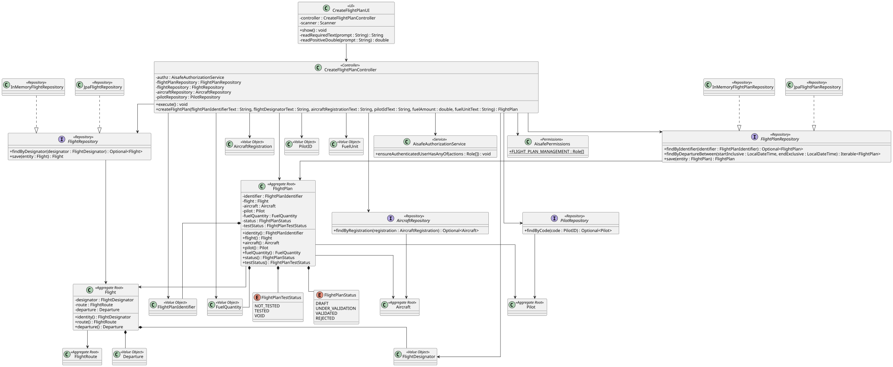
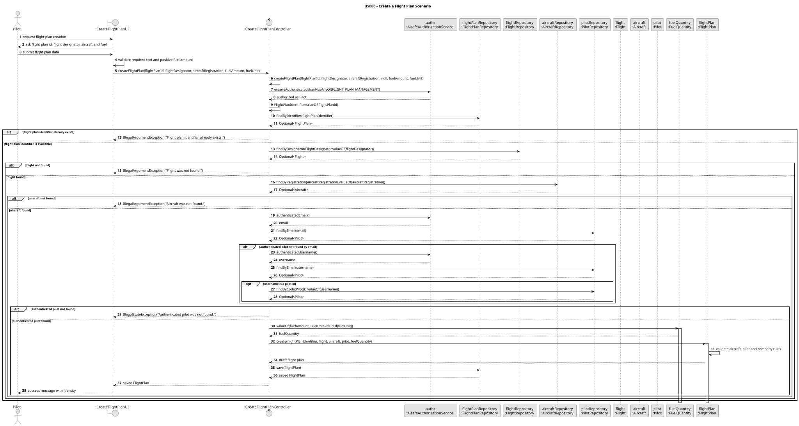

# US080 - Create a Flight Plan

## 1. Context

US080 is an EAPLI/backoffice use case for creating a flight plan for an existing flight. The current implementation is coordinated by `CreateFlightPlanController` and exposed through `CreateFlightPlanUI` in the Flight Control menu.

## 2. Design

### 2.1 Realization

The controller creates a draft `FlightPlan` only after resolving the referenced `Flight`, `Aircraft` and `Pilot` and validating that the flight plan identifier is unique.

Main implementation artifacts:

- `CreateFlightPlanUI`
- `CreateFlightPlanController`
- `FlightPlan`
- `FlightPlanRepository`
- `FlightRepository`
- `AircraftRepository`
- `PilotRepository`
