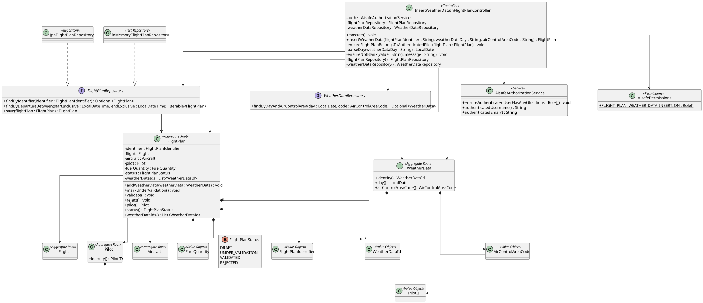
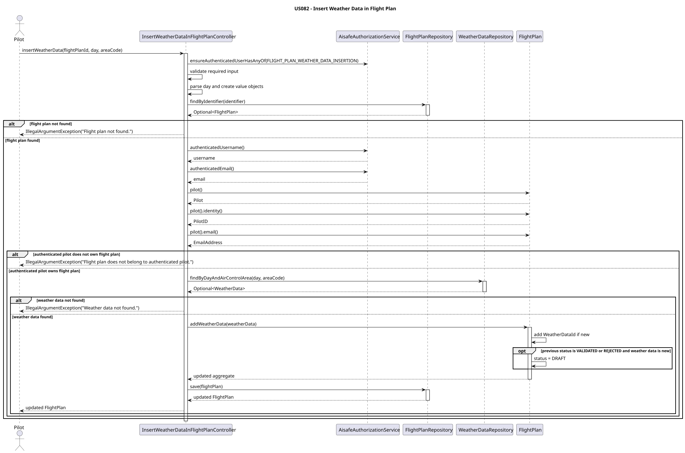

# US082 - Insert Weather Data in a Flight Plan

## 1. Context

This user story was developed for the Flight Plan area. The goal is to allow a Pilot to associate existing weather data with one of their own flight plans.

US081 and US083 deal with the Core Flight DSL import boundary used for LPROG/ANTLR work. US082 introduces a separate `flightplan.domain` model because adding weather data, validating ownership and invalidating previous tests are flight plan domain rules, not importer rules.

### 1.1 List of issues

- US082.1 - Implement Weather Data Insertion in Flight Plan
- US082.2 - Validate Flight Plan Ownership and Weather Data
- US082.3 - Invalidate Previous Flight Plan Test
- US082.4 - Add Weather Data Insertion Tests
- US082.5 - Document Weather Data Insertion

## 2. Requirements

**US082** As a Pilot, I want to add weather data to a flight plan of mine. If the flight plan has been previously tested, the test is deemed void because of the new weather data.

**Acceptance Criteria:**

- AC1 - Pilot can successfully add weather data to one of their flight plans.
- AC2 - Weather data must be associated with the selected flight plan.
- AC3 - Only flight plans belonging to the authenticated Pilot can be updated.
- AC4 - Added weather data is validated before being associated with the flight plan.
- AC5 - If the flight plan was previously tested, its test result/status is invalidated.
- AC6 - Unit and/or integration tests validate weather data insertion behaviour.

**Dependencies/References:**

This requirement depends on existing weather data from US041/US042 and on `WeatherDataRepository.findByDayAndAirControlArea(...)`. It also depends on the persisted `FlightPlan` aggregate used by flight plan creation, separate from `flightplan.importer.ImportedFlightPlan`.

## 3. Analysis

Weather data insertion is an update use case. The Pilot selects:

- a flight plan identifier;
- a weather data day in ISO format (`YYYY-MM-DD`);
- an air control area code.

The application layer validates authorization, input format, flight plan existence, ownership and weather data existence. The domain aggregate owns the actual association rule and the test invalidation rule.

The use case is restricted to the `PILOT` role through `AisafePermissions.FLIGHT_PLAN_WEATHER_DATA_INSERTION`. Although flight plan management is also available to Flight Control Operators in other contexts, this use case is explicitly a Pilot operation because the user story says the Pilot updates a flight plan of theirs.

## 4. Design

### 4.1. Realization





The `InsertWeatherDataInFlightPlanController` coordinates the use case:

1. Enforces `FLIGHT_PLAN_WEATHER_DATA_INSERTION` permission.
2. Validates required input values.
3. Parses the weather data day using ISO local date format.
4. Converts the flight plan identifier and air control area code into value objects.
5. Retrieves the selected `FlightPlan` through `FlightPlanRepository`.
6. Verifies that `FlightPlan.pilot().identity()` matches `AisafeAuthorizationService.authenticatedUsername()`.
7. Retrieves existing `WeatherData` through `WeatherDataRepository.findByDayAndAirControlArea(...)`.
8. Calls `FlightPlan.addWeatherData(...)`.
9. Saves the updated flight plan.

### 4.2. Validation Rules

| Rule | Behaviour |
|------|-----------|
| Permission | Only `PILOT` can execute the use case. |
| Flight plan identifier | Required, normalized by `FlightPlanIdentifier`. |
| Weather data day | Required, ISO date format `YYYY-MM-DD`. |
| Air control area code | Required, normalized by `AirControlAreaCode`. |
| Flight plan existence | Unknown flight plans are rejected. |
| Ownership | Authenticated username must match the flight plan pilot identifier. |
| Weather data existence | Weather data must already exist for the selected day and area. |
| Duplicate weather data | Re-adding the same weather data does not duplicate the association. |

### 4.3. Test Invalidation Rule

`FlightPlan` has a `FlightPlanTestStatus` with three values:

- `NOT_TESTED`;
- `TESTED`;
- `VOID`.

When new weather data is associated with a previously tested flight plan, `FlightPlan.addWeatherData(...)` changes the status from `TESTED` to `VOID`. This rule is kept in the domain aggregate so it is enforced regardless of the application entry point.

If the same weather data is already associated, the flight plan is not changed and the status is not invalidated again.

### 4.4. Acceptance Tests

**Test 1:** Weather data can be inserted in a flight plan.

**Refers to Acceptance Criteria:** AC1, AC2, AC4

Implemented in `InsertWeatherDataInFlightPlanControllerTest.ensureWeatherDataCanBeInsertedInFlightPlan`.

**Test 2:** Only the authenticated Pilot can update their own flight plan.

**Refers to Acceptance Criteria:** AC3

Implemented in `InsertWeatherDataInFlightPlanControllerTest.ensureFlightPlanFromAnotherPilotIsRejected`.

**Test 3:** Unknown flight plans and unknown weather data are rejected.

**Refers to Acceptance Criteria:** AC4

Implemented in `InsertWeatherDataInFlightPlanControllerTest.ensureUnknownFlightPlanIsRejected` and `InsertWeatherDataInFlightPlanControllerTest.ensureUnknownWeatherDataIsRejected`.

**Test 4:** Invalid insertion inputs are rejected with clear messages.

**Refers to Acceptance Criteria:** AC4

Implemented in `InsertWeatherDataInFlightPlanControllerTest.ensureInvalidInsertionInputsAreRejected`.

**Test 5:** A previous flight plan test is invalidated when new weather data is added.

**Refers to Acceptance Criteria:** AC5

Implemented in `FlightPlanTest.ensureAddingWeatherDataVoidsPreviousTest` and `InsertWeatherDataInFlightPlanControllerTest.ensureWeatherDataInsertionVoidsPreviousFlightPlanTest`.

**Test 6:** Duplicate weather data is not added twice and does not void an unchanged tested flight plan.

**Refers to Acceptance Criteria:** AC2, AC5

Implemented in `FlightPlanTest.ensureDuplicateWeatherDataIsNotAddedTwice` and `FlightPlanTest.ensureDuplicateWeatherDataDoesNotVoidPreviousTest`.

**Test 7:** Weather data insertion permission is restricted to Pilot.

**Refers to Acceptance Criteria:** AC1, AC3

Implemented in `AisafePermissionsTest.ensureFlightPlanWeatherDataInsertionPermissionsAreCorrect`.

## 5. Implementation

Main implementation artifacts:

- `FlightPlan`: aggregate root that stores the flight plan identifier, flight, aircraft, pilot, fuel quantity, associated weather data ids and test status.
- `FlightPlanIdentifier`: value object for flight plan identity.
- `Pilot`/`PilotID`: owning pilot aggregate and identifier used for ownership validation.
- `FlightPlanTestStatus`: enum representing `NOT_TESTED`, `TESTED` and `VOID`.
- `FlightPlanRepository`: repository abstraction for flight plan aggregates.
- `InMemoryFlightPlanRepository`: in-memory repository used by tests.
- `JpaFlightPlanRepository`: production repository used through `PersistenceContext.repositories().flightPlans()`.
- `InsertWeatherDataInFlightPlanController`: application controller that coordinates authorization, ownership validation, weather lookup and persistence.
- `WeatherDataRepository`: repository used to retrieve already registered/imported weather data.
- `AisafePermissions`: defines `FLIGHT_PLAN_WEATHER_DATA_INSERTION`, restricted to `PILOT`.

## 6. Integration/Demonstration

### Application Use Case

The controller operation is:

```java
insertWeatherData(String flightPlanIdentifier, String weatherDataDay, String airControlAreaCode)
```

Example input:

```text
Flight plan identifier: TP123
Weather data day: 2027-01-10
Air control area code: CONACC
```

If the authenticated user is `pilot01`, the selected `FlightPlan` must have a `Pilot` whose `PilotID` is `pilot01`.

### User Feedback Messages

The controller raises clear exceptions for invalid operations:

```text
Flight plan identifier is required.
Weather data day is required.
Weather data day must use ISO date format YYYY-MM-DD.
Air control area code is required.
Flight plan not found.
Flight plan does not belong to authenticated pilot.
Weather data not found.
```

## 7. Observations

The current implementation intentionally keeps US082 in `flightplan.domain` and does not reuse `flightplan.importer.ImportedFlightPlan`. The importer package remains an import/DSL boundary and should not mix importer concerns with domain behaviour.

Production flight plans are persisted through `FlightPlanRepository` and `JpaFlightPlanRepository`. The in-memory repository remains useful for focused domain/application tests without changing the domain rule for weather data association.

## 8. Tests

The following validation commands were executed successfully after implementation:

```bash
mvn -pl aisafe.infrastructure.application -am test
mvn clean verify
```
