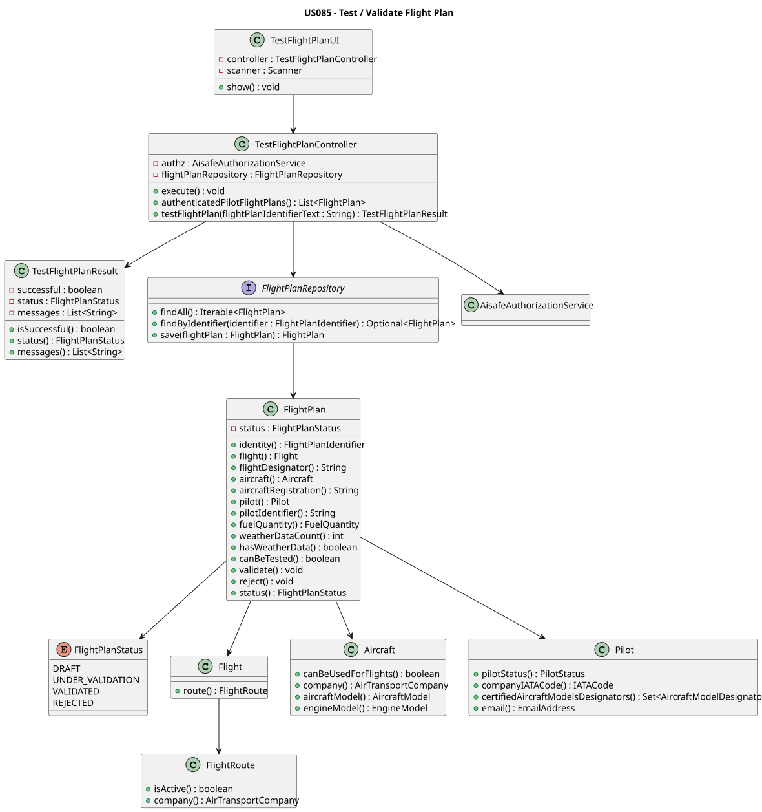

# US085 - Test / Validate Flight Plan

## 1. Context

US085 allows a Pilot to test and validate a flight plan previously created in the system.

The validation uses the Flight DSL pipeline delivered by US120/US121. The pilot provides the existing `FlightPlan` identifier and the Flight DSL file that describes the planned flight. If the DSL file is valid and matches the selected flight plan, the system marks the flight plan as `TESTED`.

The original acceptance criteria mention a test component in C. For this implementation, the test component is implemented in Java because the teacher accepted this clarification for the project delivery.

## 2. Behaviour

- The authenticated user must have flight plan management permissions.
- The selected `FlightPlan` must exist.
- The selected `FlightPlan` must belong to the authenticated pilot.
- The Flight DSL file must exist and be readable.
- The Flight DSL file must pass lexical, syntactic and semantic validation through `FlightPlanDslSyntaxValidator`.
- The DSL file must contain a flight block whose identifier matches the selected flight plan's flight designator.
- If aircraft or pilot metadata are present in the DSL, they must match the selected flight plan.
- On success, the `FlightPlan` is marked as `TESTED` and saved.
- On validation failure, the `FlightPlan` test status is not changed.

## 3. Design

### 3.1 Sequence Diagram


### 3.2 Class Diagram



## 4. Main Artifacts

- `TestFlightPlanUI`
- `TestFlightPlanController`
- `TestFlightPlanResult`
- `FlightPlan`
- `FlightPlanRepository`
- `FlightPlanDslSyntaxValidator`
- `FlightPlanParseResult`
- `DslFlightPlan`

## 5. Tests

Automated coverage is provided by `TestFlightPlanControllerTest`.

The tests cover:

- successful validation and transition to `TESTED`;
- invalid DSL file rejection;
- DSL flight mismatch rejection;
- DSL aircraft mismatch rejection;
- ownership validation;
- unknown flight plan rejection;
- invalid input validation;
- authorization failure propagation.

Run from the repository root:

```bash
mvn -pl aisafe.infrastructure.application -am -Dtest=TestFlightPlanControllerTest test
```
