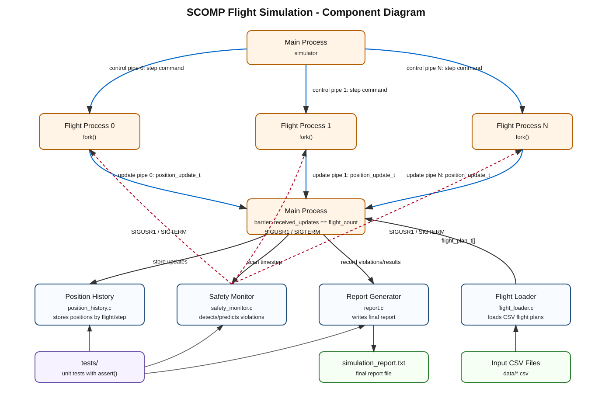

# SCOMP Flight Simulation System

This module implements the SCOMP flight simulation component. The default simulator keeps the Sprint 2 pipe-based architecture, while `run-hybrid` provides the Sprint 3 hybrid architecture for US105.

## Component Diagram



## Implemented User Stories

### US100 - Simulate Flights In A Given Area

The simulator creates one child process for each flight using `fork()`.

For each flight, the parent process creates two pipes:

- a control pipe, used by the parent to send the current timestep to the flight process;
- an update pipe, used by the flight process to send its `position_update_t` to the parent.

Each child process executes its assigned flight plan step by step. The parent process controls the simulation, receives updates, handles termination and waits for all child processes with `waitpid()`.

Signals are used for interruption and notification:

- `SIGINT` and `SIGTERM` request simulation stop;
- `SIGUSR1` notifies a flight process about a safety violation;
- `SIGPIPE` is ignored to avoid unexpected termination when writing to closed pipes.

Status: implemented successfully.

### US101 - Capture And Process Flight Movements

Each flight process sends a `position_update_t` structure to the parent process through its update pipe.

The parent validates and stores each received update in:

```c
position_history_t
```

The position history stores positions by flight and timestep:

```c
updates[flight_index][step]
```

The module also keeps a `received` matrix to know which positions were actually received. This avoids treating zero-initialized data as valid flight data.

Status: implemented successfully.

### US102 - Detect Aircraft Safety Violations In Real Time

After all updates for a timestep are received, the parent process scans the stored positions using `safety_monitor.c`.

The monitor compares aircraft pairs and checks:

- horizontal distance;
- vertical distance;
- predicted next-step position.

When a violation or predicted violation is detected:

- the event is logged to the terminal;
- the report module records the event;
- the involved flight processes are notified with `SIGUSR1`;
- the flight processes handle the signal and print a user-visible message.

If the number of violations reaches the configured threshold, the simulation requests early termination.

Status: implemented successfully.

### US103 - Synchronize Flight Execution With A Time Step

The simulation progresses timestep by timestep.

For each timestep:

1. the parent sends the timestep number to every child through the control pipes;
2. each child calculates and sends its position update;
3. the parent waits until it receives all updates for that timestep;
4. only then the parent scans for violations and advances to the next timestep.

This creates a barrier implemented with pipes. The parent only advances when:

```text
received_updates == flight_count
```

Example output:

```text
timestep 0 barrier complete: 40/40 updates processed
```

Status: implemented successfully.

### US109 - Generate And Store Final Simulation Report

At the end of the simulation, the parent process generates `simulation_report.txt`.

The report includes:

- total number of flights;
- individual flight execution status;
- safety violation events;
- simulation timestep and timestamp in seconds;
- aircraft positions at detection time;
- aircraft velocity vectors at detection time;
- final validation result, `PASSED` or `FAILED`.

The report is generated by the parent process after the simulation concludes. Threads were not used because the Sprint 2 SCOMP evaluation focused on processes, pipes, signals, timestep synchronization and final report generation.

Status: implemented successfully.

### US105 - Initialize Hybrid Simulation Environment With Shared Memory

The hybrid simulator is available through:

```sh
make run-hybrid
```

This mode keeps one independent child process per flight, but replaces pipe-based data exchange with a POSIX shared memory segment.

The parent process initializes:

- a shared memory segment with `shm_open`, `ftruncate` and `mmap`;
- named POSIX semaphores with `sem_open`;
- a scheduler thread;
- a safety detection thread;
- a report thread;
- mutexes and condition variables for internal thread synchronization.

Each child flight process waits for its timestep semaphore, computes its position, writes a `position_update_t` into shared memory, and signals the parent through the update-ready semaphore.

The parent scheduler thread advances step by step only after all flight processes have posted their updates for the current timestep. The safety thread is notified through a condition variable when a timestep is complete. When safety violations are detected, involved flight processes are still notified with `SIGUSR1`.

Status: implemented as a separate Sprint 3 hybrid mode.

## Not Implemented Yet

The following mechanisms are still pending for later Sprint 3 user stories:

- UDP remote logging;
- HTTP/AJAX visualization;
- environmental/weather thread.

The default `make run` simulator still uses pipes. The `make run-hybrid` simulator uses shared memory, semaphores, threads, mutexes, condition variables and signals.

## Build And Run

Build the simulator:

```sh
make clean
make
```

Run the default simulation:

```sh
make run
```

Run a large normal scenario:

```sh
make run-large-normal
```

Run a large scenario with violations:

```sh
make run-large-violations
```

Run the hybrid Sprint 3 simulation:

```sh
make run-hybrid
```

Run large hybrid scenarios:

```sh
make run-hybrid-large-normal
make run-hybrid-large-violations
```

Run all tests:

```sh
make test
```

Expected test result:

```text
PASS test_position_history
PASS test_safety_monitor
PASS test_flight_loader
PASS test_report
PASS test_shared_simulation
PASS test_hybrid_sync
```

## Validation Evidence

The solution was validated with:

- default simulation with 3 flights;
- large normal simulation with 40 flights;
- large violation simulation with 40 flights;
- unit tests for position history;
- unit tests for safety monitoring;
- unit tests for CSV flight loading;
- unit tests for final report generation;
- unit tests for shared memory initialization;
- unit tests for hybrid semaphore synchronization.

The large simulations demonstrate that the parent process receives all updates before advancing:

```text
timestep 0 barrier complete: 40/40 updates processed
timestep 1 barrier complete: 40/40 updates processed
timestep 2 barrier complete: 40/40 updates processed
timestep 3 barrier complete: 40/40 updates processed
timestep 4 barrier complete: 40/40 updates processed
```

The hybrid simulator demonstrates the semaphore-based barrier with equivalent output:

```text
hybrid timestep 0 semaphore barrier complete: 40/40 updates processed
hybrid timestep 1 semaphore barrier complete: 40/40 updates processed
hybrid timestep 2 semaphore barrier complete: 40/40 updates processed
hybrid timestep 3 semaphore barrier complete: 40/40 updates processed
hybrid timestep 4 semaphore barrier complete: 40/40 updates processed
```

## Group Self-Assessment

Replace the placeholder names and percentages with the real group members before delivery.

| Student          | Contribution (%) | Main Contribution |
|------------------| ---: | --- |
| Bruno Monteiro   | 25 | US100 |
| Francisco Vieira | 25 | US101 position history and tests |
| Gustavo Ferreira | 25 | US102 safety monitor and violation signalling |
| Pedro Rodrigues  | 25 | US109 report generation, loader and validation |

Total: 100%.
